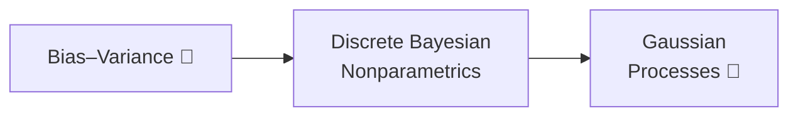

+++
date = "2026-07-02"
title = "How Complex Should a Model Be?"
linkTitle = "Model Complexity"
weight = 70
book_part = true
tracks = ["beginner", "cogsci"]
+++

**The Winter Model Fair.** Chibany judges the student modeling contest, and
every entry poses the same dilemma: the flexible models fit everything —
including the noise — while the simple ones miss the signal. This Part is
about *honest* model complexity: the bias–variance tradeoff (and its modern
double-descent twist), models that grow with the data (Dirichlet process
mixtures), and distributions over entire functions (Gaussian processes) —
whose infinite-width story is the on-ramp to [Part VIII](../deep/).

## Chapters

{}

---

*This project is generously funded by the Japanese Probabilistic Computing
Consortium Association (JPCCA).*
