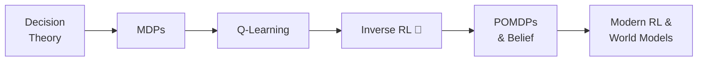

+++
date = "2026-07-02"
title = "Decisions & Reinforcement Learning"
linkTitle = "Decisions & RL"
weight = 60
book_part = true
tracks = ["beginner", "cogsci"]
+++

**Chibany learns to act.** Believing is not enough: autumn brings the health
kick, and every belief now has to *cash out as a choice*. This Part goes from
beliefs to actions — losses and decisions, planning across time (MDPs),
learning to act without a map (Q-learning), and then the great reversal:
watching *someone else* act and inferring their goal (inverse RL, theory of
mind), acting when the world itself is hidden (POMDPs and the Tiger problem),
and the modern frontier where these ideas train today's largest models.

## Chapters

{}

---

*This project is generously funded by the Japanese Probabilistic Computing
Consortium Association ([JPCCA](https://jpcca.org/)).*
