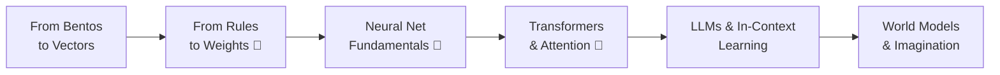

+++
date = "2026-07-04"
title = "From Bayes to Deep Networks"
linkTitle = "Deep Networks"
weight = 80
book_part = true
tracks = ["beginner", "cogsci"]
+++

**The kiosk and the trainee.** After the new year, two arrivals change campus
life: a **photo-recognizing bento kiosk** in Cafeteria A, and a **robot mascot
trainee** assigned to shadow Chibany. Neither can be reasoned with — and yet
both clearly *learn*. This Part opens the black boxes: how a network sees, why
its training is a likelihood in disguise, what attention actually attends to,
and why a large language model doing in-context learning looks suspiciously
like the [hierarchical Bayes](../structure/hierarchical-bayes/) Chibany
already knows.

**Start with [From Bentos to Vectors](vectors-and-spaces/)** — the
linear-algebra-from-zero on-ramp (vectors, dot products, matrices as
transformations of space), written for readers with no math background, with
two interactive widgets. Everything after it assumes it.

{}
The remaining chapters accompany Weeks 11–12 of the Human and Machine Learning
course and are being written now. The stubs below sketch each chapter's premise.
{}

## Chapters

{}

---

*This project is generously funded by the Japanese Probabilistic Computing
Consortium Association ([JPCCA](https://jpcca.org/)).*
