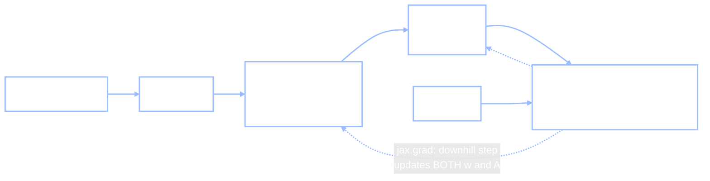

+++
date = "2026-07-16"
title = "From Rules to Weights"
weight = 10
tracks = ["beginner"]
+++

## The Kiosk Nobody Programmed

The bento kiosk in Cafeteria A has been running for a week now, and Chibany has developed a routine: hold up the bento, wait for the chirp — *tonkatsu* — and then check the label to confirm. The kiosk is almost never wrong. This morning, though, something new is bothering Chibany, and it takes a lap around the machine (trainee robot trailing three steps behind) to put a paw on it.

Every rule Chibany has ever used lives in the Bento Journal, and Chibany *wrote* every one of them. "Heavier than about 425 grams — probably tonkatsu." That rule came from the weigh-station data back in the [Mystery of the Two Peaks](../../learning/mystery-bentos/). But the kiosk never got the Journal. It has never seen the weight column. It works from a *photo* — and nobody, Chibany is quite sure, ever sat down and typed rules about pixels into it. Chibany flips through the Journal looking for the page the kiosk must be using. There is no such page.

> **Jamal:** "There's no page because there are no rules — not the kind you can write down. The kiosk was *trained*. Someone showed it thousands of labeled photos, and it adjusted millions of numbers inside itself until its answers matched the labels."
>
> **Alyssa:** "And that is a genuinely new move for this book. The Model Fair in [Part VII](../../complexity/) answered *how complex should the model be?* three ways — shrink it with a prior, let it grow with the data, put a prior on functions directly. But all three shared something we never said out loud: **we chose the features in advance.** The kiosk didn't get that courtesy. It had to learn *what to measure* as well as what to conclude."

That is this chapter's question: what changes when the features themselves become things the model learns — and how much of our Bayesian toolkit survives the change? (Spoiler, so you can relax: more of it survives than you'd think.)

---

## Three Answers, One Common Confession

We won't re-derive Part VII — one paragraph per road, links for the details.

**Ridge is a Gaussian prior plus a point estimate.** The [bias-variance](../../complexity/bias-variance/) chapter showed that penalizing large coefficients is *exactly* Bayesian regression with a Gaussian prior of width $\tau$ on the coefficients, keeping the single most probable setting afterward — the **MAP estimate** (*maximum a posteriori*: the posterior's peak, first met in the [decision theory](../../decisions/decision-theory/) chapter as what 0–1 loss makes you report). The penalty knob was the prior in disguise: $\lambda = \sigma^2/\tau^2$. But notice what was fixed before any data arrived: *we* chose the polynomial basis; ridge only chose how hard to shrink its coefficients.

**An infinitely wide network is a Gaussian process — with a fixed kernel.** The [Gaussian processes](../../complexity/gaussian-processes/) chapter ended on the punchline pair: at initialization, an infinitely wide net *is* a GP with the **NNGP kernel** (exact Bayesian inference = GP regression, no training loop at all), and *during* gradient-descent training it behaves like kernel regression with the **NTK**, a kernel that never changes. Both are beautiful — and both came with the boxed caveat that matters here: in those "lazy" limits the hidden features are frozen at their random initialization. **No feature learning.** The kernel is picked by architecture and randomness, and the data never gets to move it. (Even the [DPMM](../../complexity/dpmm/)'s nonparametric road, which grew its *cluster count* with the data, clustered whatever measurement columns it was handed.)

So all three of Part VII's answers make the same quiet confession: **somebody fixes the feature space, and then the model works inside it.** Chibany fixed it with a scale and a chopstick. The kiosk's problem — raw photos — is precisely the case where nobody knows which features to fix. This chapter is the fourth answer: *learn them.*

---

## The Bridge: Give the Features Parameters

Back to the [vectors chapter](../vectors-and-spaces/)'s bentos, because small numbers keep everything honest. A bento is a 2-D vector $\mathbf{x} = [\text{weight}, \text{crunch}]$ in rescaled units (hundreds of grams, crunch 0–10). Here are the six dishes from that chapter's widget, with labels — $1$ for tonkatsu, $0$ for not:

```python
import jax
import jax.numpy as jnp
import jax.random as jr

key = jr.PRNGKey(0)

# The six bentos from the vectors chapter, in rescaled units:
# weight in hundreds of grams, crunch on the 0-10 scale.
names = ["tonkatsu-A", "tonkatsu-B", "mega-katsu",
         "hamburger-A", "hamburger-B", "salad"]
X = jnp.array([[5.00, 8.0],    # tonkatsu-A
               [4.80, 9.0],    # tonkatsu-B
               [6.20, 9.0],    # mega-katsu
               [3.50, 3.0],    # hamburger-A
               [3.65, 2.0],    # hamburger-B
               [2.50, 1.0]])   # salad
y = jnp.array([1.0, 1.0, 1.0, 0.0, 0.0, 0.0])   # 1 = tonkatsu, 0 = not

print("data:", X.shape, " labels:", y)
```

**Output:**
```
data: (6, 2)  labels: [1. 1. 1. 0. 0. 0.]
```

On these **hand-designed features**, a linear model — a [dot product](../../glossary/#dot-product-) plus a threshold — is all you need. Take $\mathbf{w} = [1, 1]$ and offset $b = -9.5$, and call it tonkatsu when the score $\mathbf{w} \cdot \mathbf{x} + b$ is positive. Tonkatsu-A: $5 + 8 - 9.5 = 3.5$, positive. Hamburger-A: $3.5 + 3 - 9.5 = -3.0$, negative. Check the other four; all six come out right. This is a *rule* — Chibany could copy it into the Journal tonight.

But look at what made it possible: weight and crunch are superb features, and Chibany *invented* them, with a scale and a chopstick and a year of practice. The kiosk's input is a photo — thousands of pixel-brightness numbers in which no human can point to the "crunch" component. When you can't design the features, there is exactly one move left, and it is small enough to write in one line. Replace

$$f(\mathbf{x}) = \mathbf{w} \cdot \mathbf{x} + b \qquad \text{with} \qquad f(\mathbf{x}) = \mathbf{w} \cdot g(A\mathbf{x} + \mathbf{c}) + b.$$

Every piece is from the [vectors chapter](../vectors-and-spaces/): $A$ is a [matrix](../../glossary/#matrix-) — a machine that moves every point — $\mathbf{c}$ shifts the result, and $g$ is the [ReLU](../../glossary/#relu-) fold, $g(z) = \max(0, z)$ componentwise. The vector $\mathbf{h} = g(A\mathbf{x} + \mathbf{c})$ is a *new set of features*: not measured by anyone, but manufactured by the matrix. Choose a different $A$ and you get a different [feature space](../../glossary/#feature-space-).

Watch it happen. Compare the do-nothing matrix (features = the raw measurements) with a mixing matrix whose rows compute "weight minus crunch" and "crunch minus weight":

```python
def features(A, x):
    return jnp.maximum(0.0, A @ x)      # g(Ax): move every point, then fold

A_raw = jnp.array([[1.0,  0.0],
                   [0.0,  1.0]])        # identity: features = the raw measurements
A_mix = jnp.array([[1.0, -1.0],
                   [-1.0, 1.0]])        # mixes: [weight - crunch, crunch - weight]

for name, x in [("tonkatsu-A ", X[0]), ("hamburger-A", X[3])]:
    print(f"{name}: raw {x} -> identity {features(A_raw, x)}"
          f" -> mixed {features(A_mix, x)}")
```

**Output:**
```
tonkatsu-A : raw [5. 8.] -> identity [5. 8.] -> mixed [0. 3.]
hamburger-A: raw [3.5 3. ] -> identity [3.5 3. ] -> mixed [0.5 0. ]
```

Under $A_{\text{mix}}$, the tonkatsu lands at $[0, 3]$ — pure "crunch exceeds weight" — and the hamburger at $[0.5, 0]$ — pure "weight exceeds crunch." The warp-then-fold has pulled the two classes onto *different axes* of the new space (run the other four bentos through it: every tonkatsu lands on the vertical axis, everything else on the horizontal). In this manufactured feature space, telling them apart is trivial: $\mathbf{w} = [-1, 1]$, threshold at zero, done. **Changing $A$ moved the feature space, and a good $A$ made the problem easy.**

You already have a toy for exactly this — the matrix playground from the vectors chapter, now wearing a new meaning: the four sliders *are* the entries of $A$, and the ReLU checkbox *is* $g$:

<iframe src="../../widgets/matrix-transform.html" width="100%" height="560" frameborder="0" style="background:#111111; border-radius:6px; margin:1rem 0;" title="Matrix transform playground: the four sliders are the feature matrix A; toggle ReLU to fold; watch the six bento points move to new features"></iframe>

{}
Drag the four sliders and watch the six dishes (blue tonkatsu, red hamburger, green salad) carried into a new feature space — every slider setting is a different choice of $A$. (The widget centers its coordinates, so its numbers differ from our worked ones; the *move* is identical.) Then check **ReLU** and hunt for a setting where the blue points and the red points end up far apart, easy to split with one straight line. When you find one, you've done by hand what gradient descent is about to do automatically — and felt how much fiddling it takes with just four sliders. The kiosk has millions.
{}

Here is the honest catch, though. We found $A_{\text{mix}}$ by *cleverness* — by staring at two numbers per bento and thinking. That is just rule-writing moved one level up, and it does not scale to pixels. The kiosk needs the last step: **make $A$ a parameter and learn it from the data, the same way ridge learned $\mathbf{w}$.** For that we need two things Part VII already gave us — something to optimize, and a way to optimize it.

---

## The Loss Was a Likelihood All Along

Training needs a score to improve. In deep learning it is called a **loss** — a number measuring how badly the current parameters fit the data, small when predictions match labels. (This is our old friend the [loss function](../../glossary/#loss-function-) from the [decision theory](../../decisions/decision-theory/) chapter, aimed at a new target: there it priced *actions*; here it prices *parameter settings*.) The default choice for numeric targets is **squared error**:

$$L(\theta) \;=\; \sum_{i=1}^{n} \big(y_i - f(\mathbf{x}_i;\, \theta)\big)^2,$$

where $\theta$ bundles up every parameter — $A$, $\mathbf{c}$, $\mathbf{w}$, $b$. Textbooks often present this as a pragmatic pick. It is not. It is a likelihood wearing a trench coat.

{}
Assume the labels are the model's prediction plus Gaussian noise — the same assumption as every regression in this book:

$$y_i = f(\mathbf{x}_i;\theta) + \epsilon_i, \qquad \epsilon_i \sim \text{Normal}(0, \sigma^2).$$

Then the probability of the observed labels (the likelihood of $\theta$) is a product of Gaussians, and its negative logarithm is

$$-\log p(y_{1:n} \mid x_{1:n}, \theta) \;=\; \frac{1}{2\sigma^2} \sum_{i=1}^{n} \big(y_i - f(\mathbf{x}_i;\theta)\big)^2 \;+\; \underbrace{n \log\!\big(\sigma\sqrt{2\pi}\,\big)}_{\text{no } \theta \text{ anywhere}}.$$

The second term ignores $\theta$ entirely, and $1/2\sigma^2$ is a positive constant — so *the parameters that minimize squared error are exactly the parameters that maximize the Gaussian likelihood.* Minimizing this loss is **maximum likelihood**: choosing the parameters under which the observed data are most probable. (The [likelihood](../../glossary/#likelihood-) itself has been with us since Part I; "maximum likelihood" is just the decision to keep only its peak.)
{}

Never trust a derivation you didn't check numerically. The claim is that the NLL and the scaled squared error differ only by a constant — so their *differences* between any two parameter settings must agree exactly:

```python
def predictions(w, b):
    return X @ w + b                     # a linear model on the raw features

def sq_error(w, b):
    return jnp.sum((y - predictions(w, b)) ** 2)

def gaussian_nll(w, b, sigma=0.5):
    resid = y - predictions(w, b)
    return jnp.sum(resid**2 / (2 * sigma**2)
                   + jnp.log(sigma * jnp.sqrt(2 * jnp.pi)))

w1, b1 = jnp.array([0.2, 0.1]), -0.5     # two candidate settings
w2, b2 = jnp.array([0.3, 0.05]), -1.0
sigma = 0.5

nll_gap = gaussian_nll(w1, b1) - gaussian_nll(w2, b2)
sse_gap = (sq_error(w1, b1) - sq_error(w2, b2)) / (2 * sigma**2)
print(f"NLL difference:               {nll_gap:.4f}")
print(f"squared-error difference / (2 sigma^2): {sse_gap:.4f}")
```

**Output:**
```
NLL difference:               1.6758
squared-error difference / (2 sigma^2): 1.6758
```

Same number, as promised — not an analogy, an identity. And it is not special to squared error: when the target is a *category* (tonkatsu / hamburger / salad) and the model outputs a probability for each, the standard classification loss — [cross-entropy](../../glossary/#cross-entropy-) — is precisely the negative log-likelihood of a categorical distribution. One more turn of the same screw: add a Gaussian *prior* on the parameters and minimize the negative log-*posterior* instead, and out falls squared error plus $\lambda \lVert\theta\rVert^2$ — the "weight decay" that practitioners bolt onto every modern network is literally [ridge](../../glossary/#ridge-regression-and-regularization-), with the same $\lambda = \sigma^2/\tau^2$ we already own, and minimizing it is a MAP estimate.

**This is the chapter's punchline.** Deep learning did not throw the Bayesian toolkit away at the door. Every loss in the standard toolbox is a negative log-likelihood (or log-posterior) in disguise; "training" is point-estimate inference — maximum likelihood or MAP — in a model whose features are parameters too. What changed is not the *what* but the *how much*: instead of a posterior over everything, we will settle for the single best $\theta$, found by following a gradient.

---

## Learning $A$ and $\mathbf{w}$ Together

**Gradient descent**, in one line (it appeared as an idea in the [bias-variance](../../complexity/bias-variance/) chapter; now we finally run it): compute the gradient $\nabla L(\theta)$ — the direction in parameter space in which the loss increases fastest — and step the other way, $\theta \leftarrow \theta - \eta\, \nabla L(\theta)$, where the small constant $\eta$ (eta) is the **learning rate**. Repeat. JAX's `jax.grad` manufactures the gradient function for us, *through the matrix, the fold, and the dot product all at once* — which is the practical miracle that makes "just make $A$ a parameter" a plan rather than a wish.

Here is the whole thing: a **2-4-1 network** (2 inputs $\to$ 4 learned features $\to$ 1 output) trained on the six bentos. Seventeen parameters — $A$ is $4 \times 2$, plus 4 shifts, 4 read-out weights, and $b$:

```python
def net(params, x):
    h = jnp.maximum(0.0, params["A"] @ x + params["c"])   # learned features
    return jnp.dot(params["w"], h) + params["b"]           # linear read-out

def loss(params):
    preds = jax.vmap(lambda x: net(params, x))(X)
    return jnp.mean((preds - y) ** 2)

k1, k2 = jr.split(key)
params = {"A": 0.5 * jr.normal(k1, (4, 2)),   # 4 learned features of 2 inputs
          "c": jnp.zeros(4),
          "w": 0.5 * jr.normal(k2, (4,)),
          "b": jnp.array(0.0)}

grad_loss = jax.grad(loss)
print(f"loss before training: {loss(params):.4f}")
lr = 0.01
for step in range(200):
    g = grad_loss(params)
    params = jax.tree.map(lambda p, gp: p - lr * gp, params, g)
print(f"loss after 200 steps: {loss(params):.4f}")

preds = jax.vmap(lambda x: net(params, x))(X)
for name, p, t in zip(names, preds, y):
    print(f"  {name:12s} target {t:.0f}   prediction {p:6.3f}")
```

**Output:**
```
loss before training: 0.9312
loss after 200 steps: 0.0153
  tonkatsu-A   target 1   prediction  0.897
  tonkatsu-B   target 1   prediction  1.099
  mega-katsu   target 1   prediction  0.920
  hamburger-A  target 0   prediction  0.208
  hamburger-B  target 0   prediction  0.080
  salad        target 0   prediction -0.124
```

(`jax.tree.map` applies the update to every array in the `params` dictionary at once — every entry of $A$, $\mathbf{c}$, $\mathbf{w}$, and $b$ takes its own downhill step.) The loss falls from $0.9312$ to $0.0153$, and every tonkatsu now scores near $1$, everything else near $0$. Nobody told the network that "crunch exceeds weight" was a useful feature. It started from random numbers — `jr.PRNGKey(0)`'s idea of a feature space — and gradient descent *sculpted* $A$ until the manufactured features made the read-out's job easy. That, in seventeen numbers, is what happened inside the kiosk in seventeen million.

The whole chapter fits in one picture:



Contrast that dashed arrow with Part VII: there, the gradient (when there was one) could only reach $\mathbf{w}$ — the features were on the far side of a wall. Here the wall is gone, and *learning the representation* is just more of the same downhill walk.

{}
Tanaka-san watches the loss printout with satisfaction: "See? It worked out the same rule I use — heavy and crunchy means tonkatsu. It learned the rules, just like a person."

Plausible — and wrong in a way that matters. Open the trained model and there is no rule *anywhere*: no "if weight > 425 g," no "crunch exceeds weight," no sentence at all. There are seventeen numbers, tuned by two hundred nudges of gradient descent; in the kiosk, millions of numbers and millions of nudges. Our toy is small enough to *inspect* $\mathbf{h}$ and tell a story about the features — but nothing guarantees the story is faithful, and learned features are under no obligation to match any concept a human has a word for. At kiosk scale, reading meaning out of the weights is a hard, open research problem called **interpretability** — and whether we can audit what a trained system actually learned is exactly where this book ends up in [Part IX](../../ethics/), when Chibany starts asking the campus systems some pointed questions. "It fits the data" and "it reasons like me" are very different claims. Training buys you the first one only.
{}

---

## What We Gave Up: the Posterior

Before the victory lap, an honest accounting — because something real was traded away, and Part VII is what lets us see it.

Every model in Part VII answered with a *distribution*. Ridge kept a full posterior over coefficients, its width there whenever we wanted it. The GP drew a band that pinched at the data and widened away from it — it *knew what it didn't know*. Our trained network is a single point $\hat\theta$: one setting of seventeen numbers, no error bars attached. That is what maximum likelihood and MAP mean — keep the peak, discard the shape. Show the trained net a bento unlike anything in its training data and it will not widen a band; it will answer, with the same flat confidence it gives everything else. For a cafeteria kiosk, an amusing wrong chirp. For systems that matter more, the missing "I'm not sure" is a genuine cost — and we paid it deliberately, because a full posterior over millions of feature-building weights is (for now) computationally out of reach.

The trade is not absolute, just honest. Practitioners recover *some* uncertainty with tricks like **deep ensembles** — train several nets from different random initializations and treat their disagreement as an error bar. And we have already met the one regime where the exact Bayesian answer *is* available: the infinite-width limit, where the network's posterior is a GP with the NNGP kernel — at the price, per the [Gaussian processes](../../complexity/gaussian-processes/) chapter's caveat, of freezing the features again. That is the tension of modern deep learning in one sentence: **exact Bayes with fixed features, or learned features with a point estimate — pick one, for now.**

{}
Run the Part VII ↔ Part VIII bargain as an experiment on the bento data. Using the scaffolded notebook below: fit **(a)** ridge regression on the two hand features, **(b)** the 2-4-1 network from this chapter, and **(c)** kernel ridge regression with an RBF kernel — a fixed-kernel stand-in for the NNGP limit — and compare *test* error as the training set grows from 6 bentos to 200. Which method wins with tiny data? Whose advantage grows? Where does the hand-feature rule stop being beatable? *Optional stretch:* widen the network's hidden layer past the interpolation threshold and look for the double-descent shape of Belkin et al. (2019) from the [bias-variance](../../complexity/bias-variance/) chapter.

**📓 [Open in Colab: `capstone_from_rules_to_weights.ipynb`](https://colab.research.google.com/github/josephausterweil/probintro/blob/main/notebooks/capstone_from_rules_to_weights.ipynb)** — setup and data generator provided; the three model fits are TODOs.
{}

Chibany closes the Journal, looks from the kiosk to the trainee robot, and — Chibany being Chibany — starts a fresh page anyway. If the kiosk's rules are seventeen million numbers, then somebody should at least keep track of *how it was trained*. The next chapter, [Neural Network Fundamentals](../neural-net-fundamentals/), opens up exactly that: what a single artificial neuron is, why depth needs the fold, and how the gradient actually flows backward through a many-layer stack — the algorithm called backpropagation that `jax.grad` has been quietly running for us all along.

---

{}
You can state the one-line difference between Part VII and Part VIII: a fixed-feature model learns $\mathbf{w}$ in a space someone chose, while $f(\mathbf{x}) = \mathbf{w} \cdot g(A\mathbf{x} + \mathbf{c}) + b$ makes the feature space itself a parameter — you watched $A_{\text{mix}}$ carry tonkatsu and hamburger onto different axes ($[0,3]$ vs. $[0.5,0]$). You can *derive* the chapter's punchline: squared error is the Gaussian negative log-likelihood up to a constant (verified: both gaps $1.6758$), cross-entropy is the categorical one, weight decay is a Gaussian prior — so training is maximum likelihood (or MAP) in a model with learnable features. You trained a 2-4-1 network with `jax.grad` — loss $0.9312 \to 0.0153$ in 200 steps — and you can say precisely what was given up: the posterior of Part VII, traded for a point estimate (deep ensembles as a partial refund, the NNGP as the exact-Bayes limit).

*Glossary:* [loss function](../../glossary/#loss-function-), [likelihood](../../glossary/#likelihood-), [MAP estimate](../../glossary/#map-estimate-), [cross-entropy](../../glossary/#cross-entropy-), [ridge regression](../../glossary/#ridge-regression-and-regularization-), [matrix](../../glossary/#matrix-), [dot product](../../glossary/#dot-product-), [ReLU](../../glossary/#relu-), [feature space](../../glossary/#feature-space-), [NNGP](../../glossary/#nngp-), [NTK](../../glossary/#ntk-). (*Maximum likelihood* and *gradient descent* are defined in this chapter; they'll join the glossary with the Part VIII pass.)
{}

---

## References

- Belkin, M., Hsu, D., Ma, S., & Mandal, S. (2019). Reconciling modern machine-learning practice and the classical bias–variance trade-off. *PNAS*, 116(32), 15849–15854.
- Bishop, C. M. (2006). *Pattern Recognition and Machine Learning*. Springer. (Ch. 5: the loss-as-likelihood view of network training.)
- Lakshminarayanan, B., Pritzel, A., & Blundell, C. (2017). Simple and scalable predictive uncertainty estimation using deep ensembles. *NeurIPS*.
- Lee, J., Bahri, Y., Novak, R., Schoenholz, S., Pennington, J., & Sohl-Dickstein, J. (2018). Deep neural networks as Gaussian processes. *ICLR*.

---

*This project is generously funded by the Japanese Probabilistic Computing
Consortium Association ([JPCCA](https://jpcca.org/)).*
