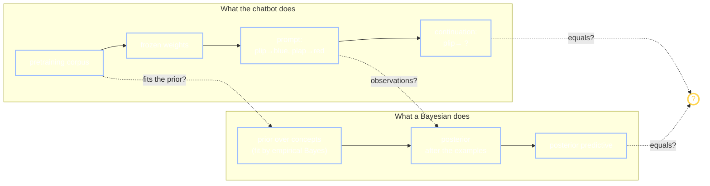

+++
date = "2026-07-04"
title = "LLMs & In-Context Learning"
weight = 40
tracks = ["beginner", "cogsci"]
+++

## The Chatbot Learns a Word That Doesn't Exist

The bento kiosk can *see*. As of the New Year break, the campus can also *talk*: the university switched on a **campus chatbot** — a large language model, an **LLM**, wired into the student portal — and within a week everyone was asking it for cafeteria hours and club-room bookings. Chibany has been circling it the way they circled the kiosk: not suspicious, exactly, but *unmeasured*, and Chibany does not leave things unmeasured.

The kiosk, remember, was trained: thousands of labeled photos, millions of numbers nudged downhill until the answers matched the labels ([From Rules to Weights](../from-rules-to-weights/)). The chatbot was trained too — on text, oceans of it. So Chibany designs a test that *cannot* be in any ocean of text, because Chibany invented it over breakfast. Into the chat window goes a tiny made-up game:

> plip → blue
> plap → red
> plip → ?

The chatbot answers: **blue**. Chibany starts a fresh chat and flips the game — plip → red, plap → blue, plip → ? — and the chatbot flips right along: **red**. The word *plip* is three hours old. It is in no dictionary, no textbook, no forum post. Whatever the chatbot did, it did not look this up.

> **Jamal:** "And here's the part that should bother you: I can promise nothing inside the model changed. No gradient step, no update — the weights that answered your first game are bit-for-bit the weights that answered the second. Training ended months before you invented *plip*."
>
> **Chibany** looks from the screen to Jamal and asks the question this whole chapter answers: *"Then where did it put what it just learned?"*



---

## Learning with the Weights Frozen

First, the phenomenon, defined precisely. **In-context learning** (ICL) is a frozen model adapting its behavior to examples supplied in its **prompt** — the text it is given to continue — with **zero weight updates**. Three examples of a made-up rule go in; the continuation follows the rule. Nothing that the [From Rules to Weights](../from-rules-to-weights/) chapter called *training* happens at any point: no loss, no gradient, no parameter moves. If you reran the same prompt tomorrow, the same frozen network would re-derive the same answer from scratch.

So where does the learning live? In the only place left: the **context window** — the stretch of recent text the model reads before predicting — and the activations computed from it. The [transformer](../transformers-attention/) architecture is what makes this mechanically possible: attention lets every token look at every other token in the window, so the three examples are *right there*, shaping the computation that produces the continuation. The adaptation is carried entirely by those transient, per-prompt activations. Close the chat, and it is gone; the weights never knew.

Notice that naming where the learning lives is not the same as *explaining* it. "The examples shape the activations" is true of any input to any network. The real question is why shaping-by-examples looks so much like *learning a rule* — and here Alyssa has been waiting patiently, because this book has exactly one machine that adapts to data without changing itself.

---

## Why That Looks Like Inference, Not Training

> **Alyssa:** "Think about what a Bayesian does when data arrives. Nothing about the *model* changes — the prior, the likelihood, every probability in the generative story stays exactly as it was. What changes is which possibilities the data has ruled out. **Conditioning, not updating parameters.** A frozen network that adapts to prompt examples is behaving the way a posterior behaves — and some researchers think that resemblance is not a coincidence but an identity."

Here is that identity spelled out — and let's be careful to call it what it is. **The claim** (Xie et al., 2022): suppose pretraining documents are generated by first drawing a latent **concept** — a topic, a style, a task; the hidden variable that makes one document cohere and differ from the next — and then generating text given that concept. In such a world, the *optimal* next-token predictor, the one that truly minimizes the pretraining loss, does not merely resemble Bayesian inference. It **is** the posterior predictive over the latent concept:

$$\underbrace{P(x_{\text{next}} \mid x_{1:n})}_{\text{the continuation}} \;=\; \sum_{c} \underbrace{P(x_{\text{next}} \mid c)}_{\text{what concept } c \text{ says}}\; \underbrace{P(c \mid x_{1:n})}_{\text{posterior over concepts}}.$$

That right-hand side is the **posterior predictive** — the [predictive distribution](../../glossary/#predictive-distribution-) you met in Part III, re-anchored: the probability of the *next* observation, computed by averaging each concept's prediction, weighted by the [posterior](../../glossary/#posterior-distribution-) over which concept is in force. Under the claim, "in-context learning" is not a bonus ability that emerged mysteriously at scale. It is what optimal next-token prediction *means* in a world with latent concepts: the prompt's examples are observations, and the continuation is inference. Xie et al. built exactly such a world — documents from a mixture of hidden Markov models, the chains of Part V with hidden states — and showed, in theory and in trained transformers, that ICL falls out of next-token pretraining alone.

Ye et al. (2024) push the framing one level up, and the level will sound familiar. Pretraining, they argue, is precisely **empirical Bayes** — the move you made in [Learning the Prior](../../structure/hierarchical-bayes/learning-the-prior/): when you don't know the prior, estimate it from data by optimizing the [marginal likelihood](../../glossary/#marginal-likelihood-). Pretraining on a corpus of sequences optimizes exactly such a marginal likelihood; where classical empirical Bayes fits the prior and then computes predictions from it, pretraining trains the network to output the resulting posterior predictives directly. Pretraining fits the **prior**; the prompt supplies the **observations**; the continuation reads out the **posterior predictive**.

You have run this machine before, one Part ago. In [Hierarchical Bayes](../../structure/hierarchical-bayes/), a new student's two bentos were hopeless on their own — until the whole Bento Journal, hundreds of bentos from *other* students, pinned down a population prior, and suddenly two observations supported a sensible, [shrinkage](../../structure/hierarchical-bayes/partial-pooling-and-shrinkage/)-tempered estimate. Map it across: the pretraining corpus is the Journal — many documents playing the role of many students; the latent concept behind a document is that student's hidden rate; **the prompt is the new student's two bentos**; and the continuation is the prediction for that student, informed by everyone else. If the claim is right, an LLM is a hierarchical Bayesian whose hyperprior was fit by gradient descent.



{}
"ICL is implicit Bayesian inference" is a **research claim**, not a settled fact. There is a formal argument and toy-world evidence for it (Xie et al., 2022; Ye et al., 2024) and quantitative, run-it-yourself evidence against it in real models (Falck et al., 2024 — coming below). This book will not pretend the question is closed. What we *can* do is make the claim precise, build a small world where it is provably true, and hand you the test that real LLMs currently fail — so you can run the debate yourself instead of taking anyone's word for it, ours included.
{}

---

## A Tiny World Where the Claim Is True — by Construction

> **Jamal:** "Arguing about a trillion-parameter model is a mug's game. Let's build a world so small the claim is a *theorem* in it, and watch both sides of the equation with our own eyes."

Documents in Jamal's world are conversations in a two-word language: someone names a word — *plip* or *plap* — and the speaker answers a color — *blue* or *red*. Every document is written under one of two **concepts**: the *plip-is-blue* convention (concept 0: plip → blue, plap → red) or the flipped *plip-is-red* convention (concept 1). Speakers slip 10% of the time, so no answer is fully reliable. And concept 0 is more common: **70% of documents** use it. (A world split 70/30 between a common kind and a rarer kind — Chibany has definitely [seen that ratio before](../../learning/mystery-bentos/).)

```python
import jax
import jax.numpy as jnp
import jax.random as jr

key = jr.PRNGKey(0)

# The made-up language: two concepts a "document" can be written under.
# Words: 0 = plip, 1 = plap.   Colors: 0 = blue, 1 = red.
# P_BLUE[c, w] = probability that word w is answered "blue" under concept c.
P_BLUE = jnp.array([[0.9, 0.1],    # concept 0: plip->blue, plap->red (with a 10% slip)
                    [0.1, 0.9]])   # concept 1: the meanings flipped
PRIOR = jnp.array([0.7, 0.3])      # concept-0 documents are more common

WORDS, COLORS = ["plip", "plap"], ["blue", "red"]
prompt = [(0, 0), (1, 1), (0, 0)]  # plip->blue, plap->red, plip->blue
print("world ready: 2 concepts, prior", PRIOR)
```

**Output:**
```
world ready: 2 concepts, prior [0.7 0.3]
```

An **ideal Bayesian in-context learner** for this world needs six lines: compute the posterior over the two concepts given the prompt's examples, then average the concepts' predictions — the exact right-hand side of the claim's equation, no approximation anywhere:

```python
def posterior(examples):
    """P(concept | the prompt's word->color examples)."""
    log_post = jnp.log(PRIOR)
    for w, c in examples:
        p_blue = P_BLUE[:, w]                                # per concept
        log_post += jnp.log(jnp.where(c == 0, p_blue, 1.0 - p_blue))
    post = jnp.exp(log_post - log_post.max())
    return post / post.sum()

def predict_blue(examples, w_query):
    """Posterior predictive: P(next color = blue | query word, examples)."""
    return jnp.sum(posterior(examples) * P_BLUE[:, w_query])

for n in range(4):
    p = predict_blue(prompt[:n], 0)                          # query: plip -> ?
    shown = ", ".join(f"{WORDS[w]}->{COLORS[c]}" for w, c in prompt[:n])
    label = f"after {n} example{'s' if n != 1 else ' '} ({shown})" if n else "before any examples"
    print(f"{label:55s} P(blue | plip) = {p:.4f}")
```

**Output:**
```
before any examples                                     P(blue | plip) = 0.6600
after 1 example  (plip->blue)                           P(blue | plip) = 0.8636
after 2 examples (plip->blue, plap->red)                P(blue | plip) = 0.8958
after 3 examples (plip->blue, plap->red, plip->blue)    P(blue | plip) = 0.8995
```

Read the sharpening. Before any examples, the prediction is the **prior blend**: seventy percent of a 0.9 plus thirty percent of a 0.1 gives 0.66 — the "zero-shot" answer, pure prior. One example lifts it to 0.86; three examples reach 0.8995, pressing against a **ceiling of 0.9** that no amount of evidence will breach — the posterior can become certain about the *concept*, but speakers still slip 10% of the time. This is what an ideal Bayesian in-context learner does: each prompt example moves the prediction, early examples move it most, and the whole path is fixed by the prior and the [likelihood](../../glossary/#likelihood-). Keep those four numbers in view; they are about to be someone's exam.

---

## Now Learn It from the Corpus Instead

> **Jamal:** "That was the Bayes side of the equation. Now the other side — a model that *learns from documents*, with no Bayes anywhere inside it. Promise."

We generate a pretraining corpus — two hundred thousand documents, each four exchanges long — and fit the dumbest possible next-token predictor: **count and normalize**. Among all corpus documents whose opening matches the prompt so far and whose next word matches the query, what fraction answer *blue*? A lookup table over contexts is a perfectly good stand-in for a trained network here, and an honest one: counting-and-normalizing is exactly **maximum-likelihood next-token prediction** — it minimizes the corpus [cross-entropy](../../glossary/#cross-entropy-), which is the same pretraining loss every real LLM minimizes, just without a neural network to carry the counts. Crucially, the predictor never sees a concept label. Documents arrive as bare text; the 70/30 mixture is nowhere in its inputs.

```python
N_DOCS, DOC_LEN = 200_000, 4
k1, k2, k3 = jr.split(key, 3)
concept = jr.choice(k1, 2, (N_DOCS,), p=PRIOR)              # one latent concept per document
words = jr.choice(k2, 2, (N_DOCS, DOC_LEN))                 # words arrive at random
p_blue = P_BLUE[concept[:, None], words]                    # (N_DOCS, DOC_LEN)
colors = (jr.uniform(k3, (N_DOCS, DOC_LEN)) > p_blue).astype(jnp.int32)   # 0 = blue

def corpus_predict_blue(examples, w_query):
    """The trained predictor: among corpus documents whose opening matches the
    prompt and whose next word is the query, the fraction answered blue."""
    n = len(examples)
    match = words[:, n] == w_query
    for i, (w, c) in enumerate(examples):
        match &= (words[:, i] == w) & (colors[:, i] == c)
    return jnp.sum(match & (colors[:, n] == 0)) / jnp.sum(match), jnp.sum(match)

for n in range(4):
    bayes = predict_blue(prompt[:n], 0)
    learned, hits = corpus_predict_blue(prompt[:n], 0)
    print(f"n={n}:  exact Bayes {bayes:.4f}   learned {learned:.4f}"
          f"   ({int(hits)} matching documents)")
```

**Output:**
```
n=0:  exact Bayes 0.6600   learned 0.6588   (100274 matching documents)
n=1:  exact Bayes 0.8636   learned 0.8650   (33149 matching documents)
n=2:  exact Bayes 0.8958   learned 0.8913   (14108 matching documents)
n=3:  exact Bayes 0.8995   learned 0.8968   (6308 matching documents)
```

Two things to see, and the first is the quiet one. Look at the **zero-shot row**: the learned predictor says 0.6588 — the prior blend, recovered to two decimal places. Nobody told it that concept 0 covers 70% of the world; it *absorbed* the prior from the corpus, which is empirical Bayes in miniature — **pretraining fit the prior**. Second, the whole learned column tracks the exact-Bayes column within the sampling noise of a finite corpus, sharpening example by example toward the same 0.9 ceiling. In this world, the claim is simply true: train a predictor to continue documents, and in-context learning — *Bayesian* in-context learning — is what you get, because the posterior predictive is the optimal continuation.

One honesty note before anyone gets carried away: a lookup table is not a transformer. A real LLM cannot memorize every context; it must generalize across contexts through learned representations, and no finite training run reaches the exact optimum. What this cell establishes is the claim's *logic*: the pretraining objective's target, in a latent-concept world, is exactly the posterior predictive. Whether real models trained on real text land close enough to that target for "implicit Bayes" to be a good description — that is the debate, and it needs a test.

---

## The Pushback: Every Bayesian Is a Martingale

Falck et al. (2024) supply the test, and its cleverness is that it needs no access to the model's insides. Don't argue about mechanism, they say — check a **signature** that any Bayesian's predictions must carry.

The signature needs one new word. A sequence of observations is **exchangeable** if its probability does not depend on the order — shuffle the examples, and the joint probability is unchanged. Our toy's examples are exchangeable (given the concept, every exchange is an independent draw, so order carries no information). Few-shot prompts of independent examples are *supposed* to be exchangeable too — three plip/plap examples teach the same rule in any order.

Now the theorem. If a model is doing Bayesian inference over exchangeable examples, its running prediction must be a **martingale**: it must not drift *systematically* as examples arrive. In symbols, with $p_n$ the prediction after $n$ examples,

$$p_n \;=\; \mathbb{E}\big[\,p_{n+1} \,\big|\, \text{first } n \text{ examples}\,\big]$$

— today's prediction equals the *expected value* of tomorrow's, averaged over what the model itself thinks the next example will be. Individual examples still move the prediction (they must — that's learning); what's forbidden is *predictable* movement. If you already knew your prediction would rise on average after one more example, whatever it turns out to be, you should have raised it now. A coherent Bayesian has no predictable self-corrections left. Why it holds: $p_n$ is a posterior average, and averaging tomorrow's posterior over tomorrow's possible data hands back today's posterior — the same total-probability bookkeeping you have used since Part I.

Run it on our exact Bayesian. Average tomorrow's prediction over all four possible next exchanges, weighted by the model's own forecast of each:

```python
def expected_next_prediction(examples, w_query):
    """Average TOMORROW's prediction over the model's own forecast of the next pair."""
    total = 0.0
    for w_next in (0, 1):                        # the next example's word
        p_b = predict_blue(examples, w_next)     # the model's own forecast of its color
        for c_next, p_c in ((0, p_b), (1, 1.0 - p_b)):
            total += 0.5 * p_c * predict_blue(examples + [(w_next, c_next)], w_query)
    return total

for n in range(3):
    today = predict_blue(prompt[:n], 0)
    tomorrow = expected_next_prediction(prompt[:n], 0)
    print(f"n={n}:  today {today:.6f}   E[tomorrow] {tomorrow:.6f}"
          f"   gap {abs(tomorrow - today):.6f}")
```

**Output:**
```
n=0:  today 0.660000   E[tomorrow] 0.660000   gap 0.000000
n=1:  today 0.863636   E[tomorrow] 0.863636   gap 0.000000
n=2:  today 0.895789   E[tomorrow] 0.895789   gap 0.000000
```

Zero gap, up to floating-point arithmetic — the exact Bayesian passes, as the theorem says it must. And here is the punch: **Falck et al. ran this style of test on real LLMs** — feeding them synthetic, genuinely exchangeable example streams (biased coin flips and the like), reading out the models' running predictions, and checking the martingale property (along with how the models' uncertainty scales as examples accumulate). The large language models they tested showed **systematic violations**: predictions that drift with the order and number of examples in ways no coherent Bayesian's can. Their conclusion, in the paper's own register: in this checkable sense, in-context learning in the LLMs they examined is *not* Bayesian. The lens is suggestive — the toy shows *why* it is so tempting — but it is not settled, and where it has been tested sharply at scale, it has cracked.

Be equally honest about what our toy cannot show. It is a world *built* so the claim holds: real pretraining text does not come stamped with clean latent concepts (topics and styles are at best a blurry version of our two conventions); real prompts are not exchangeable (language has word order, and few-shot examples can interact); and our "trained model" reached the literal optimum of its objective, which no finite training run does. The toy tells you what the claim *means* and gives the test its teeth. It cannot tell you whether the claim is true of the chatbot in the student portal.

---

## Prompts as Priors, in Practice

Even as a contested lens, the Bayesian reading earns its keep by making everyday prompt lore *predictable* rather than folkloric — if you take it seriously, three things follow.

- **Examples are evidence, so choose them like evidence.** Each of Chibany's examples was worth a 9-to-1 likelihood ratio between the concepts, which is why three sufficed. Ambiguous or redundant few-shot examples are weak evidence; examples that cleanly separate the candidate patterns move the posterior fastest.
- **Format is part of the inference.** Under the claim, the prompt's job is to *locate* a latent concept the pretraining prior already contains. A consistent format (same arrow, same line shape) is evidence pointing at one concept; inconsistent formatting spreads the posterior across several. Zero-shot behavior, meanwhile, is the prior blend — with no examples you get whatever is common in the corpus, which is exactly what our 0.66 was.
- **Order should not matter — and measurably does.** For exchangeable examples, an ideal Bayesian is order-indifferent. Real models' well-documented sensitivity to example order is, through this lens, not a quirk but *evidence* — the informal, everyday face of the same deviations the martingale test formalizes.

One line to keep separate: when the chatbot follows an *instruction* — "answer in Japanese," "be concise" — that is not in-context learning of a pattern from examples. That behavior was trained in after pretraining, by [RLHF](../../glossary/#rlhf-) — reinforcement learning from human feedback, the preference-model machinery you met in [Modern RL & World Models](../../decisions/modern-rl-world-models/). Different mechanism, different chapter.

{}
Tanaka-san has been reading over Chibany's shoulder, and the comparison table delights him: "The learned column matches the Bayes column! You just *proved* the chatbot is a Bayesian. Debate over — you can tell those martingale people to relax."

Two confusions, one of them deep. The shallow one: our learned predictor matched Bayes *in a world constructed so the theorem holds* — clean latent concepts, exchangeable examples, an optimum actually reached. Proving the claim in the world built for it says nothing about worlds that were not. The deep one: **matching Bayesian *outputs* is not implementing a Bayesian *mechanism***. A lookup table matched the posterior predictive without representing a prior or computing a posterior anywhere inside it — the agreement is in the numbers, not the machinery. We met this exact caution in the [LLM theory-of-mind debate](../../decisions/modern-rl-world-models/): a behavioral pass is not the mechanism. And here even the outputs crack at scale — the martingale violations are output-level failures, no peek inside required. The defensible position is neither Tanaka-san's "case closed" nor a dismissal: the Bayesian reading is a precise, *testable* lens, valuable exactly because it makes wrong predictions detectable.
{}

{}
The chapter handed you both sides; now run the trial yourself. Using the scaffolded notebook: **(A)** replicate the Xie-style toy — the exact Bayesian above versus a *genuinely learned* predictor: a tiny logistic model trained in-notebook by gradient descent on corpus prefixes (the count-based lookup is provided as a baseline); **(B)** implement the Falck-style martingale test as a reusable function and run it on *both* predictors — the exact Bayesian should pass, and your trained model's gap is the interesting part: is it sampling noise or systematic drift, and how would you tell? **(C)** *(stretch — clearly optional; needs an LLM API that returns token probabilities, or a small open model you can run)* sketch the same test on a real LLM: encode the plip/plap game as text, read out next-token probabilities, and chart the running prediction.

**📓 [Open in Colab: `capstone_llms_in_context_learning.ipynb`](https://colab.research.google.com/github/josephausterweil/probintro/blob/main/notebooks/capstone_llms_in_context_learning.ipynb)** — world, exact Bayes, and corpus generator provided; the trained model and the martingale test are TODOs.
{}

Chibany closes the chat window, pastes the four sharpening numbers into the Bento Journal (new page: *systems that learn without changing*), and looks over at the robot mascot trainee, who has been watching the plip/plap game with what can only be described as professional interest. Predicting the next word of a conversation is one thing. The trainee's problem is harder: predicting what the *cafeteria* will do next, so it can act. That is the next chapter — [World Models & Imagination](../world-models-imagination/), where prediction becomes a place to practice.

---

{}
You can define **in-context learning** precisely — adaptation from prompt examples with zero weight updates, living in the context window's activations, not the parameters — and you can state **the claim** with its correct owners: pretraining on latent-concept documents makes optimal next-token prediction *equal* the posterior predictive over the concept (Xie et al., 2022), with pretraining as empirical Bayes — fitting the prior by optimizing a marginal likelihood (Ye et al., 2024) — the hierarchical-Bayes machine of Part IV run at corpus scale. You built the world where the claim is a theorem and watched both sides agree: exact Bayes sharpening 0.6600 → 0.8636 → 0.8958 → 0.8995 against the 0.9 slip ceiling, and a count-based learner trained only on documents tracking it (0.6588 zero-shot — the prior, absorbed from the corpus). You can state and *run* the counter-test: exchangeable examples force a Bayesian's running prediction to be a **martingale** (today's prediction = the expected value of tomorrow's), your exact Bayesian passed with gap 0.000000, and real LLMs measurably fail such tests (Falck et al., 2024). And you can say exactly what the toy does and does not establish — the claim's logic, not its truth at scale.

*Glossary:* [posterior distribution](../../glossary/#posterior-distribution-), [prior distribution](../../glossary/#prior-distribution-), [predictive distribution](../../glossary/#predictive-distribution-), [likelihood](../../glossary/#likelihood-), [marginal likelihood](../../glossary/#marginal-likelihood-), [cross-entropy](../../glossary/#cross-entropy-), [RLHF](../../glossary/#rlhf-), [theory of mind](../../glossary/#theory-of-mind-). (*In-context learning*, *empirical Bayes*, *exchangeable*, and *martingale* are defined in this chapter; they'll join the glossary with the Part VIII pass.)
{}

---

## References

- Brown, T. B., et al. (2020). Language models are few-shot learners. *NeurIPS*. (The paper that made in-context learning famous: GPT-3 adapting to tasks from prompt examples alone.)
- Falck, F., Wang, Z., & Holmes, C. (2024). Is in-context learning in large language models Bayesian? A martingale perspective. *ICML*. arXiv:2406.00793. (The pushback: martingale-signature tests that the LLMs they examined violate.)
- Xie, S. M., Raghunathan, A., Liang, P., & Ma, T. (2022). An explanation of in-context learning as implicit Bayesian inference. *ICLR*. arXiv:2111.02080. (The claim: latent-concept pretraining makes next-token prediction posterior-predictive inference; demonstrated in a mixture-of-HMMs world.)
- Ye, N., Yang, H., Siah, A., & Namkoong, H. (2024). Pre-training and in-context learning is Bayesian inference à la De Finetti. *ICLR 2024 Workshop on Mathematical and Empirical Understanding of Foundation Models*. (The empirical-Bayes framing: pretraining optimizes a marginal likelihood and fits posterior predictives directly.)

---

*This project is generously funded by the Japanese Probabilistic Computing
Consortium Association ([JPCCA](https://jpcca.org/)).*
