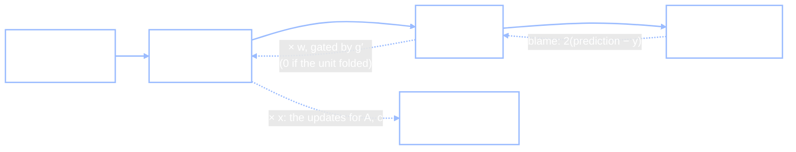

+++
date = "2026-07-16"
title = "Neural Network Fundamentals"
weight = 20
tracks = ["beginner"]
+++

## The Trainee Wants a Turn

The [previous chapter](../from-rules-to-weights/) ended with the robot mascot trainee looking oddly eager, and this evening in Cafeteria A the reason comes out. Jamal has barely opened the laptop when the trainee rolls up, extends a manipulator, and taps the screen — right on the line of code that says `jax.grad`. Then it taps its own chest panel.

> **Jamal:** "...You want to be trained. Not watch the kiosk get trained — *be* trained."
>
> **Alyssa:** "Then let's do it properly. Not seventeen million numbers — the smallest network that can learn something real. Small enough that we can watch every part move."

Chibany, who has been listening while finishing the dinner bento, produces the Bento Journal and opens it to the newest page. Since the new year, the cafeteria has run a **variety-stamp campaign**: each day, if Chibany's two bentos *differ* — exactly one of the two is tonkatsu — the day's card gets a stamp. Two tonkatsu, no stamp. Zero tonkatsu, no stamp. Chibany has been logging it faithfully: one column for lunch, one for dinner (lunch first, dinner second, the Journal's usual convention), one for the stamp.

Four kinds of day, a clean yes/no answer for each. It looks like the easiest dataset in the whole Journal. It is, in fact, the most famous trap in the history of neural networks — and walking the trainee into it, and then out of it, is this chapter.

---

## One Neuron, and What It Listens For

Everything in the previous two chapters was secretly built from one repeating part. An **artificial neuron** takes an input vector $\mathbf{x}$, computes the score $\mathbf{w} \cdot \mathbf{x} + b$, and passes it through a bend $g$ — typically the ReLU fold, $g(z) = \max(0, z)$. The bend is called the neuron's **activation function**, a name inherited from biology: real neurons either fire or stay quiet, and $g$ decides how strongly this one "fires" for a given score.

You already own both halves of that formula. The [vectors chapter](../vectors-and-spaces/) taught the dot product as multiply-matching-components-and-add, and showed that it is big and positive exactly when two vectors *point the same way*. So read the neuron the way that chapter would: **a neuron is a similarity detector.** Its weight vector $\mathbf{w}$ is a pattern it listens for; the dot product scores how much the input resembles that pattern; $b$ sets how much resemblance it takes before the neuron speaks up. A layer is just a bank of these detectors — the matrix $A$ in $g(A\mathbf{x} + \mathbf{c})$ from the [previous chapter](../from-rules-to-weights/) was four of them stacked, each row one neuron's listening pattern. Nothing here is new; we are zooming in on one part.

Jamal sets up the trainee's first dataset — the stamp page, copied straight from the Journal:

```python
import jax
import jax.numpy as jnp
import jax.random as jr

key = jr.PRNGKey(2)   # this exact seed matters -- see the note after training

# One row per kind of day: x = [lunch is tonkatsu, dinner is tonkatsu]
X = jnp.array([[0.0, 0.0],
               [0.0, 1.0],
               [1.0, 0.0],
               [1.0, 1.0]])
y = jnp.array([0.0, 1.0, 1.0, 0.0])   # variety stamp: exactly one tonkatsu

for xi, yi in zip(X, y):
    print(f"lunch={int(xi[0])}  dinner={int(xi[1])}  ->  stamp={int(yi)}")
```

**Output:**
```
lunch=0  dinner=0  ->  stamp=0
lunch=0  dinner=1  ->  stamp=1
lunch=1  dinner=0  ->  stamp=1
lunch=1  dinner=1  ->  stamp=0
```

Logicians call this function **XOR** — *exclusive or*: output 1 when exactly one of the two inputs is 1. Chibany's stamp rule is XOR wearing a furoshiki.

---

## The Perceptron, and the Wall It Hit

The first learning machine built from a neuron was Frank Rosenblatt's **perceptron** (1958): a single neuron with a hard threshold — say tonkatsu-day when the score clears zero — plus a wonderfully simple error-driven rule for learning $\mathbf{w}$ and $b$: when the machine gets an example wrong, nudge the weights toward the input it should have said yes to, and away from the one it should have refused. Rosenblatt built it in hardware, the press promised thinking machines by the weekend, and for a decade the perceptron *was* neural-network research.

A single neuron's yes/no split has a clean geometry. The set of inputs where $\mathbf{w} \cdot \mathbf{x} + b$ is exactly zero is the neuron's **decision boundary** — in our 2-D day-space, a straight line. Yes on one side, no on the other. A dataset that some straight line can split perfectly is called **linearly separable**, and for such data the perceptron is provably unstoppable: its nudge-rule always finds a separating line. "Stamp any day with at least one tonkatsu" (OR) is linearly separable. "Stamp only double-tonkatsu days" (AND) is too. The trainee could learn either before dinner.

Now try the actual stamp rule. Plot the four days as corners of a square: the two stamp days, $(0,1)$ and $(1,0)$, sit on one diagonal; the two no-stamp days, $(0,0)$ and $(1,1)$, on the other. One straight line must put the first diagonal on its yes side and the second on its no side. Chase the algebra and it refuses. Writing the score $s = w_1 x_1 + w_2 x_2 + b$:

$$\underbrace{b \le 0}_{(0,0)\text{: no stamp}} \qquad \underbrace{w_1 + b > 0}_{(1,0)\text{: stamp}} \qquad \underbrace{w_2 + b > 0}_{(0,1)\text{: stamp}} \qquad \underbrace{w_1 + w_2 + b \le 0}_{(1,1)\text{: no stamp}}$$

Add the two middle inequalities: $w_1 + w_2 + 2b > 0$, so $w_1 + w_2 + b > -b$. But the first inequality says $-b \ge 0$ — so $w_1 + w_2 + b > 0$, and the double-tonkatsu day *would get a stamp*, contradicting the fourth requirement. No line exists. Not "hard to find" — **does not exist**.

This is the trap's history. Marvin Minsky and Seymour Papert's 1969 book *Perceptrons* mapped out, with full mathematical care, exactly which functions a single-layer perceptron can and cannot represent — and XOR, the two-input function a child evaluates instantly, is the simplest thing on the *cannot* list. The book landed like a verdict: funding drained out of neural-network research for the better part of fifteen years, a stretch now remembered as the field's first winter.

The tempting escape is more layers: if one neuron draws a line, surely stacking layers of them draws something curvier? Not if the layers are linear. The [vectors chapter](../vectors-and-spaces/)'s composition punchline was built for exactly this moment: two linear machines compose into one linear machine — $B$ after $A$ is just the single matrix $BA$ — so a stack of linear layers, however tall, collapses into one layer, one line, the same wall. Minsky and Papert knew multilayer networks with *nonlinear* units escaped their theorems; what nobody had in 1969 was a way to train the middle layers. Hold that thought.

Meanwhile, watch the wall in numbers. Here is the best any purely linear model can do on the stamp page — trained by gradient descent on squared error, both inherited from the [previous chapter](../from-rules-to-weights/):

```python
def linear(params, x):
    return jnp.dot(params["w"], x) + params["b"]

def linear_loss(params):
    preds = jax.vmap(lambda x: linear(params, x))(X)
    return jnp.mean((preds - y) ** 2)

lin_params = {"w": jnp.zeros(2), "b": jnp.array(0.0)}
lin_grad = jax.grad(linear_loss)
for step in range(2000):
    g = lin_grad(lin_params)
    lin_params = jax.tree.map(lambda p, gp: p - 0.1 * gp, lin_params, g)

preds = jax.vmap(lambda x: linear(lin_params, x))(X)
print(f"best loss a line can reach: {linear_loss(lin_params):.4f}")
print("its four predictions:", [f"{float(p):.2f}" for p in preds])
```

**Output:**
```
best loss a line can reach: 0.2500
its four predictions: ['0.50', '0.50', '0.50', '0.50']
```

Two thousand steps of honest effort, and the model's least-bad move is to shrug: predict $0.5$ — "maybe a stamp?" — for every single day, loss stuck on the floor at $0.25$. The trainee robot stares at the four identical predictions and emits a low, unhappy beep.

---

## One Fold Is Enough

The fix costs almost nothing. Put a **hidden layer** between input and output — a bank of neurons whose values are neither a column of the Journal nor the final answer, which is all "hidden" means — and make its activation the ReLU fold, so the stack no longer collapses. The smallest version: two inputs, **two hidden ReLU neurons**, one output. A 2-2-1 network, nine parameters in all.

> **Jamal:** "Same loss, same gradient descent, same everything as the linear run. The only change is one folded layer in the middle."

```python
def net(params, x):
    h = jnp.maximum(0.0, params["A"] @ x + params["c"])   # 2 hidden ReLU units
    return jnp.dot(params["w"], h) + params["b"]          # linear read-out

def loss(params):
    preds = jax.vmap(lambda x: net(params, x))(X)
    return jnp.mean((preds - y) ** 2)

k1, k2 = jr.split(key)
params = {"A": 0.5 * jr.normal(k1, (2, 2)),   # 2x2: two hidden units, two inputs
          "c": jnp.zeros(2),
          "w": 0.5 * jr.normal(k2, (2,)),
          "b": jnp.array(0.0)}

grad_loss = jax.grad(loss)
print(f"loss before training: {loss(params):.4f}")
for step in range(2000):
    g = grad_loss(params)
    params = jax.tree.map(lambda p, gp: p - 0.1 * gp, params, g)
print(f"loss after 2000 steps: {loss(params):.6f}")

preds = jax.vmap(lambda x: net(params, x))(X)
for xi, yi, p in zip(X, y, preds):
    print(f"  lunch={int(xi[0])} dinner={int(xi[1])}   stamp {int(yi)}   prediction {float(p):.3f}")
```

**Output:**
```
loss before training: 0.3466
loss after 2000 steps: 0.000000
  lunch=0 dinner=0   stamp 0   prediction 0.000
  lunch=0 dinner=1   stamp 1   prediction 1.000
  lunch=1 dinner=0   stamp 1   prediction 1.000
  lunch=1 dinner=1   stamp 0   prediction 0.000
```

Loss $0.3466$ down to zero, and all four days answered exactly. The wall Minsky and Papert proved unbreakable for one layer fell to *one fold*.

And this network is small enough to interrogate. Open the trained $A$ and the two hidden neurons turn out to have learned beautifully readable listening patterns: one computes roughly $\text{ReLU}(0.64 \cdot \text{lunch} - 0.64 \cdot \text{dinner})$ — it fires *only* on lunch-only-tonkatsu days — and the other is its mirror image, firing only on dinner-only days. On the double-tonkatsu day each neuron's score is lunch-minus-dinner or dinner-minus-lunch, both zero-or-negative, and the fold silences them both. In the hidden layer's warped space, the four corners of the impossible square have been carried to points a single line separates easily, and the read-out just adds up the two detectors. This is the previous chapter's "learn the features" promise at its smallest possible scale: nobody told the network that "tonkatsu at lunch but not dinner" was a useful concept. Gradient descent sculpted it.

One honest footnote, because the code says `jr.PRNGKey(2)` and not `jr.PRNGKey(0)`: with only two hidden units — the bare minimum — gradient descent does not succeed from every random start. Many initializations roll downhill into a **local minimum**: a parameter setting where every small change makes the loss worse, yet which is not the best setting overall, so plain downhill-stepping parks there and stays. Seed 2 is a start that rolls all the way to the true bottom. This isn't embarrassing; it is a real and permanent feature of neural-network training, and practitioners answer it the blunt way: more hidden units than the bare minimum, and more than one random start.

Feel both results — the wall and the fold — with your own hands:

<iframe src="../../widgets/xor-playground.html" width="100%" height="560" frameborder="0" style="background:#111111; border-radius:6px; margin:1rem 0;" title="XOR playground: a 2-2-1 ReLU network on the four stamp days; train it, randomize it, or hand-shape the hidden units"></iframe>

{}
This is the exact model from the cell above — four points, two ReLU hidden units, gradient descent. Start in **Linear only** mode and press **Train**: the loss stalls at $0.25$ and the background never finds a split — the Minsky–Papert wall, live. Switch to **2 ReLU hidden units** and press **Train** again: watch the decision boundary bend around the diagonal and the loss fall. Now press **Randomize weights** a few times and retrain — some starts solve it, some park in the local minima from the footnote above. Finally, drag the **sliders** to hand-shape the two hidden units yourself and see if you can rediscover the lunch-only/dinner-only detectors that training found.
{}

---

## Backpropagation: Splitting the Blame

One mystery remains, and it is the one that ended the fifteen-year winter. Gradient descent needs $\nabla L$ — the loss's sensitivity to *every* parameter. For the read-out weights $\mathbf{w}$, sitting right next to the loss, that's easy. But $A$'s weights are buried *behind* the hidden layer: wiggle one of them and the effect on the loss travels through the fold, through the read-out, and only then reaches the number we measure. How do you assign credit — or blame — to a parameter two rooms away from the error?

The tool is the **chain rule**, the calculus fact about chained functions: when a change flows through a pipeline of steps, its end-to-end effect is the *product* of the per-step effects. If a weight-wiggle doubles on the way through the read-out and triples through the loss, its total effect is sixfold. **Backpropagation** is the chain rule organized as a bookkeeping procedure — run the network *forward* to get the prediction and the loss, then sweep *backward*, handing each layer its share of the blame:

- The loss hands the prediction its blame: for squared error, $2(\hat{y} - y)$ — how wrong, and in which direction.
- Each layer passes blame to whatever fed it, *multiplied by its own local sensitivity*. Passing back through the read-out multiplies by $\mathbf{w}$; passing back through the bend multiplies by $g'$ — g-prime, the activation's slope. For ReLU that slope is $1$ where the unit fired and $0$ where it was folded flat: **a silenced neuron receives no blame**, because wiggling its inputs changes nothing downstream.
- When the backward sweep reaches a parameter, its gradient is the arriving blame times what that parameter saw on the forward pass. Every parameter — all of $A$, $\mathbf{c}$, $\mathbf{w}$, $b$ — is served in one backward sweep, at roughly the cost of one extra forward pass.



> **Alyssa:** "And now the demystification, because you have been *using* backpropagation for a chapter and a half. Backpropagation is not a separate algorithm living somewhere inside JAX. It **is** reverse-mode automatic differentiation — the machinery `jax.grad` runs every time you call it. 'Automatic differentiation' means the library applies the chain rule through your actual code, step by step, exactly; 'reverse-mode' means it sweeps the blame backward the way we just described."

Don't take even that on faith. Here is the tiniest possible deep network — one input, one hidden ReLU unit, one output, so every quantity is a single number — with the chain rule done by hand next to `jax.grad`:

```python
def two_layer(w1, w2, x):
    return w2 * jnp.maximum(0.0, w1 * x)     # 1-D net: one hidden unit, one weight each

x_in, target = 2.0, 1.0
w1, w2 = 0.5, 1.5

def tiny_loss(w1, w2):
    return (two_layer(w1, w2, x_in) - target) ** 2

# Backprop by hand: forward pass, then blame flowing right to left.
h = max(0.0, w1 * x_in)                  # forward: hidden value    h    = 1.0
pred = w2 * h                            # forward: prediction      pred = 1.5
blame_pred = 2 * (pred - target)         # dL/dpred                      = 1.0
blame_w2 = blame_pred * h                # dL/dw2 = blame  x  what w2 saw
blame_w1 = blame_pred * w2 * (1.0 if w1 * x_in > 0 else 0.0) * x_in
print(f"by hand:   dL/dw1 = {blame_w1:.1f}   dL/dw2 = {blame_w2:.1f}")

g1, g2 = jax.grad(tiny_loss, argnums=(0, 1))(w1, w2)
print(f"jax.grad:  dL/dw1 = {float(g1):.1f}   dL/dw2 = {float(g2):.1f}")
```

**Output:**
```
by hand:   dL/dw1 = 3.0   dL/dw2 = 1.0
jax.grad:  dL/dw1 = 3.0   dL/dw2 = 1.0
```

Same numbers. The training cell in [From Rules to Weights](../from-rules-to-weights/), the 2-2-1 cell above, the kiosk's seventeen million parameters — all of it is this backward blame-sweep, run by `jax.grad`, at scale.

The blame-is-a-product structure has one famous failure mode. In a *deep* stack, blame reaching the early layers has been multiplied by a $g'$ and a weight for every layer it crossed. When those factors are mostly smaller than one, the product shrinks *exponentially* with depth, and the early layers receive blame indistinguishable from zero — they simply stop learning. This is the **vanishing gradient problem**, and it kept genuinely deep networks impractical for years. The modern fixes are architectural: **residual connections** — skip-paths that add a layer's input directly to its output, so blame has a multiplication-free highway back to the early layers — and **normalization** layers, which continually rescale activations to a steady size so the backward factors hover near one instead of shrinking. Keep both in your pocket: in the [Transformers & Attention](../transformers-attention/) chapter you will find a residual connection and a normalization wrapped around every single block, and now you know they are not decoration. They are what makes depth trainable.

---

## 1986: Hidden Units Earn Their Name

Credit, briefly and properly. The chain rule is old, and applying it through networks had precedents (Paul Werbos worked it out in a 1974 thesis nobody read in time). But the paper that ended the winter was Rumelhart, Hinton, and Williams' "Learning representations by back-propagating errors" (*Nature*, 1986). Its title is the point: not merely that the gradients could be computed, but that when you train hidden layers this way they *learn useful internal representations* — the paper's networks discovered features no one had designed, exactly as our two hidden neurons discovered lunch-only and dinner-only. The result anchored the two-volume *Parallel Distributed Processing* books and made "connectionism" a movement spanning psychology and AI. And it is worth knowing who was asking: David Rumelhart was a cognitive psychologist before anything else, and for him backpropagation was never just an engineering trick — it was a working hypothesis about how experience might carve structure into a mind, pursued with a warmth and seriousness his students still talk about.

{}
Tanaka-san has watched the whole session, and draws the natural conclusion: "Two hidden units cracked the unsolvable problem. The kiosk has millions. So the recipe is obvious — when in doubt, add layers. More layers is always better."

Plausible — and wrong twice. First, the [bias-variance](../../complexity/bias-variance/) chapter's ledger still applies: every layer adds parameters, and parameters buy flexibility at the price of **variance** — the freedom to fit the noise instead of the rule. Our stamp page has *four data points*; a ten-layer network pointed at it would memorize anything, including the day Chibany smudged the ink (that's **overfitting**, same as it ever was). Depth pays only when there is enough data — or enough regularization; recall from the [previous chapter](../from-rules-to-weights/) that weight decay is a Gaussian prior — to keep the extra freedom honest. Yes, that same chapter noted that hugely overparameterized networks sometimes generalize anyway (the double-descent surprise), but that is a phenomenon with conditions attached, not a license. Second, this very chapter handed Tanaka-san the other counterexample: deeper stacks multiply more blame-factors, so naive depth *trains worse* — vanishing gradients — until residual connections and normalization are added. Depth is a resource with costs, not a slider labeled "better."
{}

---

## Capstone: From Four Points to Real Pixels

{}
Two experiments, one scaffolded notebook. **(a) Replicate Minsky & Papert.** Train a linear model on XOR and confirm the floor: loss stuck at $0.25$, every prediction $0.5$. Add the 2-2-1 hidden layer and watch the same optimizer solve it — you will have reproduced, in about thirty lines, both the 1969 verdict and the 1986 reply. **(b) A real task.** The four stamp days are a logic puzzle; the kiosk's world is pixels. Load the handwritten-digit images from `sklearn.datasets.load_digits`, keep two digit classes, and train the *same two-layer architecture* — only the input width changes, from 2 to 64 pixels — to tell them apart. Report accuracy on digits the network never saw, then look at the ones it gets wrong and decide whether you'd have gotten them right. *Optional stretch:* swap in a harder digit pair and sweep the hidden width.

**📓 [Open in Colab: `capstone_neural_net_fundamentals.ipynb`](https://colab.research.google.com/github/josephausterweil/probintro/blob/main/notebooks/capstone_neural_net_fundamentals.ipynb)** — setup, data, and checks provided; the models are TODOs.
{}

The trainee robot, for its part, runs the 2-2-1 cell one more time, watches the loss print $0.000000$, and does a small spin. Chibany inspects the four predictions against the Journal page, finds no disagreements, and solemnly applies today's variety stamp to the corner of Jamal's laptop.

There is a catch coming, though. The stamp problem handed us something the kiosk never gets: inputs of a fixed, tiny size in a fixed order. A photo, a sentence, a semester of Journal entries — real inputs come in *sequences* of wildly different lengths, where what matters is not each piece alone but which pieces to look at *together*. Making a network that can decide, on the fly, what to attend to is the next chapter: [Transformers & Attention](../transformers-attention/).

---

{}
You can read an **artificial neuron** as a similarity detector — the [dot product](../../glossary/#dot-product-) score $\mathbf{w} \cdot \mathbf{x} + b$, then the **activation function**'s bend — and a layer's [matrix](../../glossary/#matrix-) as a bank of them. You can define the **perceptron** and its **decision boundary**, say what **linearly separable** means, and *prove* XOR isn't (the four-inequality contradiction), which is why a linear model's [loss](../../glossary/#loss-function-) floors at $0.25$ predicting $0.5$ everywhere — and you know the history that proof made (Minsky & Papert, 1969, and the winter after). You know why stacked linear layers don't help (they collapse to one line) and what does: one **hidden layer** with a [ReLU](../../glossary/#relu-) fold — the 2-2-1 network took loss $0.3466 \to 0.000000$ and answered all four days exactly, its two hidden units *learning* lunch-only and dinner-only detectors nobody designed. You can run **backpropagation** by hand as blame apportionment — chain rule as a product of local sensitivities, $g'$ gating blame to zero through folded units — and you verified it against `jax.grad` ($3.0$ and $1.0$, both ways), because backprop *is* reverse-mode automatic differentiation. You can name the **vanishing gradient problem** and the two modern fixes, residual connections and normalization, and say why every transformer block carries both. And you can answer Tanaka-san: more layers means more variance to keep honest ([overfitting](../../glossary/#overfitting-), the [bias-variance](../../glossary/#bias-variance-decomposition-) ledger) *and* harder training — depth is bought, not free.

*Glossary:* [dot product](../../glossary/#dot-product-), [matrix](../../glossary/#matrix-), [ReLU](../../glossary/#relu-), [loss function](../../glossary/#loss-function-), [learning rate](../../glossary/#learning-rate-), [overfitting](../../glossary/#overfitting-), [bias-variance decomposition](../../glossary/#bias-variance-decomposition-). (*Perceptron*, *linear separability*, *backpropagation*, and *vanishing gradients* are defined in this chapter; they join the glossary with the Part VIII pass.)
{}

---

## References

- Rosenblatt, F. (1958). The perceptron: A probabilistic model for information storage and organization in the brain. *Psychological Review*, 65(6), 386–408.
- Minsky, M., & Papert, S. (1969). *Perceptrons: An Introduction to Computational Geometry*. MIT Press.
- Werbos, P. J. (1974). *Beyond Regression: New Tools for Prediction and Analysis in the Behavioral Sciences*. PhD thesis, Harvard University.
- Rumelhart, D. E., Hinton, G. E., & Williams, R. J. (1986). Learning representations by back-propagating errors. *Nature*, 323, 533–536.

---

*This project is generously funded by the Japanese Probabilistic Computing
Consortium Association ([JPCCA](https://jpcca.org/)).*
