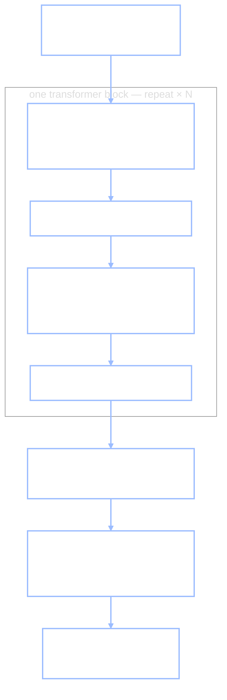

+++
date = "2026-07-04"
title = "Transformers & Attention"
weight = 30
tracks = ["beginner"]
+++

## The Journal Wants an Autocomplete

The trainee robot has discovered the Bento Journal.

It happened quietly. Chibany was writing up the day's entries — the trainee reading over their shoulder, as usual — and when Chibany's pen reached *"Friday, lunch:"*, the trainee's screen lit up with a suggestion: **tonkatsu?**

Chibany froze, pen in the air, then opened the furoshiki. Tonkatsu. The trainee had guessed the entry *before the box was open* — and over the following week its guesses kept landing about seven times in ten, exactly the campus base rate from [Mystery Bentos](../../learning/mystery-bentos/). The trainee has invented **autocomplete**: predicting the next word of a sequence from the words so far. Chibany, naturally, wants a better one — one that could finish a whole Journal entry.

> **Alyssa:** "Look at what the Journal *is*, though. Not a bag of facts — a **sequence**. One entry after another, each one written in the shadow of everything before it. Predicting the next entry from the ones so far is a problem this book has met before."

It is. In the [Markov chains](../../sampling/markov-chains/) chapter (Part V) we built exactly this kind of predictor for Chibany's own lunch choices. The [Markov property](../../glossary/#markov-property-) said: to predict tomorrow, *yesterday is all you need* — the future forgets the past, given the present. One glance back, one row of a transition table, done. And for T-versus-H lunch sequences, one glance back really was enough.

Now let the trainee loose on Journal *prose*, and watch the assumption snap. Here is a real entry, with a word missing:

> *"The unlabeled bento from Monday — the heavy one in the blue furoshiki, the one the trainee carried around all afternoon — turned out to be ______."*

A one-step predictor sees only the word *be* and must guess from there. But you already know the answer, because twenty words back the entry said **heavy** — and heavy means about 500 grams, and 500 grams means tonkatsu (the weigh-station fact from [Mystery Bentos](../../learning/mystery-bentos/)). The evidence that settles the blank is not one step back. It is *arbitrarily far* back, and it is a different distance in every sentence.

Could we just give the Markov table more memory — condition on the last two words, or three, or twenty? In principle, yes; in practice the table explodes. Every extra step of memory multiplies the number of rows by the size of the **vocabulary** (the list of all distinct words the predictor knows), and a twenty-word context over even a modest vocabulary needs more rows than there are atoms to write them on. Worse, no fixed lookback is *enough* — language plants its clues at unbounded range.

One piece of bookkeeping before we go on: the units of the sequence are called **tokens**. For us a token is simply a word; real systems chop text into word-pieces, but nothing below changes. The problem of this chapter is: *to predict the next token, how does a model reach back to the right earlier tokens — wherever they are?*



---

## One Honest Paragraph About Recurrent Networks

The first neural answer deserves its paragraph. A **recurrent neural network** (RNN) feeds the network's own output back into itself: Elman (1990) gave a network **context units** that hold a copy of its hidden vector from the previous step, so that each new token is read *alongside a running summary of everything so far*. That summary vector is a learned, high-dimensional generalization of the Markov state — the network decides for itself what "the present" should remember about the past — and for two decades this was the way to model sequences. But it has two honest problems. First, the summary is a **bottleneck**: the entire past, however long, is squeezed into one fixed-size vector that gets rewritten at every step, so a detail from forty tokens ago must survive forty consecutive rewrites to matter — and the learning signal for it fades the same way, layer by layer, which is the vanishing-gradient problem from [Neural Network Fundamentals](../neural-net-fundamentals/) wearing its time-series costume. Second, the computation is **sequential**: you cannot process token 400 before token 399, so both reading and training crawl left to right, one step at a time. An RNN's reach is *local*, relayed step by step — and what the Journal needs is *global*: a direct line from the blank to the word "heavy," however far back it sits.

---

## Attention Is a Soft Dictionary Lookup

> **Jamal:** "Here's the reframe that fixed it. Stop trying to *summarize* the past. Let the model *look things up* in the past — like a dictionary."

Start with an ordinary, hard dictionary lookup. You arrive with a **query** — the thing you want to know about. Every stored entry is filed under a **key**, and attached to each key is a **value** — the content you actually want back. Lookup: find the key that matches your query, return its value. All or nothing.

**Attention** is that lookup made *soft*, in three moves:

1. **Queries, keys, and values are vectors** — points in a feature space, exactly the objects of the [vectors chapter](../vectors-and-spaces/).
2. **The match score between the query and every key is a [dot product](../../glossary/#dot-product-)** — multiply matching components and add. Big and positive when the two vectors point the same way; near zero when they are unrelated. The similarity tool you already own is the matching engine.
3. **No key "wins."** Instead, *all* the scores are converted into positive weights that sum to one, and the lookup returns the *weighted mix of all the values* — mostly the best match's value, seasoned with the runners-up.

The score-to-weights conversion is an old friend: the **softmax** — exponentiate every score, then divide by the total so the results sum to one. It is *the same function* that turned action values into action probabilities in the [Inverse RL](../../decisions/inverse-rl/) chapter (Part VI), sharpness knob and all. There the knob $\beta$ was called [rationality](../../glossary/#rationality-inverse-temperature-): how sharply the agent favors its best action. Here $\beta$ is the **sharpness of the lookup**. Writing $\mathbf{q}$ for the query, $\mathbf{k}_j$ and $\mathbf{v}_j$ for key and value number $j$:

$$\text{weight}_j \;=\; \frac{\exp\!\big(\beta\, \mathbf{q}\cdot\mathbf{k}_j\big)}{\sum_{j'} \exp\!\big(\beta\, \mathbf{q}\cdot\mathbf{k}_{j'}\big)}, \qquad \text{output} \;=\; \sum_j \text{weight}_j\,\mathbf{v}_j.$$

As $\beta \to 0$ the scores stop mattering and the output is a uniform average of everything; as $\beta \to \infty$ the biggest score takes all the weight and the soft lookup collapses into the hard one — deterministic, winner-take-all, just like the greedy limit of the softmax policy. (Real transformers don't tune this knob: Vaswani et al. (2017) fix the sharpness at $1/\sqrt{d}$, where $d$ is the key dimension, chosen so scores stay tame as the vectors grow long. Same formula, constant $\beta$.)

Why go soft at all? Because of the punchline of [From Rules to Weights](../from-rules-to-weights/): every part of the model must be *trainable by gradient descent*, and a hard argmax is a cliff — nudge a score and the output either ignores it or jumps. The softmax is a smooth ramp: every score feels a gradient, so training can adjust every match a little. Soft is what makes the lookup *learnable*.

> **Jamal:** "Chalkboard first, then laptop. Five tokens, and I'll hand-set every vector so nothing is hidden."

Jamal borrows the shortest sentence in the trainee's phrasebook — the classic five-token test sentence — and gives each token a hand-set 4-d query and key (you can read the four dimensions as rough flavors: noun-ish, verb-ish, preposition-ish, article-ish), plus a small 2-d value: the package each token hands over if looked up. One caution about names before the code: the mixing **weights** below are computed fresh for every input and sum to one — they are *not* the learned parameter weights of the last two chapters. Same word, different object; the parameters come in the next section.

```python
import jax.numpy as jnp

tokens = ["the", "cat", "sat", "on", "mat"]

# One hand-set 4-d key and query per token (rows = tokens, in order).
# These are the exact numbers inside the widget below.
K = jnp.array([[0.0, 0.0, 0.0, 2.0],    # the
               [1.8, 0.0, 0.0, 0.0],    # cat
               [0.0, 1.8, 0.0, 0.0],    # sat
               [0.0, 0.0, 0.8, 0.0],    # on
               [1.4, 0.0, 0.6, 0.0]])   # mat
Q = jnp.array([[1.2, 0.0, 0.0, 0.3],    # the
               [0.2, 1.5, 0.0, 0.0],    # cat
               [1.5, 0.2, 0.0, 0.0],    # sat
               [0.6, 0.0, 1.6, 0.0],    # on
               [0.0, 0.0, 1.5, 0.8]])   # mat
# Each token's value: the 2-d package it hands over if looked up.
V = jnp.array([[0.0, 0.0],    # the
               [1.0, 0.0],    # cat
               [0.0, 0.0],    # sat
               [0.0, 0.5],    # on
               [0.0, 1.0]])   # mat

q = Q[2]                              # "sat" asks its question
scores = K @ q                        # five dot products: q . k_j
beta = 1.0
w = jnp.exp(beta * scores) / jnp.sum(jnp.exp(beta * scores))   # softmax
mixed = w @ V                         # weighted mix of the values

print(" token   q.k_j   weight")
for t, s, wj in zip(tokens, scores, w):
    print(f"{t:>6}   {float(s):5.2f}   {float(wj):6.3f}")
print("mixed value:", [round(float(x), 3) for x in mixed])
```

**Output:**
```
 token   q.k_j   weight
   the    0.00    0.038
   cat    2.70    0.562
   sat    0.36    0.054
    on    0.00    0.038
   mat    2.10    0.308
mixed value: [0.562, 0.327]
```

Read it like a story. The token *sat* asks a question — its query is noun-flavored ("who did the sitting, and on what?") — and the noun-flavored keys answer loudest: *cat* scores $2.7$, *mat* scores $2.1$, everything else near zero. The softmax turns those scores into a mix: **56% cat, 31% mat**, crumbs for the rest. The output is $0.562$ of cat's value plus $0.308$ of mat's value plus crumbs: $[0.562, 0.327]$ — mostly cat-stuff, a healthy side of mat-stuff. No key won outright; *sat* now holds a blend of exactly the tokens that answer its question.

Now turn the sharpness knob. Same scores, three settings of $\beta$ (the `jnp.max` subtraction is the overflow guard from the [log-sum-exp trick](../../glossary/#log-sum-exp-trick-) — it changes nothing mathematically):

```python
for beta in [0.1, 1.0, 8.0]:
    z = beta * scores
    w = jnp.exp(z - jnp.max(z)) / jnp.sum(jnp.exp(z - jnp.max(z)))
    ws = "  ".join(f"{float(x):.3f}" for x in w)
    mixed = w @ V
    print(f"beta {beta:>4}:  {ws}   mixed [{float(mixed[0]):.3f}, {float(mixed[1]):.3f}]")
```

**Output:**
```
beta  0.1:  0.179  0.235  0.186  0.179  0.221   mixed [0.235, 0.311]
beta  1.0:  0.038  0.562  0.054  0.038  0.308   mixed [0.562, 0.327]
beta  8.0:  0.000  0.992  0.000  0.000  0.008   mixed [0.992, 0.008]
```

At $\beta = 0.1$ the lookup barely looks — five nearly equal weights, a smoothie of everything. At $\beta = 8$ it is a hard lookup in all but name: 99% of the weight on *cat*, the mixed value essentially *equal* to cat's value. The whole spectrum from "average everything" to "fetch exactly one thing" is one knob on one smooth function — the same spectrum that ran from coin-flipping agent to greedy agent in Part VI.

<iframe src="../../widgets/attention-lookup.html" width="100%" height="560" frameborder="0" style="background:#111111; border-radius:6px; margin:1rem 0;" title="Attention as a soft dictionary lookup: click a token to make it the query, watch the softmax weights and the mixed value; drag the sharpness slider to sweep from uniform average to hard lookup"></iframe>

{}
The widget loads showing exactly the cell you just ran: query *sat*, sharpness $\beta = 1$, bars at 56% *cat* and 31% *mat*. **Click any token** to make it the query and watch the weights re-mix — *cat* spends most of its attention on *sat* (what did the cat do?). **Drag the** $\beta$ **slider** left toward $0.1$ and the bars flatten to a uniform average; drag it right toward $10$ and a "hard lookup" badge appears the moment one weight passes $0.95$ — softmax become argmax, the Part VI greedy limit in a new costume. Tick **show scores** to see the raw dot products the softmax is working from.
{}

---

## Self-Attention: Every Token Asks Every Token

So far one token asked and the others answered. **Self-attention** drops the asymmetry: *every* token plays all three roles at once. Each token asks its own question (its query), advertises what it contains (its key), and offers a package to anyone who looks it up (its value).

Where do a token's three vectors come from? From its [embedding](../../glossary/#embedding-) — the token's learned position in feature space — pushed through three learned [matrices](../../glossary/#matrix-): $\mathbf{q}_i = W_Q\,\mathbf{x}_i$, $\mathbf{k}_i = W_K\,\mathbf{x}_i$, $\mathbf{v}_i = W_V\,\mathbf{x}_i$. A matrix is a machine that moves every point, so $W_Q$, $W_K$, $W_V$ are three different *lenses* on the same token: one turns it into a question, one into a filing label, one into content. In the cell above we hand-set the results to see the machinery; in a real transformer these three matrices are **parameters**, sculpted by gradient descent exactly like the feature matrix $A$ in [From Rules to Weights](../from-rules-to-weights/) — nobody designs the questions; training discovers which questions are worth asking.

With every token asking at once, the lookup becomes a full table — all five queries against all five keys, one matrix product:

```python
S = Q @ K.T                                   # all 25 scores in one product
W = jnp.exp(S) / jnp.sum(jnp.exp(S), axis=1, keepdims=True)
print("       " + "".join(f"{t:>7}" for t in tokens))
for t, row in zip(tokens, W):
    print(f"{t:>6} " + "".join(f"{float(x):7.3f}" for x in row))
```

**Output:**
```
           the    cat    sat     on    mat
   the   0.102  0.486  0.056  0.056  0.300
   cat   0.051  0.073  0.758  0.051  0.067
   sat   0.038  0.562  0.054  0.038  0.308
    on   0.069  0.202  0.069  0.246  0.415
   mat   0.389  0.079  0.079  0.261  0.193
```

One row per query, each row summing to one — the *sat* row is exactly the cell we ran by hand. And the rows tell different stories: *cat* pours 76% of its attention onto *sat* (a noun finding its verb), *the* looks mostly at *cat* (an article finding its noun), *on* leans toward *mat*. This is the heart of the design: **which earlier tokens inform this one is decided by the content of the tokens themselves**, freshly, for every input. Not a fixed window, not a one-step glance — a learned, content-addressed reach across the whole sequence. The word *heavy* is one dot product away from the blank, no matter how many words sit between them.

[One honesty note: a next-token predictor lets each row look only *leftward* — a token must not consult words that haven't happened yet, so the upper-right half of this table is switched off during training. The convention is called a *causal mask*. Our toy table lets everyone see everyone because it isn't predicting anything yet.]

**One blind spot, one patch.** Check the formula again: the dot products care only about *what* the vectors are, not *where* their tokens sit. Shuffle the five tokens and every row of the table shuffles right along — attention is **order-blind**, and "the cat sat on the mat" would mix identically to "the mat sat on the cat." For a sequence model that is disqualifying, so transformers add **position information** to each token's vector before any attention happens: a "I am token number 3" vector summed into the embedding, letting keys and queries match on position as well as content. That one addition restores everything order-blindness lost — a query can now ask "what is the word *just before me*?" — and the capstone below builds exactly that head by hand.

## The Transformer Block

Attention is half of the standard unit; the other half you already own. A **transformer block** does two things to its stack of token vectors:

1. **Attention** — the tokens exchange information: each becomes a soft mix of the values it looked up.
2. **A per-token MLP** — each token's vector is then processed *on its own* by a small **multilayer perceptron**: the matrix-then-[ReLU](../../glossary/#relu-)-fold stack of the last three chapters, the same little network applied identically at every position. Attention gathers; the MLP digests.

Two pieces of glue hold the block together, and both are answers to the vanishing-gradient problem from [Neural Network Fundamentals](../neural-net-fundamentals/). A **residual connection** adds each sublayer's input back to its output — the block computes $\mathbf{x} + f(\mathbf{x})$, not $f(\mathbf{x})$ — so each layer *nudges* the vector rather than replacing it, and the gradient gets a highway that runs straight through the stack instead of fading through every transformation. **Normalization** rescales each token's vector to a standard size before each sublayer, keeping the numbers well-behaved no matter how deep the stack grows. Neither is glamorous; both are why a fifty-block tower trains at all.



Stack $N$ of these blocks — a dozen in small models, around a hundred in large ones — then take the final vector at the last position, push it through one more matrix to get a score per vocabulary word, and apply one last softmax. Out comes **a probability distribution over the next token**. Say that in this book's language: the whole tower is a *conditional distribution*, $P(\text{next token} \mid \text{all the tokens so far})$ — a Markov transition row grown up, with the entire visible history where "yesterday" used to be. Training is the move you already know from [From Rules to Weights](../from-rules-to-weights/): maximize the probability of each actual next word across a mountain of text — equivalently, minimize the [cross-entropy](../../glossary/#cross-entropy-), which *is* the negative log-[likelihood](../../glossary/#likelihood-) of a categorical distribution. Autocomplete, trained as maximum likelihood.

Why did this design displace RNNs almost overnight? Two structural reasons:

- **Parallel training.** There is no left-to-right crawl. The whole attention table is one matrix product, every position's prediction is computed at once, and matrix products are exactly what modern hardware is built to do fast. An RNN must be trained one step at a time; a transformer trains on the whole sequence simultaneously.
- **Uniform path length.** Between any two tokens stands exactly *one* attention hop — one dot product — whether they are adjacent or a thousand tokens apart. In an RNN, distant information survives only by being relayed through every intermediate summary; in a transformer, "twenty words back" and "one word back" are the same distance. The Journal's long-reach problem stops being the hard case and becomes the default case.

---

## What the Stack Learns

One refinement, then the honest part. Each block actually runs several attentions in parallel — called **heads**, each with its own $W_Q$, $W_K$, $W_V$, each free to learn a different lookup pattern — and concatenates their outputs. So a trained transformer is carrying dozens of learned lookup strategies per layer. What do they become? The best short answer: **learned, content-dependent routing.** The weights in the parameters decide, per input, which tokens flow into which — a wiring diagram redrawn for every sentence.

When researchers open trained models, *some* heads turn out to have jobs you can name. There are **previous-token heads**, which do nothing but attend one position back — the head our capstone hand-builds. And, most famously, there are **induction heads** (Olsson et al., 2022): heads that, when the current token has occurred *earlier in the sequence*, locate that previous occurrence and attend to the token that came *right after it* — copying forward what followed last time. Confronted with $\ldots A\; B \ldots A$, an induction head finds the old $A$ and proposes $B$. That is a tiny algorithm — *find your precedent, repeat history* — running inside weights that were never told to implement it; it emerges, fairly abruptly, early in training. Olsson et al. argue — on evidence they themselves describe as circumstantial, though gathered from several directions — that these heads are a large part of how big models learn new patterns from their own prompt, a thread the [next chapter](../llms-in-context-learning/) picks up.

Honesty requires the other half: **many heads have no clean story.** For every previous-token head there are heads whose weights answer to no description anyone has found; reading meaning out of a trained network remains the hard, open problem flagged in [From Rules to Weights](../from-rules-to-weights/) — interpretability at scale is a research frontier, not a solved feature. A few legible gears in a mostly unread machine: hold both facts at once.

{}
Tanaka-san has been watching the widget with delight: "Finally, a machine that *pays attention*! It concentrates on the important word and tunes out the rest — just like me listening for my name in a noisy cafeteria."

Plausible — and it's a metaphor, borrowed rather than earned. In psychology, *attention* names a **limited-capacity selection process**: a spotlight that can hold only a few things, moved serially, at real cognitive effort — the reason Tanaka-san *cannot* also follow the baseball radio while listening for his name. The transformer's "attention" has none of that machinery. It is a differentiable soft lookup — dot products, a softmax, a weighted average — executed in full for *every* token, at *every* layer, in parallel, with no scarcity and nobody concentrating. The resemblance is thin but real: the weights sum to one, so favoring one token does discount the others — a whiff of selectivity, and the reason the name stuck. Treat the word like *memory* in "computer memory": a useful borrowing that says what the part is for, and nothing about how your own version works. The model attends the way a spreadsheet remembers.
{}

---

{}
Attention is simple enough to build from scratch and rich enough that hand-set weights can implement real algorithms — the same ones found inside trained models. In the scaffolded notebook: write the softmax-lookup function yourself, then hand-set keys and queries (using position vectors, per the order-blindness patch) to implement **(a)** a *previous-token head* — every token attends exactly one position back — and **(b)** a *mini induction pattern*: on a sequence like `katsu Fri burger Sat katsu`, make the final `katsu` find the earlier `katsu` and retrieve what followed it. Visualize every weight matrix as a heatmap (a bright sub-diagonal stripe is a previous-token head you can *see*). *Stretch:* compose two layers — a previous-token head feeding an induction head — which is exactly the two-head circuit Olsson et al. (2022) describe in trained transformers.

**📓 [Open in Colab: `capstone_transformers_attention.ipynb`](https://colab.research.google.com/github/josephausterweil/probintro/blob/main/notebooks/capstone_transformers_attention.ipynb)** — setup, tokens, and plotting provided; the attention function and both heads are TODOs.
{}

Evening. Chibany writes the day's last entry, and the trainee — now openly consulting the *whole page* before it guesses, not just the last word — suggests the closing line. It is right, even about the blue-furoshiki mystery bento, twenty words of flourish and all. Chibany eyes the trainee with new respect and a small, growing question: the trainee has only ever read *one notebook*. What happens when a next-token machine of this design reads, more or less, *everything* — and then someone slips three brand-new examples into its prompt? Something that looks suspiciously like *learning* happens, with no gradient step in sight. Whether it deserves the word — and whether it is secretly this book's oldest move, Bayesian inference — is the business of [LLMs & In-Context Learning](../llms-in-context-learning/).

---

{}
You can say why next-token prediction breaks the one-step [Markov](../../glossary/#markov-chain-) assumption (the clue that resolves "turned out to be ___" sits twenty tokens back), and why more table-memory explodes while an RNN's running summary bottlenecks and fades. You can define **attention as a soft dictionary lookup**: match a **query** against every **key** by [dot product](../../glossary/#dot-product-), soften the scores with the same softmax-with-sharpness-$\beta$ you met in [Inverse RL](../../decisions/inverse-rl/), and return the weighted mix of the **values** — and you computed one by hand: *sat* mixes 56% *cat* + 31% *mat* into $[0.562, 0.327]$, flattening to a uniform average at $\beta = 0.1$ and collapsing to a 99% hard lookup at $\beta = 8$. You can read a full self-attention table (one matrix product, one row per query, causal mask for prediction), explain why attention is **order-blind** and how added **position information** patches it, and assemble the **transformer block** — attention, per-token MLP, **residual connections** and **normalization** as the gradient's highway — into a stack whose output is honest probability, $P(\text{next token} \mid \text{history})$, trained by [cross-entropy](../../glossary/#cross-entropy-) = categorical negative log-likelihood. And you can report, accurately, what lives inside: heads as learned content-dependent routing — a few interpretable (previous-token heads; **induction heads**, which find an earlier occurrence of the current token and copy what followed), and many not.

Next, [LLMs & In-Context Learning](../llms-in-context-learning/) asks what this machine becomes at scale — and whether learning-from-the-prompt is implicit Bayesian inference.

*Glossary:* [Markov property](../../glossary/#markov-property-), [Markov chain](../../glossary/#markov-chain-), [dot product](../../glossary/#dot-product-), [matrix](../../glossary/#matrix-), [embedding](../../glossary/#embedding-), [softmax policy](../../glossary/#softmax-policy-), [rationality (inverse temperature)](../../glossary/#rationality-inverse-temperature-), [ReLU](../../glossary/#relu-), [cross-entropy](../../glossary/#cross-entropy-), [likelihood](../../glossary/#likelihood-), [log-sum-exp trick](../../glossary/#log-sum-exp-trick-). (*Attention*, *query/key/value*, *self-attention*, *transformer block*, *residual connection*, and *induction head* are defined in this chapter; they'll join the glossary with the Part VIII pass.)
{}

---

## References

- Bahdanau, D., Cho, K., & Bengio, Y. (2015). Neural machine translation by jointly learning to align and translate. *ICLR*. (Attention's debut, inside a recurrent translator.)
- Elman, J. L. (1990). Finding structure in time. *Cognitive Science*, 14(2), 179–211.
- Olsson, C., Elhage, N., Nanda, N., Joseph, N., et al. (2022). In-context learning and induction heads. *Transformer Circuits Thread*. <https://transformer-circuits.pub/2022/in-context-learning-and-induction-heads/index.html>
- Vaswani, A., Shazeer, N., Parmar, N., Uszkoreit, J., Jones, L., Gomez, A. N., Kaiser, Ł., & Polosukhin, I. (2017). Attention is all you need. *NeurIPS*.

---

*This project is generously funded by the Japanese Probabilistic Computing
Consortium Association ([JPCCA](https://jpcca.org/)).*
