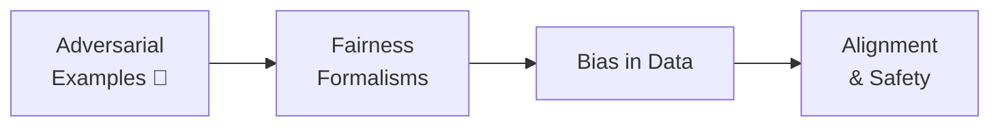

+++
date = "2026-07-02"
title = "Ethics, Fairness & Safety"
linkTitle = "Ethics & Safety"
weight = 90
book_part = true
tracks = ["beginner", "cogsci"]
+++

**The Mascot's Code.** At year's end, Chibany audits what the campus systems
actually learned — and writes a code of conduct for machines that learn from
people. Can the kiosk be fooled with a sticker? Is the cafeteria recommender
fair to every dorm — and what would "fair" even *mean*, stated as a
conditional probability? Whose priors did the models inherit from their data?
And when we trained the robot trainee with rewards, what did we *actually*
teach it?

{}
These chapters accompany Week 12 of the Human and Machine Learning course and
are being written now. The stubs below sketch each chapter's premise.
{}

## Chapters

{}

---

*This project is generously funded by the Japanese Probabilistic Computing
Consortium Association (JPCCA).*
