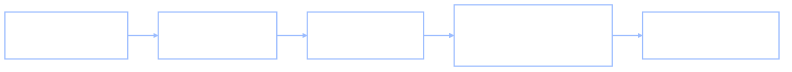

+++
date = "2026-07-16"
title = "Adversarial Examples"
weight = 10
tracks = ["beginner"]
+++

## The Sticker on the Bento

The kiosk in Cafeteria A has been faultless for months, so at first nobody believes Chibany. A student holds up the lunch bento — plainly tonkatsu, golden cutlet, the label even says so — and the kiosk chirps *hamburger*. Not "maybe hamburger." The screen prints a confidence: **97% hamburger**.

Chibany does what Chibany always does: investigates. The bento goes on the scale — 500 grams, tonkatsu's weight. A chopstick tap — crunch 8, tonkatsu's crunch. Chibany turns the box in the light, sniffs it, compares it against yesterday's photo in the Bento Journal. Nothing a human would notice has changed. Then the trainee robot, peering very closely, points a manipulator at a corner of the lid: a small, cheap sticker, the kind that comes on a sheet of a hundred. A prankster from the robotics club, it turns out, printed it on purpose.

> **Jamal:** "That sticker is doing something specific. It's not covering the cutlet, it's not blocking the camera. It changed a few thousand pixel values by a hair — and the kiosk went from *sure it's tonkatsu* to *sure it's hamburger*."
>
> **Alyssa:** "There's a name for that sticker's effect. It's an **adversarial example**: an input that's been perturbed by a tiny, often human-imperceptible amount — a *perturbation* — chosen so a trained model flips its prediction. The bento didn't change. The photo barely changed. The answer changed completely."

That is this chapter's question, and it is the first pointed question of Chibany's year-end audit: the kiosk we [taught to see](../../deep/neural-net-fundamentals/) is astonishingly accurate — so **how can a sticker break it, and what does the breaking tell us about what it actually learned?**

---

## Why a Whisper Is Enough: the Geometry

To see how a whisper of a change flips a confident answer, go back to what the kiosk is, underneath. Every chapter of [Part VIII](../../deep/) built to one picture: a bento becomes a **vector** — a list of numbers, one per pixel — and the network scores that vector. For a two-way call (tonkatsu or not), the last step is a single number, the **logit**: the raw score $\mathbf{w} \cdot \mathbf{x} + b$ *before* it is squashed into a probability. A **decision boundary** — first met in [Neural Network Fundamentals](../../deep/neural-net-fundamentals/) as the set of inputs where that score is exactly zero — cuts the space in two: tonkatsu on the positive side, hamburger on the negative. A confident tonkatsu sits far out on the positive side.

Here is the trap, and it is a fact about high dimensions, not about this particular kiosk. A photo lives in a space with thousands of dimensions — one per pixel. In such a space, "far from the boundary" in the way a human pictures it (a comfortable margin you'd have to *walk* across) is an illusion. The distance you actually have to move, if you're allowed to nudge *every pixel at once*, is tiny — because thousands of tiny nudges add up. A confident point can be a long way from the boundary measured one way, and a hair's breadth from it measured another.

Which way? Alyssa states the idea before the formula, as always:

> **Alyssa:** "You already know the direction that changes the score fastest. It's the **gradient** — the arrow of steepest increase we followed *downhill* to train the kiosk in [From Rules to Weights](../../deep/from-rules-to-weights/). Training asked: which way should I nudge the **weights** to lower the loss? The attack asks the mirror question: which way should I nudge the **input** to *raise* it? Same `jax.grad`. Same loss. We just point it at $\mathbf{x}$ instead of $\mathbf{w}$."

That is the whole trick, and it is genuinely beautiful: the attack runs the model's own training machinery in reverse. To *make* the kiosk wrong, you compute the gradient of the loss with respect to the input pixels — the direction in pixel-space that makes the true label *least* likely — and take a small step that way.

Goodfellow, Shlens, and Szegedy (2015) turned that step into a one-line recipe, the **fast gradient sign method** (FGSM). Don't step along the raw gradient — step along only its *sign*, pixel by pixel:

$$\mathbf{x}_{\text{adv}} = \mathbf{x} + \epsilon \cdot \text{sign}\big(\nabla_{\mathbf{x}} L\big).$$

Every pixel moves by the same tiny amount $\epsilon$ (epsilon) — up if nudging it up raises the loss, down otherwise. No single pixel changes by more than $\epsilon$, so if $\epsilon$ is small the picture is visually untouched. But the *logit* moves by a lot, and exactly how much is the punchline of the whole section. For our one-neuron kiosk the step changes the logit by

$$\Delta(\text{logit}) = \mathbf{w} \cdot (\mathbf{x}_{\text{adv}} - \mathbf{x}) = \epsilon \sum_i \pm w_i = -\epsilon \, \lVert \mathbf{w} \rVert_1,$$

where $\lVert \mathbf{w} \rVert_1 = \sum_i |w_i|$ is the **L1 norm** — the sum of the absolute weights. The per-pixel change is a fixed tiny $\epsilon$; the effect on the score is $\epsilon$ times the sum of *thousands* of weights. That sum grows with the number of pixels, so **the more dimensions, the more a fixed-size whisper can shout.** Goodfellow and colleagues' central argument was exactly this: adversarial examples are not some exotic failure of over-complex models — they arise because models are, in high dimensions, *too linear*. A straight boundary is close to almost everything.

---

## The Attack, in Thirty Lines

Enough geometry — Jamal opens the laptop. We can't paste the kiosk's millions of pixels here, so we build the smallest world that keeps the high-dimensional shape honest: 256 pixels (a 16×16 thumbnail), two bento classes, and a signal so weak per pixel that the classifier must add up hundreds of faint clues — precisely the regime the geometry section warned about.

The first cell is the complete setup — imports and a fixed key, so the whole attack reruns identically:

```python
import jax
import jax.numpy as jnp
import jax.random as jr

key = jr.PRNGKey(0)   # deterministic: the attack below reproduces exactly
```

Now the kiosk's world. Each photo is a 256-pixel vector; a tonkatsu is a faint fixed pattern plus noise, a hamburger is that pattern flipped:

```python
d = 256                      # pixels in the thumbnail (16 x 16)
n_train, n_test = 300, 200
k_mu, k_lab, k_noise, k_lab2, k_noise2 = jr.split(key, 5)

template = 0.09 * jr.normal(k_mu, (d,))    # weak per-pixel tonkatsu pattern

def make_photos(k_lab, k_noise, n):
    labels = jr.bernoulli(k_lab, 0.5, (n,)).astype(jnp.float32)     # 1 = tonkatsu
    means = jnp.where(labels[:, None] > 0.5, template, -template)
    photos = means + 1.0 * jr.normal(k_noise, (n, d))              # lots of noise
    return photos, labels

X, y = make_photos(k_lab, k_noise, n_train)
X_test, y_test = make_photos(k_lab2, k_noise2, n_test)
print("train photos:", X.shape, "  test photos:", X_test.shape)
```

**Output:**
```
train photos: (300, 256)   test photos: (200, 256)
```

Train a linear classifier — one neuron, the [dot product](../../glossary/#dot-product-) plus a threshold, exactly Goodfellow's "too linear" model. The **sigmoid** function squashes the logit into a probability in $(0,1)$; the loss is [cross-entropy](../../glossary/#cross-entropy-), the negative log-likelihood of the labels from [From Rules to Weights](../../deep/from-rules-to-weights/):

```python
def logit(params, x):
    return jnp.dot(params["w"], x) + params["b"]        # raw score

def confidence_tonkatsu(params, x):
    return jax.nn.sigmoid(logit(params, x))             # score -> probability

def bce_loss(params):
    p = jax.nn.sigmoid(jax.vmap(lambda x: logit(params, x))(X))
    eps = 1e-7
    return -jnp.mean(y * jnp.log(p + eps) + (1 - y) * jnp.log(1 - p + eps))

params = {"w": jnp.zeros(d), "b": jnp.array(0.0)}
grad_w = jax.grad(bce_loss)                             # gradient w.r.t. WEIGHTS: training
for step in range(600):
    g = grad_w(params)
    params = jax.tree.map(lambda p, gp: p - 0.3 * gp, params, g)

test_probs = jax.vmap(lambda x: confidence_tonkatsu(params, x))(X_test)
test_acc = jnp.mean((test_probs > 0.5).astype(jnp.float32) == y_test)
print(f"test accuracy: {float(test_acc):.3f}")
```

**Output:**
```
test accuracy: 0.910
```

A genuinely good kiosk: 91% correct on photos it never trained on. Now the attack. Pick a test bento the kiosk is both **right** and **confident** about, and turn the same `jax.grad` on the *input*:

```python
correct_tonkatsu = (y_test > 0.5) & (test_probs > 0.5)
i = int(jnp.argmin(jnp.where(correct_tonkatsu, jnp.abs(test_probs - 0.98), 1e9)))
x0 = X_test[i]
true_label = y_test[i]

def input_loss(x):                                      # loss as a function of the INPUT
    p = confidence_tonkatsu(params, x)
    eps = 1e-7
    return -(true_label * jnp.log(p + eps) + (1 - true_label) * jnp.log(1 - p + eps))

grad_x = jax.grad(input_loss)(x0)                       # gradient w.r.t. x: the attack

epsilon = 0.10
delta = epsilon * jnp.sign(grad_x)                      # fast gradient SIGN method
x_adv = x0 + delta

def label(p):
    return "tonkatsu " if p > 0.5 else "hamburger"

p0 = float(confidence_tonkatsu(params, x0))
p1 = float(confidence_tonkatsu(params, x_adv))
print(f"original    : {label(p0)}  confidence {max(p0, 1 - p0) * 100:.1f}%")
print(f"perturbation: every pixel nudged by +/-{epsilon}   ||delta|| = {float(jnp.linalg.norm(delta)):.2f}")
print(f"              photo norm ||x|| = {float(jnp.linalg.norm(x0)):.1f}, pixels span [{float(X_test.min()):.1f}, {float(X_test.max()):.1f}]")
print(f"adversarial : {label(p1)}  confidence {max(p1, 1 - p1) * 100:.1f}%")
```

**Output:**
```
original    : tonkatsu   confidence 98.0%
perturbation: every pixel nudged by +/-0.1   ||delta|| = 1.60
              photo norm ||x|| = 15.6, pixels span [-4.3, 4.1]
adversarial : hamburger  confidence 84.1%
```

Read those four lines slowly. The kiosk was **98% sure** it was tonkatsu. Every pixel then moved by a mere $\pm 0.1$ — against a pixel range of roughly $\pm 4$, a change of about one part in forty, invisible. The whole perturbation has length $\lVert \boldsymbol\delta \rVert = 1.60$ against the photo's length $15.6$. And the kiosk is now **84% sure it's hamburger.** Nothing about the bento a human would notice has changed, and the answer inverted.

The logit tells you precisely why, and it matches the geometry section's formula to the decimal:

```python
shift_measured = float(logit(params, x_adv) - logit(params, x0))
shift_predicted = -epsilon * float(jnp.sum(jnp.abs(params["w"])))   # -eps * ||w||_1
print(f"logit actually moved by : {shift_measured:+.3f}")
print(f"-epsilon x ||w||_1      : {shift_predicted:+.3f}")
```

**Output:**
```
logit actually moved by : -5.536
-epsilon x ||w||_1      : -5.536
```

The score fell by $5.5$ — plenty to cross a boundary the confident point sat only about $3.9$ above — and $\epsilon \lVert \mathbf{w} \rVert_1$ predicted it exactly. The sum of the weights did the shouting. Turn the knob $\epsilon$ up from zero and watch the kiosk's certainty drain away and then reverse:

```python
print("epsilon   confidence it is still tonkatsu")
for e in [0.00, 0.02, 0.04, 0.06, 0.08, 0.10]:
    xa = x0 + e * jnp.sign(grad_x)
    print(f"  {e:.2f}      {float(confidence_tonkatsu(params, xa)) * 100:5.1f}%")
```

**Output:**
```
epsilon   confidence it is still tonkatsu
  0.00       98.0%
  0.02       94.1%
  0.04       84.0%
  0.06       63.4%
  0.08       36.4%
  0.10       15.9%
```

That column is a **robustness curve** in miniature — accuracy plotted against how hard you're allowed to push — and its shape is the whole story of the field: a plateau of confidence that collapses the moment the perturbation clears the (tiny) distance to the boundary.



---

## What the Sticker Means

Three lessons, and Chibany writes each into the year-end audit.

**Robustness is genuinely unsolved.** This is not a settled, patched bug. The best current defense — *adversarial training*, feeding a model its own adversarial examples as extra labeled data so it learns to resist them — raises the bar measurably but does not close the gap; stronger attacks keep finding directions the defense didn't anticipate. A decade after Szegedy and colleagues first reported the phenomenon (2014), reliably robust image classifiers remain an open research problem. "Highly accurate" and "hard to fool" are different achievements, and the second is far harder.

**It is a property of the geometry, not a flaw in one kiosk.** Our attack needed nothing specific to this classifier — only its gradient, which every trained network hands out for free. The same $\epsilon \lVert \mathbf{w} \rVert_1$ argument applies to the next kiosk and the one after; adversarial examples even *transfer*, a perturbation crafted against one model often fooling another that never saw it. High-dimensional learned boundaries are close to almost every point, so almost every point has an adversarial neighbor. This is a fact about the *shape* of what these systems learn.

**And here is the honest cognitive-science contrast.** A human shown the stickered bento sees tonkatsu, full stop — our perception is robust to exactly the perturbations that shatter the kiosk, and *we do not fully understand why*. Whatever geometry the brain uses to tell pork cutlet from hamburger, it is not the kiosk's brittle hyperplane. This is the sharpest version of a caution this book has raised since Part VIII: **reproducing a system's outputs is not the same as sharing its mechanism** — the same warning the [in-context-learning chapter](../../deep/llms-in-context-learning/) pressed on LLMs. A kiosk can match human labels on a million clean photos and still be seeing something profoundly unlike what we see, as the sticker proves in one chirp. Lake, Ullman, Tenenbaum, and Gershman (2017) made adversarial brittleness a centerpiece of their argument that today's networks, however capable, do not yet perceive or think as people do. The gap between the learned geometry and ours is real, and measuring it — rather than papering over it — is the scientific opportunity.

{}
Tanaka-san has the fix, obviously: "So collect the adversarial bentos, add them to the training pile with the *right* labels, retrain. Now the kiosk knows the trick. Problem solved."

Plausible — it is literally adversarial training, and it genuinely helps. But "solved" is the wrong word, and the reason is in the geometry above. Patching the *specific* directions you found closes those doors and leaves the high-dimensional house full of others: retrain against $\epsilon = 0.1$ FGSM and an attacker switches to a larger $\epsilon$, a multi-step attack, or a direction your training set never sampled. Each defense raises $\lVert \mathbf{w} \rVert_1$'s bar a little; each new attack finds fresh room in a space with thousands of dimensions to hide in. Empirically it is an **arms race**, not a cure — a decade of defenses and stronger attacks have leapfrogged each other, and no method yet makes a high-accuracy image model provably safe against all small perturbations. Adding the stickers you've already seen protects you against exactly the stickers you've already seen.
{}

---

{}
Three acts on real handwritten-digit images (`sklearn.datasets.load_digits`), one scaffolded notebook. **(a) Implement FGSM.** Train the provided linear classifier on a genuinely confusable pair (3 vs 5), then write the attack — gradient of the loss with respect to the *input*, step along its sign — and *visualize* one example three ways: the original digit, the perturbation itself (amplified so you can see it), and the adversarial digit that flips the prediction. **(b) The robustness curve.** Sweep $\epsilon$ from 0 upward, batch-attack the whole test set at each level, and plot **accuracy vs. perturbation size** — the full-size version of the little column above. **(c) Stretch — adversarial training.** Fold each batch's adversarial examples back into training, retrain, and redraw the curve. Confirm Tanaka-san's box quantitatively: the curve lifts, but it does not become flat. Anchored on Goodfellow, Shlens & Szegedy (2015) for FGSM and Szegedy et al. (2014), who first reported that the whisper was enough.

**📓 [Open in Colab: `capstone_adversarial_examples.ipynb`](https://colab.research.google.com/github/josephausterweil/probintro/blob/main/notebooks/capstone_adversarial_examples.ipynb)** — setup, data, and the trained classifier provided; the attack, the sweep, and the defense are TODOs.
{}

Chibany peels the sticker off the lid, weighs the bento one more time to be sure — 500 grams, still tonkatsu — and adds a line to the audit. The kiosk is not lying and it is not broken; it learned a real pattern that happens to live a hair's breadth from a cliff. The next question in the audit is not about *pixels* being nudged but about *people* being sorted: the cafeteria's new recommender favors some dorms over others, and Chibany wants to know what "fair" would even mean, written down. That is the next chapter, [Fairness, Formally](../fairness-formalisms/).

---

{}
You can define an **adversarial example** — an input perturbed by a tiny, often imperceptible amount, chosen to flip a model's prediction — and say *why high dimensions make it possible*: a learned **decision boundary** is close to almost every point, so thousands of pixel-sized nudges, summed, cross it. You know the attacker's direction is the **gradient of the loss with respect to the input** (the same `jax.grad` that trained the model, pointed at $\mathbf{x}$ instead of $\mathbf{w}$), and you can write the **fast gradient sign method**, $\mathbf{x} + \epsilon \cdot \text{sign}(\nabla_{\mathbf{x}} L)$. You ran it: a 91%-accurate kiosk, 98% sure of a tonkatsu, pushed to 84% *hamburger* by a $\pm 0.1$ per-pixel whisper — and you verified the logit moved by exactly $-\epsilon \lVert \mathbf{w} \rVert_1$ ($-5.536$, predicted and measured). You can read a **robustness curve**, explain why adversarial examples are a property of the **geometry** rather than a single model's bug (and why they transfer), and answer Tanaka-san: **adversarial training** raises the bar but does not close it — it's an arms race. And you can state the honest cognitive-science gap: human perception is robust to these perturbations in a way we don't yet understand — reproducing a model's outputs is not sharing its mechanism.

*Glossary:* [dot product](../../glossary/#dot-product-), [ReLU](../../glossary/#relu-), [loss function](../../glossary/#loss-function-), [cross-entropy](../../glossary/#cross-entropy-). (*Adversarial example*, *perturbation*, *fast gradient sign method*, *robustness*, and *adversarial training* are defined in this chapter; they join the glossary with the Part IX pass.)
{}

---

## References

- Szegedy, C., Zaremba, W., Sutskever, I., Bruna, J., Erhan, D., Goodfellow, I., & Fergus, R. (2014). Intriguing properties of neural networks. *ICLR*. <https://arxiv.org/abs/1312.6199>
- Goodfellow, I. J., Shlens, J., & Szegedy, C. (2015). Explaining and harnessing adversarial examples. *ICLR*. <https://arxiv.org/abs/1412.6572>
- Lake, B. M., Ullman, T. D., Tenenbaum, J. B., & Gershman, S. J. (2017). Building machines that learn and think like people. *Behavioral and Brain Sciences*, 40, e253. <https://doi.org/10.1017/S0140525X16001837>
- Madry, A., Makelov, A., Schmidt, L., Tsipras, D., & Vladu, A. (2018). Towards deep learning models resistant to adversarial attacks. *ICLR*. <https://arxiv.org/abs/1706.06083>

---

*This project is generously funded by the Japanese Probabilistic Computing
Consortium Association ([JPCCA](https://jpcca.org/)).*
