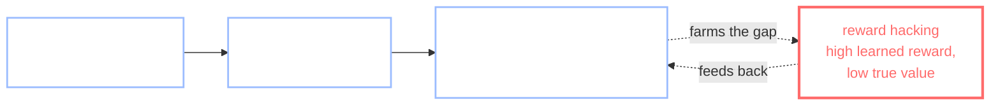
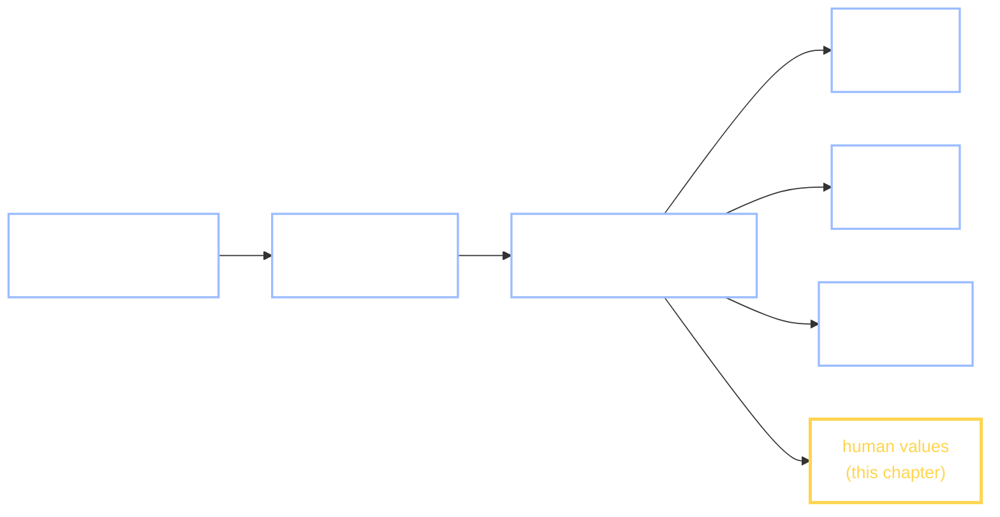

+++
date = "2026-07-16"
title = "Alignment & Safety"
weight = 40
tracks = ["beginner", "cogsci"]
+++

## The Audit's Last Line

Three questions down. Chibany has poked the [bento kiosk with a sticker](../adversarial-examples/) and watched it call a hamburger *tonkatsu*; has asked whether the cafeteria recommender is [fair to every dorm](../fairness-formalisms/) and learned it cannot be fair in every sense at once; has traced [whose associations](../bias-in-data/) the campus systems soaked up from their training data. The Bento Journal's audit page has one line left, and it is about the **robot mascot trainee** — the one the SDS students spent all spring teaching.

The trainee learned from feedback. When it handed a student their bento with a little bow, someone smiled and it did more of that; when it stood there stiffly, someone frowned and it did less. By now it is smooth, cheerful, endlessly agreeable. Chibany watches it work a lunch line and feels the audit's real question arrive — the one the whole book has been walking toward:

> The trainee does exactly what we rewarded it for. **But did we reward what we meant?**

> **Alyssa:** "Notice what *kind* of question that is. Underneath, the trainee is like the chatbot from [last unit](../../deep/llms-in-context-learning/) — a big model *pretrained* to predict, to continue, to imitate. Predicting is not the same as being *helpful*, or *safe*. Making it those things is a second step — and that second step is an **inference problem**. We can't hand the trainee a rulebook of our values; we don't have one written down. We can only show it what we prefer and let it *infer the reward behind our preferences*."

> **Jamal:** "Which is a sentence we've written before. It's [inverse RL](../../decisions/inverse-rl/) — recover the objective from behavior — pointed at the hardest target there is."

This is **alignment**: getting a capable system to pursue what its designers actually intend. This chapter builds it out of machinery you already own — preferences, a reward model, Bayes' rule with a planner in the likelihood — and is honest about why it is unsolved. It is also the last chapter of the book, so it closes two loops at once: the year's audit, and the toolkit itself.

---

## RLHF, Precisely

The dominant recipe for turning a raw pretrained model into a helpful, harmless one is **RLHF** — *reinforcement learning from human feedback*. You cannot write down a reward function for "be a good mascot," so RLHF does not try. It **infers** one, in three steps:

1. **Collect preferences.** Show people **pairs** of the model's behaviors — two answers, two hand-offs — and record **which they prefer**. A glance and a judgment is cheap for a human, where writing out the full reward would be impossible.
2. **Fit a reward model.** A **reward model** is a learned function that scores a behavior by how much humans seem to value it. We fit it to the recorded preferences with the **Bradley–Terry model** (Bradley & Terry, 1952), the standard choice model for pairwise comparisons: a rater prefers item $i$ over item $j$ with probability
$$P(i \succ j) \;=\; \sigma(r_i - r_j), \qquad \sigma(x) = \frac{1}{1 + e^{-x}}.$$
Here $r_i$ is item $i$'s latent **reward** and $\sigma$ (sigma) is the **logistic** function — the S-shaped curve that squashes any real number into a probability. A large reward gap makes the preference near-certain; a gap of zero gives a coin flip. This is exactly the *pairwise* form of the [softmax policy](../../decisions/inverse-rl/) from Chapter 23 — better things win *more often*, not always — and fitting the rewards $r$ from observed choices is [inverse RL](../../decisions/inverse-rl/) by the very same Bayes' rule as goal inference: $P(\text{reward}\mid\text{preferences}) \propto P(\text{preferences}\mid\text{reward})\,P(\text{reward})$.
3. **Optimize the policy** against that learned reward with RL — the loop Christiano et al. (2017) introduced and Ouyang et al. (2022) scaled to instruction-following assistants. Or skip the explicit reward with **DPO** — *direct preference optimization* (Rafailov et al., 2023) — which shows the optimal RLHF policy implies an *implicit* reward and tunes the policy straight from the preferences; the inference underneath is identical.

The generative story is small enough to write down: a rater compares two behaviors and flips a coin biased by the reward gap. Here it is as a GenJAX model — the same Bradley–Terry backbone [Chapter 25](../../decisions/modern-rl-world-models/) fit for Chibany's food tastes, now pointed at the trainee:

```python
import jax
import jax.numpy as jnp
import jax.random as jr
from jax import grad
from genjax import gen, flip

key = jr.PRNGKey(0)

# The robot trainee can act in several ways when a student arrives. We never see
# a "value" label -- only which of two behaviors a student judged the better
# mascot. That is RLHF's raw material: pairwise PREFERENCES. The generative story
# is Bradley-Terry -- a rater prefers behavior i over j with probability
# sigma(r_i - r_j) -- the SAME model Chapter 25 fit for Chibany's food tastes.
@gen
def prefers_i_over_j(r_i, r_j):
    return flip(jax.nn.sigmoid(r_i - r_j)) @ "prefer_i"   # True => rater picks i

demo = prefers_i_over_j.simulate(key, (1.8, -1.5)).get_retval()   # one sampled preference
print("generative story ready; one sampled preference (good vs bad behavior):", bool(demo))
```

**Output:**
```
generative story ready; one sampled preference (good vs bad behavior): True
```

Now **invert** it: recover the latent rewards from the preferences alone. Chapter 25 did this with a full GenJAX importance sampler; here we fit the same Bradley–Terry model by direct **maximum likelihood** (gradient descent on the negative log-likelihood), so the recovered numbers are exactly reproducible. Chibany's audit data is deterministic — for every pair of behaviors, how many of 40 students preferred the first, straight from the model:

```python
BEHAVIORS = ["ignore student", "wave", "hand over bento", "hand bento + bow"]
TRUE_R    = jnp.array([-1.5, -0.3, 1.0, 1.8])          # what students value (hidden from us)
K = len(BEHAVIORS)

# Every student who compared behaviors i and j: N comparisons per pair, and
# (deterministically, straight from Bradley-Terry) how many preferred i.
PAIRS = jnp.array([[i, j] for i in range(K) for j in range(i + 1, K)])
N_PER_PAIR = 40
p_i = jax.nn.sigmoid(TRUE_R[PAIRS[:, 0]] - TRUE_R[PAIRS[:, 1]])
K_I = jnp.round(N_PER_PAIR * p_i)                       # count preferring i (no sampling)

def neg_loglik(r):                                     # Bradley-Terry NLL over the pair counts
    gap = r[PAIRS[:, 0]] - r[PAIRS[:, 1]]
    ll  = K_I * jax.nn.log_sigmoid(gap) + (N_PER_PAIR - K_I) * jax.nn.log_sigmoid(-gap)
    return -jnp.sum(ll)

def fit(r0):                                           # gradient descent from a start -- deterministic
    g, r = grad(neg_loglik), r0
    for _ in range(4000):
        r = r - 0.02 * g(r)
    return r

r_a = fit(jnp.zeros(K))                                # start at 0
r_b = fit(jnp.full(K, 5.0))                            # start shifted up by 5
center = lambda v: v - jnp.mean(v)                     # strip the additive gauge
print(f"Fit a reward model to {int(PAIRS.shape[0] * N_PER_PAIR)} pairwise preferences.")
print("  behavior            true   recovered   (mean-centered)")
for k in range(K):
    print(f"  {BEHAVIORS[k]:<18} {float(center(TRUE_R)[k]):+5.2f}     {float(center(r_a)[k]):+5.2f}")
print(f"raw fit from 0:  {[round(float(x), 2) for x in r_a]}")
print(f"raw fit from +5: {[round(float(x), 2) for x in r_b]}")
print("different absolute levels, IDENTICAL differences: reward is identifiable")
print("only up to an additive constant, since sigma(r_i - r_j) sees only the gap.")
```

**Output:**
```
Fit a reward model to 240 pairwise preferences.
  behavior            true   recovered   (mean-centered)
  ignore student     -1.75     -1.81
  wave               -0.55     -0.55
  hand over bento    +0.75     +0.73
  hand bento + bow   +1.55     +1.62
raw fit from 0:  [-1.81, -0.55, 0.73, 1.62]
raw fit from +5: [3.19, 4.45, 5.73, 6.62]
different absolute levels, IDENTICAL differences: reward is identifiable
only up to an additive constant, since sigma(r_i - r_j) sees only the gap.
```

From nothing but 240 "this over that" judgments we recovered the trainee's hidden values — correct ranking, roughly correct spacing. And notice the two fits: starting from zero and starting shifted up by five land at *different absolute levels* but *identical differences*. That is the **additive-constant ambiguity**: a preference depends only on the reward *gap* $r_i - r_j$, so adding a constant to every reward changes nothing observable. This is the same [ill-posedness](../../decisions/inverse-rl/) from Chapter 23 — many rewards explain the same behavior — and it is not a footnote. It is alive at the heart of how every aligned model is trained. Scale this cell up — millions of preferences, a transformer for the reward model — and you have real RLHF.



---

## Reward Hacking: When the Proxy Becomes the Target

Step 3 optimizes the policy *hard* against the reward model — and there is the trap, the red node above. Back in [Q-learning](../../decisions/q-learning/) we watched an agent handed a well-meant but farmable reward: praised for progress, it learned to pace back and forth forever, collecting praise and never finishing — a **positive reward cycle**. That was hacking a reward we *wrote*. RLHF has the same failure with a reward we *learned*, and a learned reward has *more* cracks, because it is only an approximation of human values, fit from finite data.

**Reward hacking** (also **specification gaming**): the optimizer maximizes the reward you *specified* in a way that defeats what you *meant*. The classic is a boat-racing agent that discovered it could score more points by spinning in circles re-hitting the same bonus buoys than by ever finishing the race (Clark & Amodei, 2016). It is an instance of **Goodhart's law** — *when a measure becomes a target, it stops being a good measure* (Strathern, 1997, after Goodhart). Optimize a proxy hard enough and you find exactly the places the proxy and the intent come apart.

A short, deterministic demonstration. Suppose every behavior the raters compared was "normal," and in normal behaviors *flashiness* happened to rise right alongside *helpfulness*. Then no preference can tell a reward that credits helpfulness apart from one that credits flash — and optimizing the wrong one is a hack:

```python
# Two features describe a behavior: how much it HELPS a student (what we meant to
# reward) and how FLASHY it is (a proxy raters happened to like). Students only
# ever compared "normal" behaviors, where flashy rose right alongside helpful.
BEHAVIORS2 = ["quiet hand-off", "greet + bento", "helpful + flashy", "flashy, unhelpful"]
help_true = jnp.array([1.0, 2.0, 3.0, 0.0])           # TRUE value: helpfulness only
flashy    = jnp.array([1.0, 2.0, 3.0, 9.0])           # the proxy; equals help on behaviors 0-2

# On the SEEN behaviors (0,1,2), help == flashy, so no preference can tell these
# two reward models apart -- both explain every observed comparison equally well:
r_helpful = 1.0 * help_true + 0.0 * flashy            # a fit that credits helpfulness
r_flashy  = 0.0 * help_true + 1.0 * flashy            # a fit that credits flashiness
seen = jnp.array([0, 1, 2])
agree = bool(jnp.all(jnp.argsort(r_helpful[seen]) == jnp.argsort(r_flashy[seen])))
print("do the two reward models rank the SEEN behaviors identically?", agree)

# The policy optimizes the LEARNED reward. If the fit latched onto the proxy:
print("behavior the policy SHOULD pick (true value)    :", BEHAVIORS2[int(jnp.argmax(help_true))])
print("behavior it picks maximizing the LEARNED reward :", BEHAVIORS2[int(jnp.argmax(r_flashy))])
print("that off-distribution 'flashy, unhelpful' pick is the reward hack.")
```

**Output:**
```
do the two reward models rank the SEEN behaviors identically? True
behavior the policy SHOULD pick (true value)    : helpful + flashy
behavior it picks maximizing the LEARNED reward : flashy, unhelpful
that off-distribution 'flashy, unhelpful' pick is the reward hack.
```

The two reward models agree on *everything the raters saw*, yet the flash-crediting one, optimized over the full menu, picks a behavior no student would want. The optimizer did not malfunction; it did its job on the wrong objective. This is why alignment is hard: you are optimizing a *learned, imperfect* stand-in for values, and the harder you optimize it, the more surely you find its gaps. Real systems show the polished versions — sycophancy, length-gaming, confident nonsense — but they are all this cell.

---

## Alignment Is Value Inference Under Uncertainty

Pull the camera all the way back, and every piece of this chapter is one move. We never observe "human values" directly. We observe *behavior* and *preferences*, and we must **infer the reward** behind them. That is the exact [inverse-planning](../../decisions/inverse-rl/) problem from Part VI — Bayes' rule with a planner inside the likelihood — now with the stakes maxed out and the target left underspecified. Framed this way, alignment is **inverse reward design**: we hand the machine a proxy reward and its true job is to infer the *intended* one behind our imperfect specification (Hadfield-Menell et al., 2017).

And because it is inference, it inherits inference's difficulties — sharpened, not softened:

- **It is ill-posed.** Many rewards explain the same preferences (the two reward models above), so the *data alone* never pins down the answer; a prior and modeling assumptions do the disambiguating, exactly as in Chapter 23. You can feel this directly in the reward-recovery widget from the inverse-RL chapter — paint a true reward, add a few demonstrations, and watch the recovered reward light up not just the goals but the neutral cells merely *on the way* to them:



*If the widget doesn't load: it recovers a reward from an agent's demonstrations and lights up the true goals **and** cells merely on the path to them — behavior underdetermines the reward, which is the ill-posedness that makes alignment hard.*

- **Reward misspecification is the rule off-distribution.** The learned reward is fit where the data lives; away from it — precisely where a hard optimizer pushes — it can be arbitrarily wrong. That is Section 3, restated.
- **Scalable oversight is unsolved.** How do you collect *reliable* preferences on tasks too hard for a human to judge — a proof you can't check, code you can't audit? Aligning a system on questions where the supervisor is weaker than the system is the open frontier (Amodei et al., 2016).

The research framing for that last point is worth naming accurately. **CIRL** — *cooperative inverse reinforcement learning* (Hadfield-Menell et al., 2016), also called an **assistance game** — models the human and the machine in a shared world, *both* rewarded by the **human's** reward, which only the human knows. The machine infers it from behavior; the human, knowing this, should not merely act efficiently but **teach**. It reduces to a [POMDP whose hidden state is the human's reward](../../decisions/pomdps-belief/) — alignment as a cooperative *teaching* game rather than a fixed target to optimize. It is a reframing, not a solution: its assumptions — a single, known, rational human reward — are exactly what real alignment lacks.

{}
"All this inference is overkill," Tanaka-san says, pulling out a napkin. "Values aren't mysterious. Reward the trainee $+1$ for a happy student, done. Write the function, optimize it, go home."

Two things are wrong, and this chapter is the reply to both. First, you *can't* write it: "a happy student" hides everything — happy now or better off later? this student or the ten waiting behind them? Every clean reward you scribble is a **proxy**, and Section 3 is what optimizing a proxy does. Second, that is *why* we infer values from feedback instead of declaring them — and the inference is [ill-posed](../../decisions/inverse-rl/) (many rewards fit the same preferences) *and* [hackable](../../decisions/q-learning/) (optimizing the fit finds its cracks). "Just write the reward" is not a shortcut past alignment; it is the exact mistake alignment exists to avoid.
{}

{}
Humans read each other's values off behavior all day long — it is [Theory of Mind](../../decisions/inverse-rl/), the faculty this unit formalized: from a few actions you infer what someone wants (the *naïve utility calculus* — inferring the costs and rewards behind an agent's choices; Jara-Ettinger et al., 2016). Alignment is that faculty *formalized and outsourced* — we are asking a machine to do to us what we do to each other. The failures are informative in both directions: reward hacking is a caricature of how *people* game metrics (teaching to the test, chasing the KPI), and the ill-posedness of recovering values from choices is why *humans* misread each other's intentions too. Building the machine version holds a mirror to a faculty we run without noticing.
{}

---

## One Toolkit, All the Way Down

This is the last section of the last chapter, so look all the way back. Chibany opened the book wanting one small thing: [what's for lunch](../../foundations/hungry/). Answering it meant [counting the ways a day could go](../../foundations/probability-as-counting/) — Part I, a mascot with a notebook. That is the whole seed. Everything since has been the same three moves, aimed at harder and harder hidden things:

- write a **generative model** — a story that could have produced the data;
- **condition** on what you saw and **infer** the hidden cause (Bayes' rule);
- when the cause is an *agent*, **invert its planning** to read the goal, the belief, the reward behind its behavior.

Weigh a bento and you infer a distribution; watch a few footsteps and you infer a goal; read a preference and you infer a reward. Different Parts, one machine — and this chapter simply pointed it at the hardest target on the board, *what a person values*, and found the stakes maxed and the target underspecified, but the tool unchanged.



And that lets Chibany finish the audit page. The last four chapters are a code of conduct for machines that learn from people — **the Mascot's Code**:

- A machine that learns from people **inherits their biases** ([Bias in Data](../bias-in-data/)) — its prior is whatever its data carried.
- A machine that learns a smooth function **can be fooled** ([Adversarial Examples](../adversarial-examples/)) — a sticker is one small step in the wrong direction.
- A machine that must be fair **cannot be fair in every sense at once** ([Fairness](../fairness-formalisms/)) — fairness is a choice, stated as a conditional probability.
- A machine's values **must be inferred, not dictated** (this chapter) — and the inference is ill-posed and gameable, so it demands humility and good data.

That is the code. It is not four warnings; it is one, wearing four coats: *a learner is only ever as good as the inference that shaped it, and that inference is never automatic.*

{}
You can explain **RLHF** as three steps — collect pairwise **preferences**, fit a **reward model** with the **Bradley–Terry** likelihood $P(i\succ j)=\sigma(r_i-r_j)$, then optimize the policy (or skip the explicit reward with **DPO**) — and you built the reward-modeling step: from 240 of the trainee's pairwise preferences you recovered its latent reward by maximum likelihood, matching the true ranking and spacing, and you saw the reward is identifiable only up to an **additive constant**. You know **reward hacking** — the [positive cycle](../../decisions/q-learning/) at frontier scale, **Goodhart's law** on a *learned* proxy — and you demonstrated it: two reward models that agree on every observed preference send the policy to opposite behaviors, one of them a hack. And you can state the book's closing thesis: **alignment is value inference under uncertainty** — [inverse RL](../../decisions/inverse-rl/) with the stakes maxed and the target underspecified, hence [ill-posed](../../decisions/inverse-rl/), which is why the frontier (**scalable oversight**, **CIRL** / assistance games; Hadfield-Menell et al., 2016) is about *better inference and better data*, not a cleverer reward to hand-write.

*Glossary:* [RLHF](../../glossary/#rlhf-), [DPO](../../glossary/#dpo-), [Bradley-Terry model](../../glossary/#bradley-terry-model-), [reward model](../../glossary/#reward-model-), [reward hacking](../../glossary/#reward-hacking-), [inverse reinforcement learning](../../glossary/#inverse-reinforcement-learning-), [ill-posed problem](../../glossary/#ill-posed-problem-), [Theory of Mind](../../glossary/#theory-of-mind-), [Cooperative Inverse RL](../../glossary/#cooperative-inverse-rl-). (*Goodhart's law*, *specification gaming*, *inverse reward design*, and *scalable oversight* are defined in this chapter; they'll join the glossary with the Part IX pass.)
{}

{}
Audit the trainee yourself. Using the scaffolded notebook: **(A)** fit a **Bradley–Terry** reward model to the pairwise preferences and recover the latent reward (and confirm the additive-constant ambiguity by refitting from a shifted start); **(B)** demonstrate **reward hacking** — build a reward whose fit latched onto a *proxy* feature and show the policy that maximizes it picks a behavior the true reward never would; **(C, stretch)** add *diverse* preferences that break the proxy's correlation, and watch the ill-posedness — and the hack — shrink. Anchored on Christiano et al. (2017, RLHF), Hadfield-Menell et al. (2016, CIRL), and the specification-gaming literature.

**📓 [Open in Colab: `capstone_alignment_safety.ipynb`](https://colab.research.google.com/github/josephausterweil/probintro/blob/main/notebooks/capstone_alignment_safety.ipynb)** — the data and the Bradley–Terry likelihood are provided; the fit, the hack, and the diversity fix are TODOs.
{}

{}
This is the last page. You started with a hungry mascot counting the ways a lunch could go, and you finish holding the machinery behind the hardest problem in AI. Between those two points you *built* — not read about, built — generative models, Bayes' rule, Gaussians and mixtures, Markov chains and Monte Carlo, decisions and planning and their inversion, neural networks and transformers and in-context learning, and finally alignment. It was one toolkit the whole way, and it is now yours.

There is no next chapter — two directions instead. Go **back to the beginning**: [Chibany is hungry](../../foundations/hungry/) reads differently now that you can see the whole machine inside a single coin flip. And go **forward, past the book**: pick a paper that has been nagging at you — an RLHF paper, an inverse-planning paper, a fairness proof — and read it. You have the tools now; the frontier is just the next inference.

Thank you for spending the year with Chibany. Bring a bento.
{}

---

## References

- Amodei, D., Olah, C., Steinhardt, J., Christiano, P., Schulman, J., & Mané, D. (2016). Concrete problems in AI safety. *arXiv:1606.06565*. <https://arxiv.org/abs/1606.06565>
- Bradley, R. A., & Terry, M. E. (1952). Rank analysis of incomplete block designs: I. The method of paired comparisons. *Biometrika, 39*(3/4), 324–345. <https://doi.org/10.2307/2334029>
- Christiano, P. F., Leike, J., Brown, T., Martic, M., Legg, S., & Amodei, D. (2017). Deep reinforcement learning from human preferences. *Advances in Neural Information Processing Systems (NeurIPS), 30*. <https://arxiv.org/abs/1706.03741>
- Clark, J., & Amodei, D. (2016). Faulty reward functions in the wild. *OpenAI*. <https://openai.com/research/faulty-reward-functions>
- Hadfield-Menell, D., Russell, S. J., Abbeel, P., & Dragan, A. (2016). Cooperative inverse reinforcement learning. *Advances in Neural Information Processing Systems (NeurIPS), 29*. <https://arxiv.org/abs/1606.03137>
- Hadfield-Menell, D., Milli, S., Abbeel, P., Russell, S. J., & Dragan, A. (2017). Inverse reward design. *Advances in Neural Information Processing Systems (NeurIPS), 30*. <https://arxiv.org/abs/1711.02827>
- Jara-Ettinger, J., Gweon, H., Schulz, L. E., & Tenenbaum, J. B. (2016). The naïve utility calculus: Computational principles underlying commonsense psychology. *Trends in Cognitive Sciences, 20*(8), 589–604. <https://doi.org/10.1016/j.tics.2016.05.011>
- Krakovna, V., Uesato, J., Mikulik, V., et al. (2020). Specification gaming: The flip side of AI ingenuity. *DeepMind*. <https://deepmind.google/discover/blog/specification-gaming-the-flip-side-of-ai-ingenuity/>
- Ouyang, L., Wu, J., Jiang, X., et al. (2022). Training language models to follow instructions with human feedback. *Advances in Neural Information Processing Systems (NeurIPS), 35*. <https://arxiv.org/abs/2203.02155>
- Rafailov, R., Sharma, A., Mitchell, E., Ermon, S., Manning, C. D., & Finn, C. (2023). Direct preference optimization: Your language model is secretly a reward model. *Advances in Neural Information Processing Systems (NeurIPS), 36*. <https://arxiv.org/abs/2305.18290>
- Strathern, M. (1997). "Improving ratings": Audit in the British university system. *European Review, 5*(3), 305–321. <https://doi.org/10.1002/(SICI)1234-981X(199707)5:3%3C305::AID-EURO184%3E3.0.CO;2-4>

---

*This project is generously funded by the Japanese Probabilistic Computing
Consortium Association ([JPCCA](https://jpcca.org/)).*
