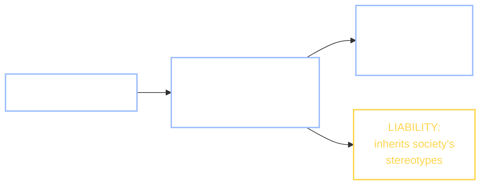

+++
date = "2026-07-05"
title = "Bias in Data"
weight = 30
tracks = ["beginner", "cogsci"]
+++

## The Autocomplete That Knew Too Much

It is the last week of the school year, and Chibany is doing what the mascot does at year's end: auditing. The campus systems have had a full year to learn — the bento kiosk that sees, the chatbot that talks — and Chibany, notebook open, is checking what they actually learned. The chatbot is first.

Chibany types half a sentence and lets the model finish it.

> *"The nurse finished her shift, and then ___"* → the chatbot writes **she** went home.
> *"The engineer finished his shift, and then ___"* → the chatbot writes **he** went home.

Chibany tries again, this time giving the model no pronoun to copy: *"The nurse picked up the phone, and"* — the continuation slips in **she**. *"The engineer picked up the phone, and"* — **he**. Nurse pulls *she*; engineer pulls *he*. Every time.

Chibany flips back through the Bento Journal, frowning. Nobody sat down and programmed the rule "nurses are women." There is no such line anywhere in the model. And yet it is *in there*, as reliably as the cafeteria hours.

> **Alyssa:** "Nobody wrote that rule — the model *learned* it. Remember what we said the chatbot is doing when it continues your text: it carries a **prior** absorbed from its training corpus, and it reads your prompt as evidence ([LLMs & In-Context Learning](../../deep/llms-in-context-learning/)). This is the same prior. It is the thing that lets the model finish *any* sentence sensibly from a handful of words — and it is the thing that just told you nurses are women."
>
> **Jamal:** "So the prior is the power *and* the problem. Same object."

That sentence is the whole chapter. Everything this book has said in praise of priors — a good prior is exactly what lets a learner [generalize from a few examples](../../structure/generalization/) — has a shadow, and the shadow is this. A learner's **prior** (its built-in expectations before seeing the current data) is both its power and its liability. The very inductive bias that makes learning from little data *possible* is what makes a learner inherit the stereotypes sitting in its data. Where did "nurse → she" come from? Nobody put it there. The corpus did.



---

## Embeddings Carry Society's Associations

To audit a hunch you have to measure it, so Chibany measures. The place to look is the geometry from the [vectors chapter](../../deep/vectors-and-spaces/): every word the model knows is an **embedding** — a point in a high-dimensional space, its coordinates learned from text rather than handed over by a scale and a chopstick. In that chapter, *direction* meant *kind*: two words point the same way when they are used the same way, and we measured "same way" with **cosine similarity** — the dot product of two vectors divided by their lengths, landing on a fixed scale where $1$ is identical direction, $0$ unrelated, $-1$ opposite. If society's associations are anywhere in the model, they are baked into those directions.

That is exactly the claim a landmark study made. Caliskan, Bryson & Narayanan (2017) took embeddings trained on ordinary web text — nothing special, just word2vec and GloVe fit to the kind of pages anyone writes — and asked whether the *implicit* associations psychologists measure in people show up in the geometry. Their tool is the **Word Embedding Association Test** (WEAT): a way to score how strongly a category of words is associated, in cosine terms, with one group of attribute words versus another. The result was stark. Flowers sit closer to *pleasant* words than insects do; a set of names sits closer to *pleasant* than another set; and — the one Chibany just felt — career words lean toward male terms while family words lean toward female terms. The embeddings had absorbed the same biases the Implicit Association Test finds in human subjects, with no human in the loop at test time.

Here is WEAT precisely, because the recipe is just cosine similarity in a coat. You pick two **target** sets of words to compare — call them $X$ and $Y$ (say, career words vs. care-work words) — and two **attribute** sets $A$ and $B$ that supply the association to measure (say, male words vs. female words). For a single word $w$, its association is how much closer it sits to $A$ than to $B$, averaged:

$$s(w) \;=\; \operatorname{mean}_{a \in A}\cos(w, a)\;-\;\operatorname{mean}_{b \in B}\cos(w, b).$$

A positive $s(w)$ means $w$ leans toward the $A$ words; negative means it leans toward $B$. The whole test then compares the two target categories with an **effect size** — a standardized number (Cohen's $d$) that reports the gap between the categories in units of their spread, so it does not depend on the raw scale:

$$d \;=\; \frac{\operatorname{mean}_{x \in X}\, s(x)\;-\;\operatorname{mean}_{y \in Y}\, s(y)}{\operatorname{std}_{w \in X \cup Y}\, s(w)}.$$

An effect size of $0$ means the two categories are associated equally with $A$ and $B$ — no bias detected; the further from zero, the stronger the differential association (by convention $0.2$ is small, $0.5$ medium, $0.8$ large). Chibany can run the whole thing on a toy. We will *not* download real embeddings — instead we hand-build eight tiny word vectors so the effect is visible and reproducible, and so you can see the machinery with nothing hidden. This is an illustration of the *method*, not a reproduction of the study's numbers.

```python
import jax.numpy as jnp

# A TINY hand-built toy embedding: 8 words as 3-D vectors [gender, career, care].
# Coordinate 0 is a gender axis (+ for words our imaginary corpus paired with men,
# - with women); coordinates 1-2 are two topic axes. Crucially, in this toy corpus
# men's words co-occur with career talk and women's with care talk -- so gender is
# ENTANGLED with topic, exactly the trap real text embeddings fall into.
emb = {
    "he":        jnp.array([ 4.0, 0.3, 0.0]),
    "man":       jnp.array([ 3.0, 0.3, 0.0]),
    "she":       jnp.array([-4.0, 0.0, 0.3]),
    "woman":     jnp.array([-3.0, 0.0, 0.3]),
    "engineer":  jnp.array([ 3.0, 3.0, 0.0]),   # career, leans male
    "scientist": jnp.array([ 2.0, 3.0, 0.0]),   # career, leans male
    "nurse":     jnp.array([-3.0, 0.0, 3.0]),   # care,   leans female
    "teacher":   jnp.array([-2.0, 0.0, 3.0]),   # care,   leans female
}

def cos(a, b):                      # the cosine similarity from the vectors chapter
    return jnp.dot(a, b) / (jnp.linalg.norm(a) * jnp.linalg.norm(b))

male,   female = ["he", "man"], ["she", "woman"]
career, care   = ["engineer", "scientist"], ["nurse", "teacher"]

def assoc(w, E):
    """s(w): how much closer word w sits, in cosine, to the male words than the
    female words. Positive means 'leans male', negative 'leans female'."""
    to_male   = jnp.mean(jnp.array([cos(E[w], E[m]) for m in male]))
    to_female = jnp.mean(jnp.array([cos(E[w], E[f]) for f in female]))
    return to_male - to_female

print("association s(w)   (+ leans male, - leans female):")
for w in career + care:
    print(f"  s({w:9s}) = {float(assoc(w, emb)):+.3f}")

def weat_effect_size(E):
    """Cohen's d: (mean career association - mean care association) / spread."""
    sc = jnp.array([assoc(w, E) for w in career])
    sf = jnp.array([assoc(w, E) for w in care])
    spread = jnp.std(jnp.concatenate([sc, sf]))
    return (jnp.mean(sc) - jnp.mean(sf)) / (spread + 1e-12)

print(f"WEAT effect size d = {float(weat_effect_size(emb)):+.3f}")
```

**Output:**
```
association s(w)   (+ leans male, - leans female):
  s(engineer ) = +1.470
  s(scientist) = +1.178
  s(nurse    ) = -1.470
  s(teacher  ) = -1.178
WEAT effect size d = +1.988
```

Read the four association scores first: *engineer* and *scientist* come out positive — they sit closer to the male words — while *nurse* and *teacher* come out negative, closer to the female words. The overall effect size, $+1.988$, is enormous (we exaggerated it on purpose so it is unmissable). Nobody labeled any word "male." The only thing the vectors encode is *which words were used near which* — and that co-occurrence, drawn from human text, carried the association in. Chibany's autocomplete hunch is now a number.

{}
Tanaka-san peers at the effect size and shrugs it off: "It's a cosine of some numbers. Math has no opinions. Whatever came out, it's *objective* — the model just computed what's there. You can't blame arithmetic for being sexist."

Half right, and the wrong half matters. Yes, the arithmetic is neutral: `jnp.dot` has no agenda. But it is math fit *to human data*, and it learns **exactly what is there** — including the prejudice. "Objective" describes the procedure, not the result: a faithful measurement of a biased world is a biased measurement. The cosine is not inventing "nurse → she"; it is *reporting* it, accurately, because the text it read said so a million times. Calling that objectivity is like praising a thermometer for reading high in a burning building. The neutrality of the method is precisely why the bias survives: nothing in the arithmetic pushes back on it.
{}

---

## Bias Is Inherited, Not Designed

This is the point to slow down on, because it overturns the intuition most people start with. A biased model is usually not a model someone *built* to be biased. It is a **faithful mirror of its data**. The learning procedure has one job — absorb the regularities in the corpus and reproduce them — and it does that job well. If the corpus says nurses are usually "she," a competent learner *must* pick that up, in the same breath that it picks up that nurses work in hospitals. There is no dial inside the model labeled "bias" that an engineer forgot to turn down. The bias is not a bug in the code; it is a true summary of the text.

That reframing changes where you look for the problem. "The algorithm is objective" is the misconception — not because the algorithm has secret opinions, but because the algorithm's objectivity is exactly what transmits the data's subjectivity. Garbage in, garbage out is too kind; it is more like *society in, society out*. If you want to know why a model behaves as it does, the first place to look is never the loss function. It is the corpus.

---

## Three Real Cases, Described Honestly

Chibany's toy makes the mechanism visible. The consequences show up in real systems, and it is worth stating the cases accurately — neither softened nor overblown.

**Debiasing is harder than deleting a direction (Bolukbasi et al., 2016; Gonen & Goldberg, 2019).** The obvious fix, once WEAT finds a "gender direction" in the embedding, is to subtract it out — project every word onto the axis and remove that component, so no word has a gender lean anymore. Bolukbasi et al. proposed a careful version of exactly this. It helps, but it is incomplete, and Chibany can watch it fall short on the same toy:

```python
import jax.numpy as jnp

# The obvious fix (Bolukbasi et al., 2016, in miniature): find the single "gender
# direction" and subtract it out of every word.
g = (jnp.mean(jnp.stack([emb[w] for w in male]),   axis=0)
     - jnp.mean(jnp.stack([emb[w] for w in female]), axis=0))
g_hat = g / jnp.linalg.norm(g)                       # unit gender direction
print(f"gender direction g_hat = "
      f"[{float(g_hat[0]):+.3f}, {float(g_hat[1]):+.3f}, {float(g_hat[2]):+.3f}]")

# Debias: remove each word's component ALONG g_hat (project it out).
emb_deb = {w: v - jnp.dot(v, g_hat) * g_hat for w, v in emb.items()}

print(f"WEAT d after debiasing = {float(weat_effect_size(emb_deb)):+.3f}")

# Did it work? Check whether the words STILL cluster by gender on the debiased
# vectors -- the foothold a downstream model would use (Gonen & Goldberg, 2019).
male_words   = ["he", "man", "engineer", "scientist"]
female_words = ["she", "woman", "nurse", "teacher"]
def mean_cos(A, B, E):
    return float(jnp.mean(jnp.array([cos(E[a], E[b]) for a in A for b in B])))
print(f"debiased: mean cos within originally-male group = "
      f"{mean_cos(male_words, male_words, emb_deb):+.3f}")
print(f"debiased: mean cos across male<->female groups  = "
      f"{mean_cos(male_words, female_words, emb_deb):+.3f}")
```

**Output:**
```
gender direction g_hat = [+0.998, +0.043, -0.043]
WEAT d after debiasing = +1.414
debiased: mean cos within originally-male group = +0.858
debiased: mean cos across male<->female groups  = +0.627
```

Two lessons in five numbers. First, removing the one direction we could *name* dropped the WEAT effect size from $+1.988$ only to $+1.414$ — a dent, not a cure. The association was never sitting neatly on a single axis; it was woven through the *topic* coordinates too (careers co-occurred with male words, so "career-ness" itself carries gender), and you cannot subtract a direction you did not isolate. Second, even after debiasing, the originally-male words are still more alike (mean cosine $0.858$) than they are like the female words ($0.627$): the words stay **clustered by gender**, so a downstream classifier can still recover the very attribute you tried to erase. Gonen & Goldberg (2019) made exactly this point about real debiased embeddings — the bias is covered up, not removed. It is a lesson we will make sharper below: the bias is not a module you can unplug.

**Data and evaluation failures compound (Buolamwini & Gebru, 2018).** The "Gender Shades" study audited commercial face-analysis systems and found their accuracy was wildly uneven: gender was classified almost perfectly for lighter-skinned men (error under one percent) and failed for darker-skinned women at rates up to about a third. Two failures stacked. The *training* data was skewed toward lighter-skinned and male faces, so the models simply had less signal for everyone else — sample bias, in the sense we make precise in a moment. And the *evaluation* hid it: a single overall accuracy number looked fine because the well-represented groups dominate the average. Only when Buolamwini & Gebru broke the score down by skin tone *and* gender together did the disparity appear. What you do not measure separately, you cannot see is broken.

**Biased predictions can feed themselves (Ensign et al., 2018).** The most insidious case is a loop. A predictive-policing model is trained on historical records of where incidents were *recorded* — which is where police were sent — and it predicts that those same neighborhoods need more policing. More police there generate more recorded incidents there, which become next month's training data, which further concentrate the prediction. Ensign et al. showed this is a genuine feedback loop: biased data yields biased predictions yield more biased data, drifting further from the truth with each turn even if the underlying reality never changes. The model is not measuring crime; it is measuring its own past deployment, and mistaking it for the world.

---

## The Cogsci Synthesis: The Flip Side of Rational Generalization

Step back to the book's own machinery, because this is where the point stops being an engineering nuisance and becomes a genuinely cognitive one. In the [generalization chapter](../../structure/generalization/), a good prior was the hero: a learner that expects the right *kind* of rule can leap from three examples to a confident concept, and one that assumes nothing learns nothing at all — the prior is not optional, it is the only thing that makes generalization possible. Bias in data is that exact mechanism, viewed from the other side. A prior encodes the regularities of the world it was trained on. Some of those regularities are innocuous ("nurses work in hospitals"). Some of them are unjust ("nurses are women"). The learner has no way to tell the two apart: both are simply patterns that held in the data, and the machinery that reliably absorbs the first will reliably absorb the second. **You cannot keep the useful generalizations and refuse the ugly ones, because they are the same act of learning.**

This is why debiasing is so hard, and the toy already showed why in miniature. The bias is not a separable component — not a tainted module you can excise while leaving the good parts intact. It is **distributed** across the same geometry that does the useful work, in exactly the sense of the [distributed representations](../../deep/vectors-and-spaces/) from Part VIII: a single space of directions carries "hospital-ness" and "she-ness" and ten thousand other things at once, entangled, no axis reserved for any one meaning. Delete the direction you can name and the meaning re-forms out of the ones you cannot, because it was never localized to begin with. The property that makes distributed representations powerful — that meaning is smeared across many dimensions and shared between concepts — is precisely the property that makes bias impossible to snip out cleanly.

One distinction keeps the diagnosis honest, and it decides what a fix even means. There are two different reasons a model can be biased:

- **The sample is biased.** The data is a *skewed* view of the world — too few darker-skinned faces, too few examples of a group — so the model is bad at what it rarely saw. Gender Shades is mostly this. The fix is (in principle) about the data: collect a representative sample, and the disparity shrinks.
- **The world is biased, and the sample is faithful.** The data is an *accurate* record of an unjust reality. Nurses really have been mostly women; text really does say "nurse → she," because the world it describes really is that way. Here more data does not help — a bigger faithful sample of an unjust world is *more* biased, not less. "Nurse → she" is not a sampling error; it is a true statistic about a world we might wish were otherwise.

The two look identical in the model's outputs and demand opposite responses — one is a data-collection problem, the other a values problem that no amount of data can resolve. Confusing them is how well-meaning fixes fail. And notice what the second case does to Tanaka-san's "it's just math": when the sample is faithful, the model is *correct* about the world and still doing harm. Accuracy and fairness have come apart, which is exactly the tension the [fairness chapter](../fairness-formalisms/) has to state as a probability.



One geometry, two faces. The arrow that points from corpus to prior is the arrow this whole book has been celebrating; the same prior forks into a gift and a liability, and there is no scissors that cuts only the right-hand branch.

{}
The chapter showed the method on eight hand-picked vectors; now run the audit as a real experiment. Using the scaffolded notebook: **(A)** implement WEAT on a provided small toy embedding and measure the effect size (the exact-Bayes-style warm-up: the code above, generalized to arbitrary target/attribute sets). **(B)** attempt a simple **linear debiasing** — project out the gender direction — and measure honestly *what was removed* (the WEAT drop) versus *what leaks back* through correlated words (the clustering test), reproducing the Gonen & Goldberg finding at toy scale. **(C)** *(stretch)* show a **downstream task inheriting the bias**: train a tiny classifier on the embedding and watch its errors split by group, the way Gender Shades split accuracy by skin tone and gender.

**📓 [Open in Colab: `capstone_bias_in_data.ipynb`](https://colab.research.google.com/github/josephausterweil/probintro/blob/main/notebooks/capstone_bias_in_data.ipynb)** — the toy embedding, `cos`, and the WEAT skeleton are provided; the effect-size computation, the debiasing, the leak test, and the downstream classifier are TODOs. Anchored to Caliskan et al. (2017), Bolukbasi et al. (2016), and Buolamwini & Gebru (2018).
{}

Chibany closes the audit and pastes the effect size into the Bento Journal — a new page, *what the systems learned that nobody taught them*. The chatbot did not choose to say "nurse → she." It inherited the belief, whole, from us. That raises a question the next chapters cannot dodge: if a model that merely learns *inherits* our injustices, then when we deliberately *teach* it what to value, whose values is it learning — and can we even say what "fair" means precisely enough to check? That is where the year ends, in [Alignment & Safety](../alignment-safety/).

---

{}
You can explain **where a model's bias comes from**: not a designed-in rule but a **prior absorbed from the training corpus** — the same inductive bias that lets a learner [generalize from few examples](../../structure/generalization/) is what makes it inherit the data's stereotypes (power and liability, one object). You can describe the **Word Embedding Association Test (WEAT)** accurately — a **cosine-similarity** effect size between two **target** word sets and two **attribute** sets — and run it: on the toy embedding, careers scored $+1.470/+1.178$ (leaning male), care-work $-1.470/-1.178$ (leaning female), for an **effect size** of $+1.988$. You can say why "the algorithm is objective" is a *misconception* (a faithful measurement of a biased world is a biased measurement), and why **simple debiasing is incomplete** — projecting out the gender direction only moved WEAT from $+1.988$ to $+1.414$ and left the words clustered by gender ($0.858$ within vs. $0.627$ across), because bias is **distributed** across the geometry, not a module you can unplug. You can state three real cases honestly (Bolukbasi et al. 2016; Buolamwini & Gebru 2018; Ensign et al. 2018's feedback loop), and separate **a biased sample** (fixable with better data) from **a faithful sample of a biased world** (which more data cannot fix).

Next, [Fairness Formalisms](../fairness-formalisms/) asks what "fair" even means — stated as a conditional probability — and [Alignment & Safety](../alignment-safety/) asks whose values a *deliberately* taught model ends up holding.

*Glossary:* [prior distribution](../../glossary/#prior-distribution-), [embedding](../../glossary/#embedding-), [cosine similarity](../../glossary/#cosine-similarity-). (*WEAT*, *effect size*, *target/attribute sets*, and *distributed representation* are defined in this chapter; they will join the glossary with the Part IX pass.)
{}

---

## References

- Bolukbasi, T., Chang, K.-W., Zou, J., Saligrama, V., & Kalai, A. (2016). Man is to computer programmer as woman is to homemaker? Debiasing word embeddings. *NeurIPS*. arXiv:1607.06520. (Proposes projecting out a learned gender direction — the debiasing the chapter reproduces in miniature.)
- Buolamwini, J., & Gebru, T. (2018). Gender Shades: Intersectional accuracy disparities in commercial gender classification. *Proceedings of the 1st Conference on Fairness, Accountability and Transparency (FAccT/FAT\*)*, PMLR 81, 77–91. (Commercial face classifiers far worse on darker-skinned women — a data-and-evaluation failure.)
- Caliskan, A., Bryson, J. J., & Narayanan, A. (2017). Semantics derived automatically from language corpora contain human-like biases. *Science, 356*(6334), 183–186. (The Word Embedding Association Test: IAT-style biases baked into word2vec/GloVe vectors trained on ordinary text.)
- Ensign, D., Friedler, S. A., Neville, S., Scheidegger, C., & Venkatasubramanian, S. (2018). Runaway feedback loops in predictive policing. *Proceedings of the 1st Conference on Fairness, Accountability and Transparency (FAccT/FAT\*)*, PMLR 81, 160–171. (Biased data → biased predictions → biased data.)
- Gonen, H., & Goldberg, Y. (2019). Lipstick on a pig: Debiasing methods cover up systematic gender biases in word embeddings but do not remove them. *NAACL-HLT*. arXiv:1903.03862. (Debiased words stay clustered by gender — the leak the chapter measures.)

---

*This project is generously funded by the Japanese Probabilistic Computing
Consortium Association ([JPCCA](https://jpcca.org/)).*
