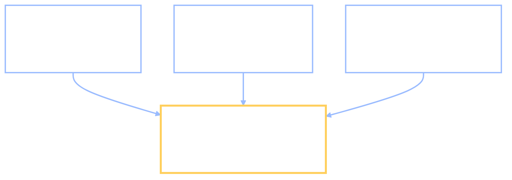

+++
date = "2026-07-16"
title = "Fairness, Formally"
weight = 20
tracks = ["beginner", "cogsci"]
+++

## Which Fairness Does Chibany Mean?

The campus bento-shop recommender has been running all semester. Every student who opens it gets a short list of shops to try tonight, ranked. This week the complaints arrived: **Sakura dorm** says the recommender keeps steering them to the same three tired shops, while **Kaede dorm** gets the good new ones. Kaede dorm says the opposite. Both feel cheated.

Chibany, who has been keeping score in the Bento Journal all year, pads over to the grad-student office with the single question a mascot always asks: *is it fair?*

> **Alyssa:** "That's the trap in the question, Chibany. You said 'fair' like it's one thing. It isn't. There are several precise notions of fairness — each one is a statement about a **conditional probability** — and here's the part nobody wants to hear: **they contradict each other.** You can't have them all. So before we can answer 'is it fair,' someone has to choose *which* fairness we even mean."

That is the whole chapter in one breath, and it is the payoff a probability book can give an ethics unit that an ordinary ethics unit cannot. "Fair" is not a feeling to be argued about; each version of it is an *equation* in the language we built back in [Conditional Probability](../../foundations/conditional-probability/) — the chapter where conditioning meant **restricting the outcome space** and writing $P(A \mid B)$ for "the probability of $A$ once we know $B$." We are about to write three different fairness conditions in exactly that notation, compute them on real numbers, and watch them collide.

---

## A Decision With a Ground Truth

A ranked list of shops is fuzzy — "favoring" a dorm is hard to pin down. To get crisp numbers, Alyssa swaps in a cleaner decision the student council actually makes: a **food-truck micro-loan**. A truck applies; the council's model says **approve** or **deny**; and later we find out whether the truck would have *succeeded* (paid the loan back and kept trading) or not. A yes/no decision with a yes/no ground truth is exactly what fairness formulas need.

Let us lock in four symbols and use them for the rest of the chapter.

- $\hat{Y}$ — the **prediction** (the "hat" means *estimated*): $\hat{Y}=1$ approve, $\hat{Y}=0$ deny.
- $Y$ — the **truth**: $Y=1$ the truck would succeed, $Y=0$ it would not.
- $G$ — the **group**: $G=a$ for Sakura dorm, $G=b$ for Kaede dorm.
- $\hat{S}$ — the model's **risk score**, which it thresholds into $\hat{Y}$. Here the score is coarse: it sorts each applicant into a **low** or **high** bin, and the model approves exactly the high-bin trucks.

Now the crux, the fact everything below turns on: **the two dorms have different base rates.** The **base rate** (or **prevalence**) is $P(Y=1 \mid G)$ — the fraction of that group's trucks that would actually succeed. Sakura dorm sits by the station with heavy foot traffic, so more of its trucks would thrive; Kaede dorm is tucked behind the gym. This is a fact about *circumstance*, not about any truck's merit — and, as we will see, it is enough to make fairness impossible to fully satisfy.

Here is a semester of applications, tallied. Each dorm's trucks are split by score bin, and within each bin by what actually happened.

{}
Cross a yes/no prediction with a yes/no truth and you get four counts — the **confusion matrix**:

- **TP** (true positive): approved and would succeed.
- **FP** (false positive): approved but would fail.
- **FN** (false negative): denied but would have succeeded.
- **TN** (true negative): denied and would fail.

From these four we read three **rates**, each a conditional probability. Every rate is computed *within a group* $G$ — one set for Sakura, one for Kaede — so read each $P(\cdot)$ as conditioned on $G$ even where the symbol is dropped for brevity:

- **TPR**, the **true-positive rate** $= P(\hat{Y}=1 \mid Y=1, G) = \frac{\text{TP}}{\text{TP}+\text{FN}}$ — of the trucks that *would* succeed, what fraction did we approve? (Also called *sensitivity* or *recall*.)
- **FPR**, the **false-positive rate** $= P(\hat{Y}=1 \mid Y=0, G) = \frac{\text{FP}}{\text{FP}+\text{TN}}$ — of the trucks that would *fail*, what fraction did we wrongly approve?
- **PPV**, the **positive predictive value** $= P(Y=1 \mid \hat{Y}=1, G) = \frac{\text{TP}}{\text{TP}+\text{FP}}$ — of the trucks we approved, what fraction actually succeed? (Also called *precision*.)
{}

Let us compute those rates for each dorm. The `bins` table below is our whole dataset; the code just does the arithmetic the box above defines.

```python
import numpy as np

# bins[dorm] = rows = score bin (low, high), cols = true outcome (fail Y=0, succeed Y=1)
bins = {
    "Sakura": np.array([[ 75,  25],     # low  bin: 75 fail, 25 succeed
                        [100, 300]]),    # high bin: 100 fail, 300 succeed
    "Kaede":  np.array([[300, 100],
                        [ 25,  75]]),
}

def confusion(dorm):
    """Classifier approves iff the applicant is in the HIGH score bin."""
    low, high = bins[dorm]
    TN, FN = low[0], low[1]      # denied  (score low):  correctly (fail) / wrongly (succeed)
    FP, TP = high[0], high[1]    # approved (score high): wrongly (fail) / correctly (succeed)
    return TP, FP, FN, TN

for dorm in ("Sakura", "Kaede"):
    TP, FP, FN, TN = confusion(dorm)
    n = TP + FP + FN + TN
    base_rate = (TP + FN) / n            # P(Y=1 | G): success prevalence
    approve   = (TP + FP) / n            # P(Yhat=1 | G): overall approval rate
    TPR = TP / (TP + FN)                 # P(Yhat=1 | Y=1, G): true-positive rate
    FPR = FP / (FP + TN)                 # P(Yhat=1 | Y=0, G): false-positive rate
    PPV = TP / (TP + FP)                 # P(Y=1 | Yhat=1, G): positive predictive value
    print(f"{dorm:6s}  base_rate={base_rate:.2f}  approve_rate={approve:.2f}  "
          f"TPR={TPR:.3f}  FPR={FPR:.3f}  PPV={PPV:.3f}")
```

**Output:**
```
Sakura  base_rate=0.65  approve_rate=0.80  TPR=0.923  FPR=0.571  PPV=0.750
Kaede   base_rate=0.35  approve_rate=0.20  TPR=0.429  FPR=0.077  PPV=0.750
```

Read the two rows against each other. The base rates differ exactly as promised (**0.65** vs **0.35**). The two dorms are approved at wildly different rates (**0.80** vs **0.20**). Their error rates differ too: Sakura's failing trucks get wrongly approved **57%** of the time, Kaede's only **8%**. And yet — hold onto this — an approved truck has the **same** chance of succeeding, **0.75**, in *both* dorms. One classifier, three completely different stories, depending on which conditional probability you look at. Each of those stories has a name.

---

## Three Fairnesses, Three Equations

Here are the three criteria that dominate the field, each stated the way Alyssa insisted — as an equality between conditional probabilities — with a plain-language gloss and the verdict on *our* classifier. Read $=a$ and $=b$ as "for Sakura" and "for Kaede."

| Criterion | As a conditional-probability equation | In plain words | On our classifier |
|---|---|---|---|
| **Demographic parity** | $P(\hat{Y}{=}1 \mid G{=}a) = P(\hat{Y}{=}1 \mid G{=}b)$ | both groups are approved at the same **rate** | $0.80$ vs $0.20$ — **fails** |
| **Equalized odds** | $P(\hat{Y}{=}1 \mid Y{=}y, G{=}a) = P(\hat{Y}{=}1 \mid Y{=}y, G{=}b)$ for each $y$ | equal **error rates**: TPR and FPR matched across groups | TPR $0.92$/$0.43$, FPR $0.57$/$0.08$ — **fails** |
| **Calibration** (sufficiency) | $P(Y{=}1 \mid \hat{S}{=}s, G{=}a) = P(Y{=}1 \mid \hat{S}{=}s, G{=}b)$ | a **score means the same thing** in each group | $0.75$ / $0.25$ in both — **holds** |

This is the one row that conditions on the **score** $\hat{S}$ rather than the decision $\hat{Y}$ — because it asks what a score is *worth*, not what the model *did*. Here the two coincide: the model approves exactly the high-bin trucks, so the high score *is* the set of approvals. With a two-valued score, calibration on "high" is therefore the same statement as **predictive parity** — equal PPV — which is the form the impossibility below actually uses.

Three sentences of intuition, one per row:

- **Demographic parity** looks *only* at $\hat{Y}$ and $G$ — never at the truth $Y$. It demands equal approval rates, full stop. It is the "equal outcomes" notion, and it deliberately ignores whether the groups actually differ in success. Our classifier flunks it 0.80 to 0.20.
- **Equalized odds** conditions on the truth $Y$: *among the trucks that would succeed*, both groups should be approved equally often (equal TPR), and *among the trucks that would fail*, both should be wrongly approved equally often (equal FPR). It is the "equal error rates" notion — a mistake should be as likely for you whichever dorm you are from. This is the criterion **ProPublica** used to indict COMPAS; more on that shortly. Our classifier flunks it badly.
- **Calibration** (also called **sufficiency**) conditions on the *score*: whatever a "high" score is worth, it should be worth that in every group — a high-scoring Sakura truck and a high-scoring Kaede truck should succeed equally often. Our classifier was built to satisfy exactly this: high means 0.75 and low means 0.25 in **both** dorms. It **holds**.

Verify the calibration claim, and print the three verdicts, straight from the same `bins` table.

```python
# Calibration: does a score bin mean the same success rate in both dorms?
for dorm in ("Sakura", "Kaede"):
    for i, name in ((0, "low"), (1, "high")):
        fail, succeed = bins[dorm][i]
        p_success = succeed / (fail + succeed)          # P(Y=1 | S=bin, G)
        print(f"{dorm:6s} S={name:4s}  P(succeed | score, dorm) = {p_success:.2f}")

def verdict(x_a, x_b):
    return "holds" if abs(x_a - x_b) < 1e-9 else "FAILS"

Sa = dict(zip(("TP", "FP", "FN", "TN"), confusion("Sakura")))
Ka = dict(zip(("TP", "FP", "FN", "TN"), confusion("Kaede")))

dp_a = (Sa["TP"] + Sa["FP"]) / sum(Sa.values())
dp_b = (Ka["TP"] + Ka["FP"]) / sum(Ka.values())
print(f"\nDemographic parity:  P(approve|Sakura)={dp_a:.2f}  P(approve|Kaede)={dp_b:.2f}  -> {verdict(dp_a, dp_b)}")

tpr_a, tpr_b = Sa["TP"]/(Sa["TP"]+Sa["FN"]), Ka["TP"]/(Ka["TP"]+Ka["FN"])
fpr_a, fpr_b = Sa["FP"]/(Sa["FP"]+Sa["TN"]), Ka["FP"]/(Ka["FP"]+Ka["TN"])
eo = verdict(tpr_a, tpr_b) == "holds" and verdict(fpr_a, fpr_b) == "holds"
print(f"Equalized odds:      TPR {tpr_a:.3f} vs {tpr_b:.3f} ; FPR {fpr_a:.3f} vs {fpr_b:.3f}  -> {'holds' if eo else 'FAILS'}")

ppv_a, ppv_b = Sa["TP"]/(Sa["TP"]+Sa["FP"]), Ka["TP"]/(Ka["TP"]+Ka["FP"])
print(f"Calibration (=> equal PPV):  PPV {ppv_a:.2f} vs {ppv_b:.2f}  -> {verdict(ppv_a, ppv_b)}")
```

**Output:**
```
Sakura S=low   P(succeed | score, dorm) = 0.25
Sakura S=high  P(succeed | score, dorm) = 0.75
Kaede  S=low   P(succeed | score, dorm) = 0.25
Kaede  S=high  P(succeed | score, dorm) = 0.75

Demographic parity:  P(approve|Sakura)=0.80  P(approve|Kaede)=0.20  -> FAILS
Equalized odds:      TPR 0.923 vs 0.429 ; FPR 0.571 vs 0.077  -> FAILS
Calibration (=> equal PPV):  PPV 0.75 vs 0.75  -> holds
```

Notice the quiet bridge in the last line: when the classifier approves exactly the high-score trucks, the high bin *is* the set of approvals, so "calibration on the high score" is the same statement as "equal **PPV**." Calibration guarantees **predictive parity** — the approved trucks succeed at the same rate in every group. That link is the hinge of the impossibility we are about to prove.



---

## The Impossibility, Made Exact

Our classifier *happened* to satisfy calibration and violate the other two. Could a cleverer designer fix that — tune the model so calibration **and** equalized odds both hold? When the base rates differ, the answer is a theorem: **no.** Except in degenerate cases (perfect prediction, or equal base rates), calibration and equalized odds cannot both hold. This is the result of **Kleinberg, Mullainathan & Raghavan (2016)** and, in the form we will use, **Chouldechova (2017)**.

The proof fits on a napkin. For *any* classifier, the base rate $p = P(Y{=}1\mid G)$, the predictive value PPV, and the **false-negative rate** FNR $= 1-\text{TPR} = P(\hat{Y}{=}0 \mid Y{=}1)$ obey a fixed algebraic identity:

$$\text{FPR} \;=\; \frac{p}{1-p}\,\cdot\,\frac{1-\text{PPV}}{\text{PPV}}\,\cdot\,(1-\text{FNR}).$$

Stare at what it forces. Suppose we *demand* predictive parity (PPV equal across groups — which calibration hands us) and *also* demand equal FNR (half of equalized odds). Then on the right-hand side only one thing still differs between the groups: $p$. So the two groups' FPRs can be equal **only if their base rates are equal.** Different base rates make equal FPR mathematically impossible once PPV and FNR are pinned. The three fairnesses are not merely hard to satisfy together — the arithmetic forbids it.

Watch the identity hold on our numbers, then watch it strangle the fix.

```python
# Chouldechova's identity: for any classifier, prevalence p, PPV, FNR (=1-TPR) obey
#     FPR = (p / (1-p)) * ((1-PPV)/PPV) * (1 - FNR)
def fpr_from_identity(p, ppv, fnr):
    return (p / (1 - p)) * ((1 - ppv) / ppv) * (1 - fnr)

for dorm in ("Sakura", "Kaede"):
    TP, FP, FN, TN = confusion(dorm)
    p   = (TP + FN) / (TP + FP + FN + TN)
    ppv = TP / (TP + FP)
    fnr = FN / (TP + FN)
    print(f"{dorm:6s}  p={p:.2f}  identity FPR={fpr_from_identity(p, ppv, fnr):.3f}  "
          f"actual FPR={FP/(FP+TN):.3f}")

# Now TRY THE FIX: impose equal PPV (calibration already gives it, 0.75) AND equal FNR
# (the other half of equalized odds) on BOTH dorms. The identity then pins each dorm's
# FPR to its own base rate alone — so watch the two FPRs refuse to match.
ppv, fnr = 0.75, 25/325                       # imposed equally on both dorms
print()
for dorm, p in (("Sakura", 0.65), ("Kaede", 0.35)):
    print(f"forced   {dorm:6s}  p={p:.2f}  FPR pinned to {fpr_from_identity(p, ppv, fnr):.3f}")
print("Equal PPV and equal FNR still leave the FPRs unequal — unless the base rates match.")
```

**Output:**
```
Sakura  p=0.65  identity FPR=0.571  actual FPR=0.571
Kaede   p=0.35  identity FPR=0.077  actual FPR=0.077

forced   Sakura  p=0.65  FPR pinned to 0.571
forced   Kaede   p=0.35  FPR pinned to 0.166
Equal PPV and equal FNR still leave the FPRs unequal — unless the base rates match.
```

The first two lines show the identity reproduces both dorms' actual FPRs from base rate, PPV, and FNR alone — no free parameters. The last block is the theorem made concrete: even after we *impose* equal PPV and equal FNR on both dorms — everything equalized odds and calibration jointly demand except FPR itself — the identity still pins Sakura's FPR to $0.571$ and Kaede's to $0.166$, because their base rates differ. Equalized odds needs *both* rates matched; the arithmetic hands us equal FNR and then forces unequal FPR. There is no threshold, no reweighting, no clever loss that escapes it. **Calibrated and error-rate-balanced, with unequal base rates: pick at most one.**

This is not a contrived toy. It is precisely the shape of the most famous fairness dispute in machine learning.

{}
**COMPAS** is a risk score sold by Northpointe (now Equivant) and used in U.S. courts to estimate a defendant's risk of re-offending. In 2016, **ProPublica** (Angwin, Larson, Mattu & Kirchner) reported that among defendants who did *not* go on to re-offend, Black defendants were labeled high-risk far more often than white defendants — a **false-positive-rate** gap. That is a violation of **equalized odds**.

**Northpointe** replied (Dieterich, Mendoza & Brennan, 2016) that the score was **calibrated**: a given risk score meant the same probability of re-offending regardless of race — equal **PPV**. That is **predictive parity**, and it held.

Both measurements were correct. The base rates of re-offense in the data differed between the groups, and — exactly as the identity above dictates — a calibrated score with unequal base rates *must* have unequal false-positive rates. **Kleinberg et al. (2016)** and **Chouldechova (2017)** proved that the two camps were demanding incompatible fairnesses, not that either had made an error. (A caveat this book will return to: those measured base rates come from arrest records, which reflect *who gets policed* — an upstream bias the [Bias in Data](../bias-in-data/) chapter takes up. The impossibility bites even on perfect data; biased data only sharpens it.)
{}

---

## Fairness Is a Modeling Choice

Here is the lesson to carry out of this chapter. Because the three criteria cannot coexist when base rates differ, **"fair" has no technical default.** There is no setting of the model that is fair in every sense at once, so *someone must choose which conditional-probability equality matters* for the case at hand — and that choice is an **ethical** judgment, not a mathematical one. The math is not silent; it does something better than pick for you. It tells you the exact **menu** (these three, and their variants) and the exact **price** of each (satisfy this one and, by the identity, you *must* give up that one). It converts a vague argument about fairness into a precise argument about *which* fairness — and forces the trade-off into the open where it can be debated honestly.

For the loan, the council might reasonably decide that a *wrongful denial* to a struggling dorm is the harm to minimize, and pick equalized odds — accepting that scores will no longer mean one uniform thing. Or it might decide that an approved truck must have the same real chance of success everywhere, and keep calibration — accepting unequal error rates. Reasonable people, looking at the same identity, will choose differently. That is not a failure of the analysis; it is the analysis doing its job.

{}
Tanaka-san has a clean-sounding fix: "Forget these three quarreling definitions. Just make the model **equally accurate** for both dorms — same percent correct — and you're done. Equal accuracy, equal treatment."

It sounds airtight and it is wrong. **Accuracy is not a fairness criterion at all.** Accuracy is $P(\hat{Y}=Y)$ — one lumped number — and two groups can share it while the *composition* of their errors is wildly different. Check our classifier: Sakura's accuracy is $(300+75)/500 = 0.75$ and Kaede's is $(75+300)/500 = 0.75$ — **identical**. Yet one dorm's failing trucks are wrongly approved 57% of the time and the other's only 8%. Equal accuracy sat on top of a gross error-rate imbalance and hid it. Accuracy tells you how *often* the model is right; fairness is about *for whom* it is wrong, and in *which direction*. Equalizing the lump says nothing about the split.
{}

---

## The Conflict Isn't a Bug of Machines

{}
It is tempting to read the impossibility as a defect peculiar to algorithms. It is not. **Human notions of fairness conflict in the very same way.** Social psychology has long distinguished three principles of distributive justice (Deutsch, 1975): **equality** (everyone gets the same), **equity** (rewards in proportion to contribution or merit), and **need** (resources go where they are needed most). Ask people to divide a prize among unequal contributors and equality, equity, and need pull in different directions — the same three-way tension we just saw between demographic parity (equality), calibration (a merit-like "the score earns the outcome"), and error-balance (a need-like protection against wrongful harm).

There is even a classic impossibility echo: **Arrow's theorem** (1951) proved that no method of aggregating individual preferences into a group choice can satisfy a short list of obviously-desirable conditions at once. The fairness impossibility is machine learning's version of the same lesson — when a handful of intuitively-required properties are written down precisely, they turn out to be jointly unsatisfiable. So the algorithm did not *invent* an unfairness; it **formalized a genuine value conflict** that was in the human concept all along. That is why the math is clarifying rather than damning: it makes a disagreement people were always going to have finally explicit.
{}

---

{}
Turn the three definitions into an auditing tool, then reproduce the impossibility yourself on a bigger, messier dataset. In the scaffolded notebook:

- **Part A — the three criteria as code.** Implement `demographic_parity`, `equalized_odds`, and `calibration` (predictive parity) as functions on a confusion matrix (or on `y_true, y_pred, group` arrays). A complete `confusion()` helper is provided; the three metrics are your TODOs. Check them against this chapter's numbers (0.80/0.20, the diverging FPRs, PPV 0.75 both).
- **Part B — the impossibility on a COMPAS-like set.** A synthetic two-group dataset with **unequal base rates** and a **calibrated** score is generated for you. Your TODO: pick the decision threshold, confirm calibration holds, then *measure the equalized-odds violation* — print the two groups' false-positive rates and watch them diverge, exactly as the identity predicts. Then try to fix it and fail on purpose.
- **Part C — the fairness frontier (stretch).** Sweep group-specific thresholds and **plot** the trade-off: every point that closes the FPR gap opens a PPV gap. The impossibility becomes a curve you cannot get above.

**Anchors.** Kleinberg, Mullainathan & Raghavan (2016) and Chouldechova (2017) are the impossibility results you are reproducing; the ProPublica/Northpointe COMPAS exchange (2016) is the real case your synthetic data mimics — described honestly: both camps measured correctly, under different fairness criteria.

**📓 [Open in Colab: `capstone_fairness_formalisms.ipynb`](https://colab.research.google.com/github/josephausterweil/probintro/blob/main/notebooks/capstone_fairness_formalisms.ipynb)** — data and plotting provided; the three metrics and the threshold audit are TODOs.
{}

---

{}
You can state, with a straight face and an equation, that **"fair" is not one thing.** You can write each of the three dominant fairness criteria as an equality between **conditional probabilities** — **demographic parity** ($P(\hat{Y}{=}1\mid G)$ equal), **equalized odds** ($P(\hat{Y}{=}1\mid Y,G)$ equal — matched TPR and FPR), and **calibration**/sufficiency ($P(Y{=}1\mid \hat{S},G)$ equal) — and read each off a **confusion matrix** via TPR, FPR, and PPV. You worked a two-group example by hand where one classifier satisfies calibration while flunking the other two, and you proved the **impossibility** with Chouldechova's identity: with **unequal base rates**, calibration and equalized odds cannot both hold, so forcing equal PPV drives the false-positive rates apart (0.57 vs 0.08 here). You can explain **COMPAS** accurately — ProPublica and Northpointe were both right, under different criteria — and say why **equal accuracy is not fairness**. Above all you can state the lesson: fairness is a **modeling choice**, not a technical default; the math gives you the menu and the price, and the choice of dish is ethical.

Next, [Bias in Data](../bias-in-data/) asks where the unequal base rates and skewed labels come from in the first place — whose priors the model inherited — and [Alignment & Safety](../alignment-safety/) closes the year on what we *actually* taught a learner when we chose its objective. Both build on the move you just made: turning a value question into a question about a distribution.

*Glossary:* [conditional probability](../../glossary/#conditional-probability-). (*Demographic parity*, *equalized odds*, *calibration/sufficiency*, *predictive parity*, *confusion matrix*, *true-positive rate*, *false-positive rate*, and *positive predictive value* are defined in this chapter; they will join the glossary with the Part IX pass.)
{}

---

## References

- Angwin, J., Larson, J., Mattu, S., & Kirchner, L. (2016). Machine bias. *ProPublica*. <https://www.propublica.org/article/machine-bias-risk-assessments-in-criminal-sentencing>
- Arrow, K. J. (1951). *Social Choice and Individual Values*. Wiley.
- Barocas, S., Hardt, M., & Narayanan, A. (2019). *Fairness and Machine Learning: Limitations and Opportunities*. <https://fairmlbook.org/>
- Chouldechova, A. (2017). Fair prediction with disparate impact: A study of bias in recidivism prediction instruments. *Big Data, 5*(2), 153–163. <https://doi.org/10.1089/big.2016.0047>
- Deutsch, M. (1975). Equity, equality, and need: What determines which value will be used as the basis of distributive justice? *Journal of Social Issues, 31*(3), 137–149.
- Dieterich, W., Mendoza, C., & Brennan, T. (2016). *COMPAS Risk Scales: Demonstrating Accuracy Equity and Predictive Parity*. Northpointe Inc.
- Hardt, M., Price, E., & Srebro, N. (2016). Equality of opportunity in supervised learning. *Advances in Neural Information Processing Systems (NeurIPS), 29*. <https://arxiv.org/abs/1610.02413>
- Kleinberg, J., Mullainathan, S., & Raghavan, M. (2016). Inherent trade-offs in the fair determination of risk scores. *Innovations in Theoretical Computer Science (ITCS 2017)*. <https://arxiv.org/abs/1609.05807>

---

*This project is generously funded by the Japanese Probabilistic Computing
Consortium Association ([JPCCA](https://jpcca.org/)).*
