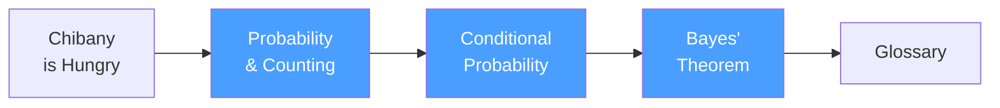

+++
date = "2026-07-02"
title = "Foundations: Counting Lunches"
linkTitle = "Foundations"
weight = 10
book_part = true
tracks = ["beginner", "cogsci"]
aliases = ["/intro/"]
+++

**Will there be tonkatsu today?** It is April, a new school year at Chiba
Tech, and the campus mascot
[Chibany](https://admission.chibatech.ac.jp/about/chibany/) has one consuming
question about the two bentos students bring them every day. This Part builds
all of probability out of that question — by **counting**. Sets of possible
days, events as subsets, conditioning as crossing out possibilities, and
Bayes' rule as the inevitable arithmetic of updating.

Most probability courses jump straight into formulas. Here, **probability is
fancy counting**: What are all the possibilities? Which ones include tonkatsu?
What's the ratio? That perspective makes conditional probability, Bayes' rule,
and everything after them feel natural instead of mysterious — and it is
exactly the mental model that [probabilistic programming](../genjax/) runs on.
No prior math background required.

## Chapters

{}

New to the book? The [Start Here](../start/) guide explains the two reading
tracks and how the Parts fit together.

---

*This project is generously funded by the Japanese Probabilistic Computing
Consortium Association ([JPCCA](https://jpcca.org/)).*
