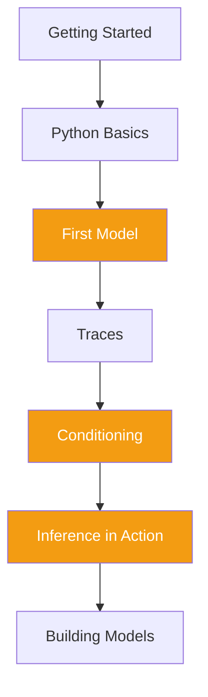

+++
date = "2026-07-04"
title = "The Tools: Probabilistic Programming with GenJAX"
linkTitle = "The Tools: GenJAX"
weight = 20
book_part = true
tracks = ["beginner", "cogsci"]
+++

**Teach the laptop to imagine days.** Over Golden Week, Jamal lends Chibany a
laptop — and Part I's counting gets a superpower. In
[Foundations](../foundations/) you learned that probability questions are
really three questions: *What's possible? What am I interested in? Count
them!* **GenJAX** is a probabilistic programming language that lets the
computer do all three: write code that *generates* possible days, filter for
the ones you care about, and let simulation do the counting.

**Designed for complete beginners to programming.** We use
[Google Colab](getting-started/) (nothing to install, runs in the browser),
teach just enough Python, and connect every line of code back to the sets you
already know. You won't become a programmer — you'll become someone who can
*use* probabilistic programming to explore probability and build models.

**Core chapters** (yellow): generative models, conditioning, and inference —
the three ideas every later Part leans on. Later chapters' code assumes this
Part; whenever a code block puzzles you, come back here.

Wondering why this book teaches GenJAX instead of Stan or PyMC? [The honest answer](why-genjax/).

## Chapters

{}

---

{}
**Don't try to memorize Python syntax!** Focus on what the code is trying to
do, how it maps onto the probability concepts, and what happens when you run
it. You can always copy-paste and modify examples — understanding beats
memorization.
{}

*This project is generously funded by the Japanese Probabilistic Computing
Consortium Association ([JPCCA](https://jpcca.org/)).*
