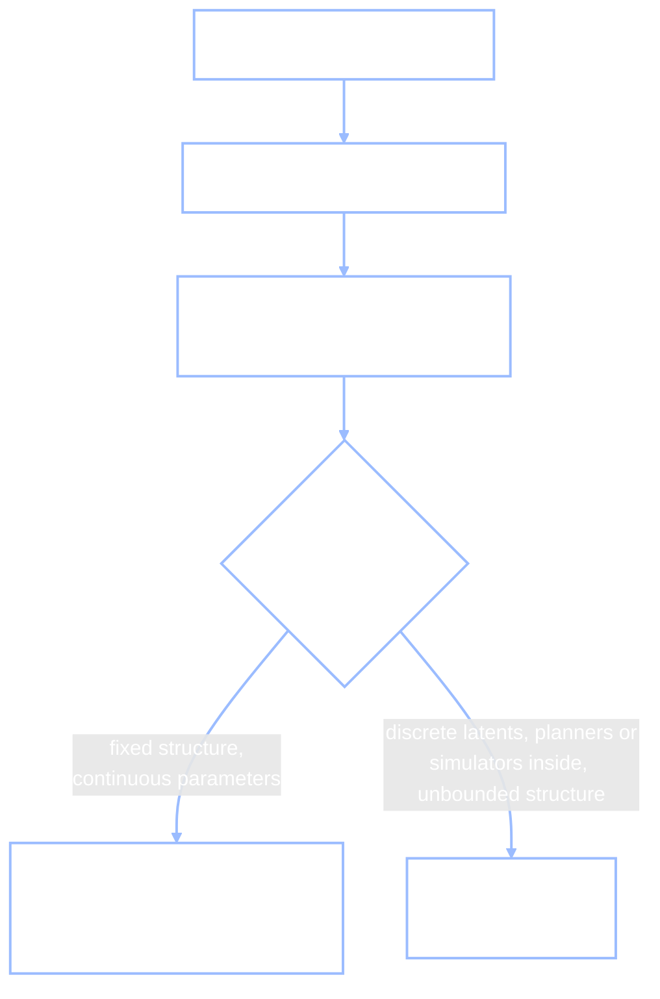

+++
date = "2026-07-04"
title = "Why GenJAX? (and when Stan or PyMC would do)"
weight = 12
tracks = ["beginner", "cogsci"]
+++

## "Aren't They All the Same?"

Golden Week, day two. Jamal's borrowed laptop is open on the cafeteria table, Chibany perched beside it, one paw hovering over the trackpad as if daring the machine to imagine a bento first. That's when Tanaka-san arrives — no marbles today, just opinions.

> **Tanaka-san:** "I asked around. My statistician friends all use **Stan** or **PyMC** — nobody's heard of this GenJAX thing. Aren't they all the same anyway? You write a model, the computer does the statistics. Why not teach the one everyone uses?"
>
> **Alyssa:** "That's a completely fair question — and half right, which is the dangerous kind of right. They *do* share the same core idea. The differences only show up when you look at what kinds of models each one can hold."

This chapter is the honest answer. It won't claim Stan or PyMC are bad — they're excellent, and for many models they're the *better* choice. It will show you the three things this particular book needs that they can't do comfortably.

## The Common Ground: One Contract, Three Tools

Stan, PyMC, and GenJAX are all **probabilistic programming languages** (PPLs): languages where you write down a **generative model** — a program describing how you believe data comes to exist — then **condition** on the data you actually saw, and get back a **posterior**, your updated beliefs about the hidden parts (the same Bayes-rule update you met in [Foundations](../../foundations/), automated). That three-step contract is identical across all three tools. Tanaka-san's "aren't they all the same?" is right about the contract.



Where he's wrong is in thinking the contract is the whole story. Each tool makes a bet about what your model looks like, and the bets differ.

Stan and PyMC bet on **fixed-structure models with continuous parameters**: a known set of parameters, declared up front, connected by a fixed graph of distributions. A hierarchical regression. The Beta-Binomial models you'll build in [hierarchical Bayes](../../structure/hierarchical-bayes/) (Part IV). For that family they are superb: both run mature implementations of **Hamiltonian Monte Carlo** (HMC — a sampling method that uses the *gradient* of the posterior to take long, efficient steps; Part V introduces sampling methods properly), auto-tuned by **NUTS** (the No-U-Turn Sampler, the self-adjusting HMC variant that Stan runs by default). Both plug into **ArviZ**, a standard library of posterior diagnostics and plots that tells you whether your sampler actually worked. And both have huge communities — a decade-plus of forum answers, case studies, and textbooks.

{}
This is not a grudging concession — it's advice. If your model is a hierarchical regression, a Beta-Binomial, a mixed-effects model, anything with a fixed set of continuous parameters and a likelihood you can write on one line: Stan and PyMC are mature, fast, battle-tested, and better documented for that job than GenJAX is. Nothing in this book forbids you from using them. Several of your future collaborators will insist on it, and they'll be right.
{}

So why isn't this book teaching Stan? Because the models this book cares about — models of *minds* — keep breaking the fixed-structure bet. Three concrete ways.

## Case 1: The Planner in the Likelihood

The clearest example lives in the [Inverse RL](../../decisions/inverse-rl/) chapter (Part VI). There, an observer watches an agent walk across a grid and infers its hidden goal. The **likelihood** — the term $P(\text{actions} \mid \text{goal})$ that says how probable the observed behavior is under each candidate goal — is not a textbook distribution. It's a **policy**: the answer to "how would a goal-seeker act?", computed by running **value iteration** (a dynamic-programming algorithm that scores every action in every situation) and pushing the scores through a **softmax** (which turns scores into action probabilities). The likelihood *is a planning algorithm*.

In GenJAX, that's no problem, because a model is just a Python function marked `@gen`. It can call any code — including a planner — and sample a **discrete latent** (a hidden variable with finitely many values, here "which goal") like any other random choice:

<!-- validate: skip -->
```python
# Condensed sketch of the Inverse RL chapter's validated program (see that
# chapter for the full, runnable version).
LOGITS = BETA * jnp.stack([q_values_for_goal(g) for g in GOAL_STATES])
                          # ^ value iteration -- ordinary JAX code, run per goal

@gen
def observer(states):                        # a goal-seeker, as a program
    g = categorical(jnp.log(PRIOR)) @ "goal"          # sample the DISCRETE goal
    for t in range(len(states)):
        categorical(LOGITS[g, states[t]]) @ f"a_{t}"  # act by goal g's softmax policy
```

Condition this program on the observed actions and inference (enumeration in the toy version, importance sampling at scale) inverts the planner: goals whose policies *like* the observed path get posterior weight. The planner sits inside the model, and the machinery doesn't blink.

Now try to say the same thing in Stan:

```stan
model {
  // 1. Stan samples no discrete parameters: marginalize the goal by hand.
  //    (Fine here -- there are only three goals.)
  vector[G] lp = log(goal_prior);
  for (g in 1:G) {
    // 2. The killer: Q[g] must come from value iteration -- a dynamic
    //    program you re-implement yourself. And every action probability
    //    below is a softmax you unroll into hand-written arithmetic:
    for (t in 1:T)
      lp[g] += beta * Q[g, s[t], a[t]] - log_sum_exp(to_vector(Q[g, s[t]]));
  }
  target += log_sum_exp(lp);   // no traces, no simulate-then-condition:
}                              // the entire likelihood, written by hand
```

Be fair to Stan: the first obstacle is survivable. Stan's language cannot sample discrete latent variables, so you marginalize the goal by hand — sum its three possibilities into `log_sum_exp` — and with three goals that's fine. The killer is the second obstacle. Stan's model block is a recipe for *one number*, the log-posterior density; the language has **no traces and no simulate-then-condition**. There is no way to say "run this agent forward, then condition on what it did." You must hand-derive the entire likelihood as explicit arithmetic — and if the thing you're inferring feeds the planner (a continuous reward, the agent's rationality), value iteration moves *inside* the model block, re-run and differentiated through at every step of the sampler. You'd be re-implementing the planner in a language designed for density arithmetic, not for running programs.

PyMC hits the same wall — a planner-shaped likelihood becomes a custom log-probability you write yourself — with one extra bruise: PyMC *does* allow discrete latents, but its samplers for them are the fragile part of the toolbox, and they will fight you.

## Case 2: Unbounded Structure

Second case, from Part VII: [Discrete Bayesian Nonparametrics](../../complexity/dpmm/). Chibany's question there is "how many bento types exist, *really*?" — and the honest model refuses to fix the number of clusters in advance. The **Chinese Restaurant Process** (CRP — a sequential rule where each new data point either joins an existing cluster or opens a brand-new one) makes "how many clusters?" a *random quantity the model itself samples*.

A Gen-style trace can hold a different number of random choices on different runs — one run opens three tables, another opens seven — so the CRP is directly expressible as a program. (In the DPMM chapter we truncate the infinite model at a large `K_max` for JAX's fixed-shape speed, but that's an engineering choice; the *language* can say the unbounded thing.)

Stan cannot say it at all. Its `parameters` block is a fixed-size declaration compiled before any data is seen — a model whose *dimension varies between posterior samples* is not expressible in the language, full stop. The standard workaround is truncated **stick-breaking** (an approximation that caps the number of clusters at a hand-picked ceiling). PyMC is more flexible but shares the core limitation: you must choose a truncation level $K$ up front and hope it's generous enough. Neither can ask Chibany's actual question — "how many?" — as a first-class random variable.

## Case 3: Models Are JAX Values

The third reason is about what surrounds the model. GenJAX models are built from **JAX**, the numerical library that also powers much of modern deep learning — and that means a model is an ordinary JAX value you can hand to JAX's transformations: `vmap` (run one function over a whole batch at once), `jit` (compile it to fast machine code), and `grad` (differentiate it). Watch `vmap` simulate a thousand of Chibany's days in one shot:

```python
import jax
import jax.numpy as jnp
import jax.random as jr
from genjax import gen, flip

@gen
def bento_day():
    tonkatsu = flip(0.7) @ "tonkatsu"   # the 70/30 base rate, as a program
    return tonkatsu

simulate_many = jax.jit(jax.vmap(lambda k: bento_day.simulate(k, ())))
traces = simulate_many(jr.split(jr.PRNGKey(0), 1000))
print(f"fraction tonkatsu across 1,000 simulated days: {jnp.mean(traces.get_retval()):.3f}")
```

**Output:**
```
fraction tonkatsu across 1,000 simulated days: 0.695
```

One line batched a thousand simulations; the same trick batches a thousand *inferences*, and `jit` compiles whole inference loops. That composability is not a convenience feature — it's the book's thesis made runnable. The same machinery that trains the neural networks of [Part VIII](../../deep/) executes these probabilistic programs: **one substrate from counting bentos to transformers**. When this book later claims that perception, learning, and large language models are variations on "programs plus probability," the claim is credible partly because everything runs on the same stack. Stan lives in its own compiled world, separate from the deep-learning ecosystem. PyMC has real bridges (including JAX-backed samplers), but the model and the neural network remain guests in each other's houses rather than the same kind of object.

## The Scorecard

| | Stan | PyMC | GenJAX |
|---|---|---|---|
| **Fixed-structure continuous models** | **Gold standard** — mature NUTS, years of hardening | Excellent, Pythonic | Works, but you assemble more yourself |
| **Discrete latents** | Not sampled — marginalize by hand | Allowed, but the samplers fight you | Native: sample, enumerate, or weight them |
| **Model-inside-model / simulation-based likelihoods** | Hand-write the whole likelihood | Same wall (custom log-probability) | Just call the code inside `@gen` |
| **Unbounded structure** | Not expressible — truncated workarounds | Truncation level you must pick | Expressible (CRP); truncation only for speed |
| **Composability with deep learning** | Separate world | Real bridges (JAX backends) | Same substrate — models are JAX values |
| **Diagnostics & community maturity** | **Gold standard** — ArviZ, huge community | Excellent — ArviZ native, large community | Young — smaller community, bring your own diagnostics |

Read the last row as honestly as the first: choosing GenJAX costs you a decade of accumulated tooling and forum answers. This book pays that cost on purpose, because rows two through five are where models of minds live.

## Jamal's One-Liner

> **Tanaka-san:** "Fine — so they're the same handshake, different grips. But I'm telling my friends you conceded the regression point."
>
> **Jamal:** "Concede away. Here's the whole chapter in one line: **Stan answers 'what are the parameters?' Gen-style PPLs answer 'what program produced this?'** When the hypothesis is a curve, ask Stan. When the hypothesis is a *process* — a planner, a growing set of clusters, a mind — you want the model to *be* a program."

Chibany, who has been waiting out the debate with unusual patience, taps the trackpad. Fair enough — time to teach the laptop to imagine days for real. If you want GenJAX on your own machine, [local installation](../local-install/) is next but strictly optional; the road for everyone else runs through [Python Basics](../python-basics/) to [your first model](../first-model/).

{}
You can say what all **probabilistic programming languages** share — write a **generative model**, **condition** on data, get a **posterior** — and where the bets diverge. You can name when **Stan** or **PyMC** is the better tool (fixed-structure continuous models: mature **HMC/NUTS**, **ArviZ** diagnostics, a huge community) and give the three concrete reasons this book teaches **GenJAX** instead: likelihoods that *are* programs (the planner-in-the-likelihood of [Inverse RL](../../decisions/inverse-rl/)), **unbounded structure** sampled directly (the CRP of the [DPMM chapter](../../complexity/dpmm/)), and models as **JAX values** that `vmap`, `jit`, and `grad` compose with the deep-learning stack of [Part VIII](../../deep/). And you can repeat Jamal's one-liner at parties.
{}

---

*This project is generously funded by the Japanese Probabilistic Computing Consortium Association ([JPCCA](https://jpcca.org/)).*
