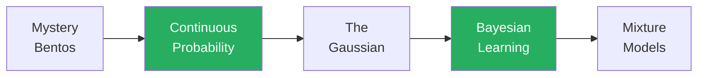

+++
date = "2026-07-02"
title = "Continuous Probability & Bayesian Learning"
linkTitle = "Continuous & Bayesian"
weight = 30
book_part = true
tracks = ["beginner", "cogsci"]
aliases = ["/intro2/"]
+++

**The Mystery of the Two Peaks.** Early summer, and something has changed:
this semester's bentos arrive wrapped in furoshiki — opaque. Chibany, refusing
to peek, starts *weighing* them, and the weights refuse to behave: the average
is 441 g, yet **no bento ever weighs 441 g**. Solving that mystery takes this
whole Part: continuous quantities need *densities* instead of counts, bumps
need *Gaussians*, learning needs *priors that become posteriors*, and the two
peaks themselves need *mixture models*.

Everything runs on the GenJAX you learned in [The Tools](../genjax/) —
probabilities become densities, sums become integrals, counting becomes area,
but the *code barely changes*. No calculus required: intuition first, visuals
and code before math.

## Chapters

{}

Wondering how many kinds of bento there *really* are, or whether a model can
be too flexible? That thread continues in
[How Complex Should a Model Be?](../complexity/) — best read after
[Decisions & RL](../decisions/).

---

*This project is generously funded by the Japanese Probabilistic Computing
Consortium Association ([JPCCA](https://jpcca.org/)).*
