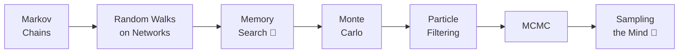

+++
date = "2026-07-02"
title = "Chains, Walks & Sampling"
linkTitle = "Sampling"
weight = 50
book_part = true
tracks = ["beginner", "cogsci"]
+++

**The question you can't sum.** Chibany wants an answer about a whole
*semester* of bentos — and for the first time, no formula gives it. This
Part's move: when you can't compute, **wander and count**. Chibany wanders
the campus (Markov chains), the campus web (random walks and PageRank), their
own memory (search as a censored walk), and finally learns to answer any
question by sampling — Monte Carlo, particle filtering, and MCMC — closing
with the question of whether *minds* sample too.

## Chapters

{}

---

*This project is generously funded by the Japanese Probabilistic Computing
Consortium Association (JPCCA).*
