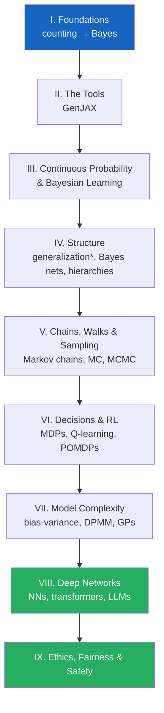

+++
date = "2026-07-02"
title = "The Beginner Track: Probability → Probabilistic ML → Probabilistic Computing"
linkTitle = "🤖 Beginner track"
weight = 10
+++

For readers starting from a light background who want to end up genuinely
fluent in probabilistic machine learning — through neural networks, LLMs, and
the ethics of deployed models.

<button type="button" class="track-toggle-btn" data-track-choice="beginner">Set Beginner as my track</button>

## The roadmap

## Reading order

1. **Part I — Foundations**: all chapters
2. **Part II — The Tools (GenJAX)**: all chapters
3. **Part III — Continuous Probability & Bayesian Learning**: all chapters
4. **Part IV — Structure**: Generalization (the setup and number-game parts
   are enough — the Shepard and No-Free-Lunch parts are the CogSci deep end),
   then Bayes nets, conditional independence, causality, information theory,
   hierarchical Bayes
5. **Part V — Chains, Walks & Sampling**: Markov chains, random walks, Monte
   Carlo, particle filtering, MCMC (memory search and *Sampling the Mind* are
   CogSci-badged extras)
6. **Part VI — Decisions & RL**: decision theory, MDPs, Q-learning, POMDPs,
   modern RL (*Inverse RL* is a CogSci-badged extra — skim its RLHF section)
7. **Part VII — Model Complexity**: all chapters — this Part is *for you*
8. **Part VIII — Deep Networks**: all chapters
9. **Part IX — Ethics, Fairness & Safety**: all chapters

Off-track chapters are never forbidden — they are dimmed, not hidden. If a
🧠-badged chapter looks interesting, read it.

---

*This project is generously funded by the Japanese Probabilistic Computing
Consortium Association (JPCCA).*
