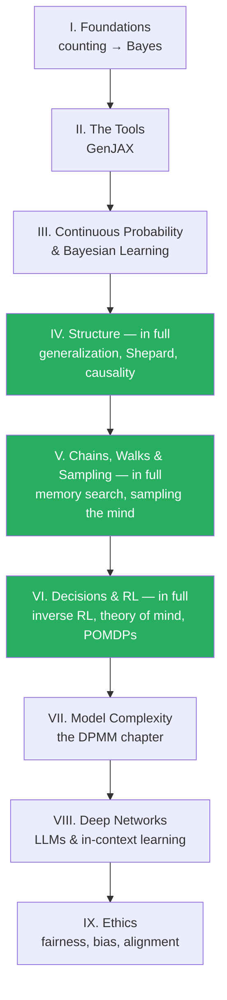

+++
date = "2026-07-02"
title = "The CogSci Track: Bayesian Cognitive Science"
linkTitle = "🧠 CogSci track"
weight = 20
+++

For readers who want to use probabilistic modeling to build and test
**theories of minds** — human or machine.

<button type="button" class="track-toggle-btn" data-track-choice="cogsci">Set CogSci as my track</button>

## The roadmap

## Reading order

1. **Part I — Foundations**: all chapters
2. **Part II — The Tools (GenJAX)**: all chapters
3. **Part III — Continuous Probability & Bayesian Learning**: all chapters
4. **Part IV — Structure, in full** — the generalization chapter (all four
   parts, including Shepard's law and No Free Lunch) is a centerpiece of this
   track
5. **Part V — Chains, Walks & Sampling, in full** — including *Memory Search
   as a Random Walk* and *Sampling the Mind*
6. **Part VI — Decisions & RL, in full** — including *Inverse RL* (goal
   inference and theory of mind), POMDPs, and the modern-RL frontier
7. **Part VII — Model Complexity**: the *Discrete Bayesian Nonparametrics*
   chapter (Anderson's rational model of categorization lives here);
   bias-variance and GPs are 🤖-badged extras
8. **Part VIII — Deep Networks**: *LLMs & In-Context Learning* (in-context
   learning as implicit hierarchical Bayes) and *World Models*
9. **Part IX — Ethics, Fairness & Safety**: fairness formalisms, bias in
   data, alignment

---

*This project is generously funded by the Japanese Probabilistic Computing
Consortium Association (JPCCA).*
