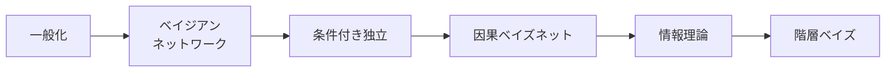

+++
date = "2026-07-02"
title = "構造：概念・因果・階層"
linkTitle = "構造"
weight = 40
book_part = true
tracks = ["beginner", "cogsci"]
+++

**弁当の出所プロジェクト。**[二つの山の謎](../learning/)を解いたことで、
Chibanyは何が届くのか（トンカツ70%・ハンバーグ30%の混合）を知りました。この
Partではその**背後にあるルール**を探ります：少数の例からどのように概念が一般化
するのか、何が何を引き起こすのか、それぞれの日はどれほど驚くべきものなのか、
そして各学生の本当の割合はいくつなのか。弁当日誌が研究の道具になります。

## 章一覧

{}

---

*本プロジェクトは日本確率計算コンソーシアム協会（[JPCCA](https://jpcca.org/)）の助成を受けています。*
