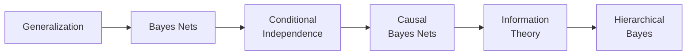

+++
date = "2026-07-02"
title = "Structure: Concepts, Causes & Hierarchies"
linkTitle = "Structure"
weight = 40
book_part = true
tracks = ["beginner", "cogsci"]
+++

**The Bento Provenance Project.** Solving the [Mystery of the Two
Peaks](../learning/) told Chibany *what* arrives — a 70/30 mixture of
tonkatsu and hamburger. This Part is about the **rules behind it**: which
concepts generalize from a few examples, what causes what, how surprising each
day really is, and what each individual student's true rate is. The Bento
Journal becomes a research instrument.

## Chapters

{}

---

*This project is generously funded by the Japanese Probabilistic Computing
Consortium Association (JPCCA).*
